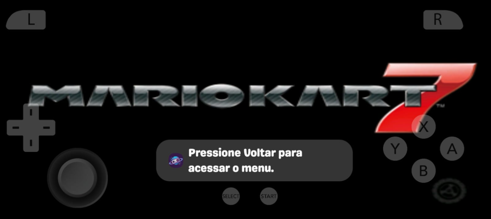
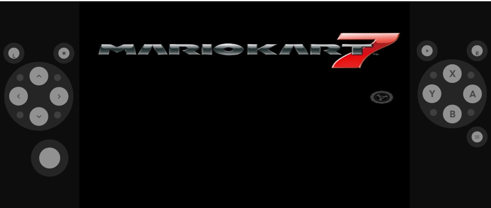
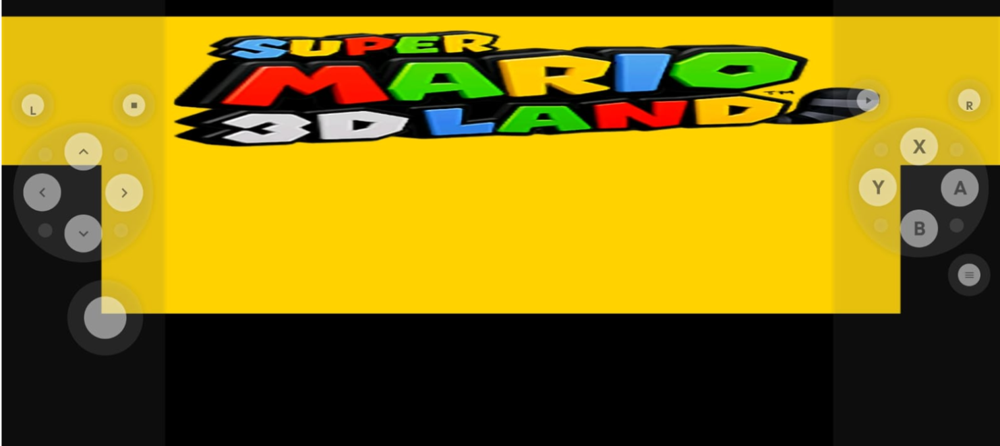

# [BUG] 3DS no celular: não dá para jogar em tela única, os controles ocupam colunas laterais e a imagem sai deformada

## Status

**Em retest desde 2026-11-13.** O dono decidiu fechar o bug sem a T9 (redesenho do layout de toque), que virou o backlog `docs/backlog/arquivados/2026-11-13-3ds-layout-toque-padrao-imagem-1.md`.

**Commits**

| Task | Commit | Onde |
|------|--------|------|
| T7 (core Azahar 2126.2, GL, migração) | `478fc91`, `0e0d6cc` | `CoreID.CITRA`; `GameSystem.kt` (bloco 3DS, `defaultSettings`); `AzaharMigrationHandler`; `lemuroid-cores` tag `1.23.0` |
| T2 (opção "Tela única") | `e00e834` | `GameSystem.kt::exposedSettings` (`citra_layout_option` = `single_screen`) |
| T4 + T5 (controles sobre o jogo, imagem esticada) | `a208873` | `SystemCoreConfig.singleScreenLayout`; `GameViewModelRetroGameView` |
| T6 (3DS ignora a proporção de Ajustes) | `922a2ef` | `GameViewModelRetroGameView`; `MobileGameScreen` |
| T3 (botão de troca de telas, sem L3 no duplo toque) | `a14e1f0` | `SystemCoreConfig.screenSwap`; `GameViewModelRetroGameView::toggleScreenSwap`; `GameViewModelTouchControls`; `Nintendo3DS.kt`; `Controls.kt::SecondaryButtonSwapScreens` |
| T8 (resolução padrão 2x) | `447643c` | `GameSystem.kt::defaultSettings` (`citra_resolution_factor` = `2`) |

**Evidência (moto g86 5G, Mali-G615, APK debug)**

- Cada task tem a sua seção "implementação e validação" abaixo, com prints, medidas de proporção e o logcat (`Updating core variable: …`, `logcat -b crash` vazio).
- **T3:** item 7 inteiro, em 2026-11-12, das 22h10 às 22h25.
- **T8:** teste do dono de 2x a 5x, sem queda de velocidade.
- **Testes de unidade:** `GameSystemSingleScreenTest`, `AzaharMigrationHandlerTest`.

**O que falta para `done/`**

1. **Antes do APK de clientes** (pendências da T7):
   - conferir o crash de shader de `docs/bugs/open/2026-09-02-crashes-nativos-cores-citra-dolphin.md` com o Azahar;
   - jogar uma corrida inteira do MK7.
2. **Versão publicada** com o Azahar (decisão do dono).
3. **Retest da cliente do S20 FE** (chamado #330), que também serve de prova em Adreno, porque não temos aparelho Adreno:
   - o modelo, em Configurações ▸ Sobre o telefone (SM-G781… = Adreno 650, SM-G780… = Mali-G77);
   - uma corrida do MK7 em tela única, com print ou vídeo.
4. **Se aparecer crash só em Adreno:** a telemetria de crash de core avisa, e o `CoreCrashFallback` desliga os shaders de hardware. A correção é um build novo.

- **Data:** 2026-11-07
- **Status:** em retest (ver "## Status" no topo). **T7 implementada e publicada em 2026-11-12:** o core 3DS é o Azahar 2126.2 (tag `1.23.0` do `lemuroid-cores`), com migração de saves e prefs validada no moto g86. A T7 ainda depende das provas em Adreno, de uma corrida jogada e do crash de shader antes de ir num APK para clientes. **T2 feita em 2026-11-12** (opção "Tela única" no menu, validada no moto). **T4 + T5 feitas em 2026-11-12:** na tela única em paisagem, os controles ficam sobre o jogo e a imagem estica até preencher; validadas no moto. **T6 feita em 2026-11-12:** o 3DS ignora a proporção de Ajustes, e só a tela única em paisagem estica; validada no moto. T3 feita em 2026-11-12, T8 feita em 2026-11-13 (padrão 2x), T9 aberta. **T3 implementada em 2026-11-12, sem commit e sem a prova no aparelho:** um botão no pad, tratado pelo app por `citra_swap_screen`, com colunas e `AUTO` quando a tela de baixo está visível. O analógico deixou de mandar L3 no duplo toque. Os testes, o ktlint e o build passam. Ver "Próximo passo (passagem de bastão, 2026-11-12, depois da implementação da T3)".
- **Severidade:** Alta para 3DS. Levou uma cliente a pedir reembolso do pacote poucas horas depois da compra.
- **Complexidade:** Média (uma opção de core é trivial; troca de tela, overlay e proporção por layout mexem em touch e na tela do jogo)
- **Branch:** redesenho-tv-jogos-salvos-tela (onde foi investigado; a correção ainda não tem branch)
- **Origem:** sessão de WhatsApp `45861677588562@lid`, chamado #330 (Galaxy S20 FE, Plataforma Multigames), e relato do dono com os prints abaixo

---

## Sintoma

A cliente jogava *Super Mario 3D Land* e *Mario Kart 7* no Retro Game System e reclamou, em ordem:

- "Como esticar a tela" [169526]
- "E deixa os controles transparente" [169533]
- "O jogo do super Mario 3d está Assim" [169874]
- "Eu queria deixar tela unica" [169876]; "Como deixar com tela inteira" [169878]; "Eu queria tirar essas bordas" [169883]
- "Não tem tela única" [169895]
- "Eu já cliquei e não preenche a tela só aparece tela superior e inferior / Esquerda e direita" [169897]
- "As duas opções não preenche a tela" e "Fica com a tela recortada" [169899, 169900]
- "Tem como dar o reembolso do app" [169914], logo depois de ouvir que não havia solução

**Esperado (dono):** ficar igual à imagem 1, de outro emulador: só a tela de cima, ocupando a tela do celular, sem distorção, com os controles por cima do jogo. Segundo o dono, a imagem e o padrão de controles desse emulador são superiores aos nossos. Tela única entra como **opção**, não como padrão (decisão do dono, 2026-11-07).

| | Print |
|---|---|
| 1. Outro emulador: o que a cliente quer |  |
| 2. Mario Kart 7 no nosso app |  |
| 3. Super Mario 3D Land no nosso app |  |

---

## Evidência

### Provado no código

- **Só duas opções de layout.** `GameSystem.kt:1866-1877` restringe `citra_layout_option` a `Default Top-Bottom Screen` e `Side by Side`, que em pt-BR viram "Superior — inferior" e "Esquerda — direita". É exatamente o que a cliente descreveu em [169897].
- **O core tem as outras.** `libretro/citra`, `citra_libretro.cpp:146-147`: `Default Top-Bottom Screen|Single Screen Only|Large Screen, Small Screen|Side by Side`. A string existe no binário que vai no app: `grep -a -c "Single Screen Only" libcitra_libretro_android.so` deu **1** (build `bundled-cores`, arm64). O fonte lido é o `master` de 2026-11-07; o `.so` pode ser de outro commit, então só a string foi conferida no binário.
- **Controles em colunas.** `ControllerConfigs.NINTENDO_3DS` tem `allowTouchOverlay = false` (`ControllerConfigs.kt:383`). Com isso, em paisagem, `GameScreenLayout.buildConstraintSet` usa `buildConstraintSetLandscapeNoOverlay`, que põe o `gameView` entre `leftPad` e `rightPad`. Vem do commit `1071b08`; o motivo não está registrado. O mesmo valor aparece em `ControllerConfigs.kt:258` e `:273`.
- **Não há botão de troca de tela.** O core troca a tela em `RETRO_DEVICE_ID_JOYPAD_L3` (`citra_libretro.cpp`, bloco `screen_swap_btn`). `Nintendo3DS.kt` tem L, Select, analógico, R, Start e Menu; não tem L3.
- **Em tela única de cima não há toque na tela de baixo.** `EmuWindow_LibRetro::UpdateLayout`, caso `SingleScreen` sem `swapped`: mostra a tela de cima e faz `enableEmulatedPointer = false`.
- **Geometria que o core reporta** (`UpdateLayout`): Top-Bottom 400×480 (0,83); Side by Side 720×240 (3,0); Single Screen 400×240 (1,67) ou 320×240 com a de baixo.
- **"Proporção da tela" é global.** `ScreenAspectRatio` lê uma preferência geral (`SettingsManager.screenAspectRatio`), não por sistema. O encaixe é "contain" (ver `docs/features/concluido/proporcao-tela/proporcao-tela.md`).

### O emulador da imagem 1

- **Família identificada, app exato não.** O balão "Pressione Voltar para acessar o menu." é idêntico à string `emulation_menu_help` do Azahar em pt-BR (`values-b+pt+BR/strings.xml:471`). A frase vem do Citra Android (`Press Back to access the menu.`, commit do #6248, exibida em Toast ao iniciar o jogo). Logo, é um app da família Citra/Azahar, e não um core libretro nosso.
- **O ícone do balão não é de nenhum dos conferidos:** é um planeta azul com anel e um controle, em fundo roxo. Não é o Azahar (flor branca), nem o `com.theemulator.citra` da Play Store (laranja), nem o Retro Game System. Provavelmente é um app rebatizado. Fica pendente perguntar o nome à cliente.
- **Recursos que essa família tem nativamente** (`values/strings.xml` do Azahar): layouts `Single Screen`, `Large Screen`, `Side by Side` e `Portrait`, e aspect ratio `Default`, `16:9`, `4:3`, `21:9`, `16:10` e `Stretch`.
- **O logo do Mario Kart 7 está menos achatado na imagem 1** do que na imagem 2: cerca de 6,4:1 contra 8,2:1, por medida visual. Não foi comparado com a proporção nativa do jogo.
- **Resolução:** o core usa `1x (Native)` por padrão (`citra_libretro.cpp:310`) e o app não define outro valor; só expõe `citra_resolution_factor`. São 400×240 ampliados para a tela do S20 FE, candidato direto à imagem pior.
- **Existe core libretro do Azahar:** `src/citra_libretro/` no repositório `azahar-emu/azahar`, com `ENABLE_LIBRETRO` no CMake e `single_screen` nas opções. ~~O nome e os valores das opções mudam em relação ao `citra_layout_option` atual. O caminho `azahar_libretro_android.so.zip` testado no buildbot deu 404, então pode ser preciso compilar.~~ **Corrigido em 2026-11-07:** não é preciso compilar, e `citra_layout_option` continua igual. Ver "Comparação T7 + T1".

### Medido nos prints (ainda sem explicação)

- **Imagem 3, 1483×662:** a tela de cima ocupa x 2–1482, y 28–248, ou seja 1480×220 (6,7:1, quando o nativo é 5:3). A de baixo ocupa x 151–1334, y 248 até cerca de 468, ou seja 1183×220 (5,4:1, quando o nativo é 4:3). A razão entre as larguras é 0,80, igual a 320/400, então é a mesma tela Top-Bottom esticada cerca de **4× na horizontal**. O jogo passa por baixo das colunas e sobram 28 px pretos em cima e cerca de 195 px embaixo.
- **Imagem 2, 1536×653:** colunas até x≈248 e a partir de x≈1282 (luminância 13–14 contra 0), área central de 1034×653.
- Em Top-Bottom com `Automática`, o "contain" deveria dar cerca de 544×653 centrados. **Nenhum dos prints bate com isso**, e a imagem 3 também não bate com `Esticar para preencher`, que daria 331 px de altura por tela, e não 220.

---

## Causa-raiz

**Provada**, para "não dá para ter tela única": a opção existe no core, mas o app filtra a lista em `GameSystem.kt`. **Provada**, para as colunas: `allowTouchOverlay = false`.

**Provada no aparelho (T1)**, para a deformação do print 2: é a preferência global `Esticar para preencher` aplicada à coluna central entre os pads. Com `Automática`, o core mostra 5:3 exato. O core não deforma nada. O print 3 continua sem gatilho reproduzido (ver "Tabela de geometria").

~~Aberta, para a deformação. Falta medir no aparelho, com `printRetroVariables` e captura de tela...~~ Medido em 2026-11-07; ver "Tabela de geometria".

## Hipóteses descartadas

- **"O app não tem a opção porque o core não suporta":** caiu; o core suporta e a string está no `.so`.
- **"Isso é do próprio jogo", como o agente disse [169905]:** caiu; o limite é do que o app expõe.
- **"Basta adicionar Single Screen":** insuficiente. Em tela única de cima o toque na tela de baixo some e não há botão L3, então um jogo que exige toque ficaria sem saída. E 5:3 numa área de 2,2:1 ainda deixa bordas, que era a reclamação.

## Correção planejada

**Decidido pelo dono:** tela única é opção; o padrão continua `Default Top-Bottom Screen`.

**Decidido pelo dono em 2026-11-08:**

1. **A tela única abre esticada, sem bordas, como o print da cliente** (Single Screen + Stretch), e não com 5:3 e barras.
2. **Trocar o core 3DS pelo libretro do Azahar**, em OpenGL, pelo desempenho medido em T7.
3. **Vulkan no frontend fica fora.** Os dados de C × C2 não justificam.

**As tasks abaixo estão abertas e NÃO iniciadas** (pedido do dono: "abra estas tasks, não inicie por enquanto"). A especificação de cada uma está em "Tasks abertas (2026-11-08)".

~~**Pendente:** como a tela única preenche a área sem distorcer.~~ **Medido (T5):** não preenche sem distorcer. A imagem 1 é Single Screen + Stretch, esticada 1,27× no moto e 1,34× no S20 FE. "Sem bordas" e "sem distorção" não cabem juntos numa tela 20:9. O dono escolhe qual vira o padrão da tela única; o Azahar oferece os dois.

Tabela atualizada em 2026-11-07 ~22h45 com o que T1, T5 e T7 provaram. T1, T5 (medição) e T7 (medição) estão feitos; as linhas abaixo são o trabalho de código que resta.

| # | Parte | Onde | Prova |
|---|---|---|---|
| T1 | ✅ **Feito.** Deformação = `Esticar` com colunas; core sem culpa. Print 3 sem gatilho (falta split screen e janela flutuante) | — | "Tabela de geometria" |
| T2 | ✅ **Feito em 2026-11-12** (`single_screen`; `large_screen` medido e não exposto). Expor `Single Screen Only` (avaliar `Large Screen, Small Screen`) com tradução pt-BR. **O core atual já aceita o valor** (400×240 medido via prefs), e o Azahar também (`GetLayoutOption`) | `GameSystem.kt`, `strings.xml` | Opção aparece e a tela muda em Mario Kart 7 |
| T3 | ✅ **Feito em 2026-11-12** (`SystemCoreConfig.screenSwap`, botão `SecondaryButtonSwapScreens`; provado no moto, ver "T3: implementação e validação"). Botão de troca de tela (L3) no layout de toque | `Nintendo3DS.kt` | Tela de baixo acessível e tocável; confirmar se o toque responde com a tela trocada |
| T4 | ✅ **Feito em 2026-11-12** (`SystemCoreConfig.singleScreenLayout`; ver "T4 + T5: implementação e validação"). Controles sobre o jogo em tela única; colunas só onde o toque na tela de baixo precisa da área livre | `allowTouchOverlay` hoje é fixo por `ControllerConfig`; precisa depender do layout | Print igual à imagem 1 e toque sem disparo acidental |
| T5 | ✅ **Feito em 2026-11-12**, forma (a) generalizada pelo layout: FILL só na tela única em paisagem; em retrato e nos outros layouts, a pref global. Tela única com o jogo ocupando a tela: **Single Screen + `Esticar`, com overlay (T4)** reproduz a imagem 1 (Stretch 1,27× no moto, 1,34× no S20 FE). `Automática` dá 5:3 sem distorção com barras laterais. **Dono (2026-11-08): esticado, sem bordas.** `ScreenAspectRatio` é global, então para o 3DS ter o seu é preciso preferência por sistema ou por layout | `ScreenAspectRatio`, `SettingsManager` | Logo do MK7 em ~6,7 (Stretch) ou 5,27 (sem distorção) no S20 FE, conforme a escolha, sem colunas |
| T6 | ✅ **Feito em 2026-11-12** (`SystemCoreConfig.ignoresScreenAspectRatio`; ver "T6: implementação e validação"). A deformação de Top-Bottom e Side by Side é **só** `Esticar` aplicado à coluna central (1,35× no moto, 1,90× no S20 FE, 2,68× na vertical em Side by Side). Candidatos: ignorar `Esticar` para o 3DS quando há colunas, ou proporção por sistema (a mesma de T5). Não mexe no core | `GameViewModelRetroGameView` / `ScreenAspectRatio` | Top-Bottom e Side by Side com 5:3 por tela (logo do MK7 em 5,27) com `Esticar` ligado |
| T7 | **Aprovado pelo dono em 2026-11-08.** **Trocar `citra` pelo libretro do Azahar 2126.2** (sem compilar: binário da release). Medido no moto: 57 contra 42–45 fps de apresentação no MK7, 0 crash. **Obrigatório:** `citra_graphics_api=OpenGL` em `defaultSettings` (sem ela o core quebra no `context_reset`). Migrar as chaves da tabela "Core Azahar" e o `CoreCrashFallback` (`citra_use_hw_shader`). Antes de publicar: conferir o crash de `2026-09-02-crashes-nativos-cores-citra-dolphin.md` e jogar uma corrida inteira. **Adreno (decisão do dono, 2026-11-12): não há aparelho Adreno, só o moto (Mali).** A prova em Adreno passa a ser o retest no S20 FE da cliente, com o modelo confirmado (SM-G781… = Snapdragon 865/Adreno 650; SM-G780… = Exynos 990/Mali-G77, e aí o Adreno fica sem prova). Para o público geral com Adreno, o risco fica no lançamento: o alarme é a telemetria de crash de core, e a rede é o `CoreCrashFallback` (desliga os shaders de hardware). Não há volta ao core antigo: uma família de crash só em Adreno pede build novo | `CoreID.kt`, `GameSystem.kt`, `CoreCrashFallback.kt`, `lemuroid_core_citra` | `braco.sh` A/B no mesmo aparelho, 0 crash em 5 min e log `Using OpenGL hw renderer` |
| T8 | Resolução padrão do 3DS acima de 1x. ✅ **Feito em 2026-11-13:** o dono rodou o Azahar GL de 2x a 5x no moto, sem queda de velocidade (relato do dono, sem número de fps). Pelo critério aprovado, o padrão sobe para **2x**, e de 3x para cima continua só como opção do menu. Prefs já gravadas não mudam. | `defaultSettings` do 3DS em `GameSystem.kt` (`citra_resolution_factor` `"1"` → `"2"`) | Teste do dono no moto, 2x a 5x; `testFreeBundleDebugUnitTest` e `ktlintCheck` |
| T9 | Redesenhar o layout de toque do 3DS no padrão da imagem 1: L/R nos cantos, direcional e analógico à esquerda, ABXY à direita, Select/Start no centro | `Nintendo3DS.kt` | Print comparado à imagem 1 e controles sem sobrepor o essencial |

Depois de publicar, avisar o bug do agente no digitalstoregames: `docs/modules/chatbot-whatsapp/areas/prompt-kb/bugs/2026-11-07-agente-multigames-improvisa-menu-e-layout-do-3ds-no-android.md`.

### Tasks abertas (2026-11-08)

**Situação:** abertas, **não iniciadas** (pedido do dono). Registradas também no backlog [`docs/backlog/2026-11-08-3ds-core-azahar-e-tela-unica-esticada.md`](../../../backlog/2026-11-08-3ds-core-azahar-e-tela-unica-esticada.md). Nenhuma tem branch ainda. Os símbolos citados foram conferidos em 2026-11-08 no `HEAD` local; quem implementar abre cada um de novo antes de editar.

**Ordem sugerida:** T7 → T2 → T4 + T5 → T6 → T3 → T9 → T8.

- **T7 primeiro** porque reescreve o bloco 3DS de `GameSystem.kt`, que T2 e T8 também editam. Fazer T2 antes obrigaria a refazer o trabalho.
- **T4, T5, T6, T3 e T9 não dependem do core:** a geometria reportada é a mesma nos dois.

**T7: trocar o core 3DS pelo libretro do Azahar (OpenGL).** Complexidade **Alta** (core em `lemuroid-cores`, JNI/LibretroDroid, ciclo do `:game`).

- **Entra:**
  - trocar o binário de `lemuroid-cores/lemuroid_core_citra` e de `bundled-cores/src/main/jniLibs/arm64-v8a/libcitra_libretro_android.so` pelo `azahar-libretro-android-arm64-v8a` da release 2126.2. **Sem patch nenhum:** os `.so` do scratchpad são só de medida.
  - seguir o fluxo do pitfall 15: commit no `lemuroid-cores` → push → tag nova → `CoreDownloader.CORES_VERSION` → ponteiro do submódulo.
  - em `GameSystem.kt`, no bloco 3DS, `defaultSettings` com **`citra_graphics_api=OpenGL`**: sem ela o core escolhe Vulkan e quebra no `context_reset`, provado na 1ª rodada do B. Ela não deve ser exposta.
  - migrar as chaves conforme a tabela "Core Azahar": `citra_use_hw_shader`, `citra_shaders_accurate_mul` (fixar `disabled`, como o nosso padrão atual), `citra_use_disk_shader_cache`, `citra_enable_touch_touchscreen`, `citra_enable_mouse_touchscreen`; remover `citra_render_touchscreen`.
  - em `CoreCrashFallback.kt`, a constante `CITRA_HW_SHADERS` passa a `citra_use_hw_shader`.
  - as prefs `cv_3ds_*` antigas de quem já usa: definir se migra o valor ou descarta.
  - `CoreID.CITRA` pode manter o nome do arquivo (`libcitra_libretro_android.so`). Decidir no design se o nome exibido muda para "Azahar".
- **Não entra:** Vulkan; resolução acima de 1x (é T8); qualquer mudança de layout.
- **Riscos a fechar antes de publicar:**
  - **Saves.** O Azahar usa `<files>/save` como pasta de usuário (`SetUserPath` no log). Conferir se save e extdata gravados pelo core atual abrem no Azahar. Perder o progresso de quem já joga é bloqueante.
  - O crash de shader de `2026-09-02-crashes-nativos-cores-citra-dolphin.md`.
  - Aparelho Adreno.
- **Prova:**
  - `braco.sh` A/B no moto com o APK de verdade: log `Using OpenGL hw renderer`, fps ≥ ao do braço B (57) e 0 crash em 5 min;
  - a mesma medida num Adreno;
  - uma corrida inteira jogada no MK7 e a primeira fase do SM3DL;
  - um save de antes da troca carregando depois dela.

**T2: expor `Single Screen Only`.** Complexidade **Baixa**. Depende de T7 só para não editar o bloco duas vezes.

- **Entra:**
  - um terceiro `ExposedSetting.Value("Single Screen Only", ...)` em `citra_layout_option`, no `GameSystem.kt`, bloco 3DS (hoje só tem `Default Top-Bottom Screen` e `Side by Side`);
  - as strings em `strings.xml` e `values-pt-rBR/strings.xml`.
  - O padrão continua Top-Bottom.
  - Avaliar `Large Screen, Small Screen` no mesmo passo, sem obrigação de expor.
- **Não entra:** proporção (T5) nem overlay (T4).
- **Prova:** a opção aparece no menu do jogo, e o MK7 passa a 400×240 sem reiniciar o jogo. Pelo core atual, via prefs, isso já foi medido.

**T4: controles sobre o jogo na tela única.** Complexidade **Média**.

- **Hoje:** `ControllerConfigs.NINTENDO_3DS` tem `allowTouchOverlay = false` (`ControllerConfigs.kt:383`). Em paisagem, `GameScreenLayout.buildConstraintSet` usa `buildConstraintSetLandscapeNoOverlay` (`GameScreenLayout.kt:123`), que põe o jogo entre as colunas.
- **Entra:** o overlay passa a depender do layout do core. Com `Single Screen Only`, os controles ficam sobre o jogo; com Top-Bottom e Side by Side, ficam como hoje, porque o toque na tela de baixo precisa da área livre. A troca de layout pelo menu com o jogo aberto precisa trocar o ConstraintSet.
- **Não entra:** a disposição dos botões (T9).
- **Prova:**
  - em tela única e paisagem, o jogo ocupa a largura inteira sob os controles;
  - em Top-Bottom, nada muda;
  - trocar o layout pelo menu com o jogo aberto atualiza os dois.

**T5: tela única esticada, sem bordas (decisão do dono).** Complexidade **Média**. Depende de T2 e T4.

- **Entra:** na tela única do 3DS, a imagem preenche a área (`TARGET_ASPECT_FILL`), independente da preferência global `screen_aspect_ratio`, que é uma só para todos os sistemas (`SettingsManager.screenAspectRatio`, `ScreenAspectRatio.kt`). O design decide entre duas formas:
  - (a) forçar FILL quando o 3DS está em `Single Screen Only`;
  - (b) proporção por sistema, com o 3DS em FILL por padrão. Esta também serve a T6.
- **Não entra:** mudar a proporção dos outros sistemas.
- **Prova:** o logo do MK7 mede **~6,7** (como o print 1, que mediu 6,72; no moto, o Azahar standalone em Stretch deu 6,69), sem faixa preta lateral, no moto e no S20 FE ou equivalente.

**T6: Top-Bottom e Side by Side sem deformação.** Complexidade **Média**. Ligada a T5.

- **Entra:** com colunas, `Esticar` deixa de deformar o 3DS. Ou o 3DS usa `Automática` nesses layouts, ou herda a proporção por sistema de T5 (b).
- **Não entra:** o core. Ele não deforma nada, como T1 provou.
- **Prova:** o logo do MK7 mede **5,27** em Top-Bottom e Side by Side, com a preferência global em `Esticar`.

**T3: botão de troca de tela.** Complexidade **Média**.

- **Hoje:** na tela única de cima, o core desliga o toque (`enableEmulatedPointer = false`), e `Nintendo3DS.kt` não tem L3, o botão que troca a tela no core atual (`screen_swap_btn`).
- **Entra:** um botão de troca no layout de toque do 3DS, visível ao menos na tela única. **Conferir no Azahar 2126.2 qual botão ou opção troca a tela**: no core atual é L3, e no Azahar ainda não foi aberto.
- **Prova:** na tela única, o botão mostra a tela de baixo, e um toque nela responde num jogo que exige toque.

**T9: layout de toque no padrão do print 1.** Complexidade **Média**. Depende de T4.

- **Entra:** em `lemuroid-touchinput/.../radial/layouts/Nintendo3DS.kt`:
  - L/R nos cantos superiores;
  - direcional e analógico à esquerda;
  - ABXY à direita;
  - Select/Start no centro, embaixo;
  - o botão de T3.
- **Prova:** print lado a lado com o print 1 e controles sem cobrir o centro da pista do MK7.

**T8: resolução padrão acima de 1x.** Complexidade **Baixa** no código e **Média** na medida. Depende de T7.

- **Entra:** medir o Azahar GL em 2x no moto e num Adreno com `braco.sh`. Se ficar em ≥ ~55 fps no demo do MK7, fixar o padrão em `defaultSettings`, talvez por faixa de aparelho.
- **Prova:** captura 1x × 2x da mesma cena e fps.

### T7: análise de implementação (2026-11-12)

Iniciada a pedido do dono ("continue o desenvolvimento desse backlog"). Registro feito antes da primeira edição de código.

**Binário.** O `azahar_libretro.so` sai de `azahar-libretro-android-arm64-v8a-2126.2.zip` (`gh release download 2126.2 -R azahar-emu/azahar`). Tem 38.173.520 bytes, SHA-256 `c2d1e341…6c226`, **sem patch**. O `.so` de bancada (`azahar-2126.2-gl2.so`) difere dele em 14 bytes (`cmp -l | wc -l`), que são o patch da string e o do `MOVZ`. O core atual tem SHA-256 `a733a6db…` e está idêntico em `lemuroid-cores/bundled-cores/.../arm64-v8a/` e em `lemuroid-cores/lemuroid_core_citra/.../arm64-v8a/`. As outras ABIs têm arquivo vazio ou texto de symlink e não mudam.

**Fonte do Azahar lida** (`src/citra_libretro/{core_settings,environment,citra_libretro}.cpp` na tag 2126.2, via `gh api`):

- `ParseStorageOptions`: com `citra_use_libretro_save_path = "LibRetro Default"` (o padrão), a pasta de usuário é **`<saveDir>/Azahar/`**. O core atual usa `<saveDir>/Citra/`: a string `Citra/` e o mesmo `No save dir provided` aparecem no `.so`. **Sem migração, todo o progresso some.** Não é apagado, mas fica numa pasta que o Azahar não lê.
- No moto, as duas árvores têm a mesma estrutura: `sdmc/Nintendo 3DS/…/title/00040000`, `nand/data/…/{sysdata,extdata}`, `sysdata`, `cheats` e `shaders/opengl/…`. Comando: `adb shell find saves/{Citra,Azahar} -maxdepth 6 -type d`. Copiar `Citra/` para `Azahar/` deve bastar. **Falta provar** com um save do core atual carregado no Azahar.
- `RegisterCoreOptions`: o LibretroDroid só trata `SET_VARIABLES` (v0). Nesse caminho o core declara as **chaves curtas** como valores: `citra_layout_option` = `default|single_screen|large_screen|side_by_side` e `citra_resolution_factor` = `1|2|3`. Os booleanos ficam `enabled|disabled`.
- `GetLayoutOption` aceita também os rótulos antigos (`Side by Side`, `Single Screen Only`…). `GetGraphicsAPI` só reconhece `OpenGL` com essa grafia, e qualquer outra coisa vira `GetPreferredRenderer()` (Vulkan).
- `citra_resolution_factor`: `std::stoi`. O default declarado é `disabled`, que não está na lista; no v0 o core cai no índice 0 (`1`). Vamos fixar `1` em `defaultSettings`.

**App, símbolos abertos:**

- `LemuroidCoreOption.getCorrectExposedSettings` filtra os `ExposedSetting.Value` por `key in coreOption.optionValues`, os valores que o **core** declara. Hoje as chaves são `Default Top-Bottom Screen` e `Side by Side`. Com o Azahar, nenhuma bate, a lista fica vazia e o `GameMenuCoreOptionsScreen` dá `continue` (`if (entriesValues.isEmpty())`): **o layout sumiria do menu**. As chaves passam a `default` e `side_by_side`.
- `CoreVariablesManager.retrieveCustomCoreVariables` repassa só as chaves expostas, lidas das prefs Harmony com o prefixo `cv_3ds_`. Os valores são `Boolean` (vira `enabled`/`disabled`) ou `String` (vai direto). Renomear uma chave exposta faz a pref antiga ser **ignorada**. Isso inclui o `cv_3ds_citra_use_hw_shaders=false` que o `CoreCrashFallback` grava depois de um crash: sem migração, quem já caiu voltaria aos shaders por hardware.
- O core antigo declara `citra_resolution_factor` como `1x (Native)|2x|…`, então uma pref antiga pode ter `2x`. O `stoi` do Azahar leria `2`, mas o menu não acharia o valor na lista.
- `GameLoader.load` monta `coreVariables` e `savesDirectory` (`DirectoriesManager.getSavesDirectory()` = `<externalFiles>/saves`) antes do core existir. É o ponto para migrar prefs e pasta. O molde é o `DesmumeMigrationHandler`, injetado no `GameLoader` por `LemuroidApplicationModule.gameLoader`. Os `SavesMigrator` existentes não servem: lidam com SRAM em `ByteArray`, e o 3DS guarda uma árvore de pastas.
- `CoreCrashFallback.CITRA_HW_SHADERS` passa a `citra_use_hw_shader`.

**O que fazer (T7, código):**

1. `lemuroid-cores`: trocar os dois `arm64-v8a/libcitra_libretro_android.so` pelo `.so` oficial. O nome do arquivo e o `CoreID.CITRA` ficam iguais. O nome exibido passa a "Azahar", para a telemetria separar crash do core novo do antigo.
2. `GameSystem.kt`, bloco 3DS, `defaultSettings`: `citra_graphics_api=OpenGL`, `citra_use_libretro_save_path=LibRetro Default` (a migração depende dele), `citra_resolution_factor=1`, `citra_shaders_accurate_mul=disabled`, `citra_use_disk_shader_cache=disabled`, `citra_enable_touch_touchscreen=enabled`, `citra_enable_mouse_touchscreen=disabled` e `citra_use_hw_shader=enabled`. **Sai** `citra_render_touchscreen`.
3. `GameSystem.kt`, `exposedSettings`: os valores do layout com chaves curtas; `citra_use_acc_mul` → `citra_shaders_accurate_mul`; `citra_use_hw_shaders` → `citra_use_hw_shader`. Os ids de string ficam (evita mexer em ~20 locales).
4. Novo `lib/migration/AzaharMigrationHandler.kt`, chamado no `GameLoader.load` só quando `coreID == CITRA` e antes de ler as variáveis. Em erro, loga e segue: a migração nunca impede o jogo de abrir.
   - **Prefs:** renomear `cv_3ds_citra_use_hw_shaders` → `…use_hw_shader` e `cv_3ds_citra_use_acc_mul` → `…shaders_accurate_mul` (só se a nova não existir). Converter os valores de `cv_3ds_citra_layout_option` para as chaves curtas. Converter `cv_3ds_citra_resolution_factor` pelo número inicial, limitado a 1–3. É idempotente.
   - **Pasta:** se `saves/Azahar` não existe e `saves/Citra` existe, copiar para `saves/Azahar.migrating` (sem `shaders/`, que são cache do outro core) e renomear para `Azahar`. Uma `Azahar.migrating` que sobrou de cópia interrompida é apagada e refeita. `Citra/` fica intacta, como backup e para um eventual rollback.
5. `CoreCrashFallback`: a constante e o KDoc.
6. Publicar no `lemuroid-cores` (pitfall 15: commit, push, tag `1.23.0` e `CORES_VERSION`). **Push e tag só depois da validação no aparelho.**

**Prova (no moto):** apagar ou desviar o `saves/Azahar` da bancada. Instalar o debug. O MK7 abre com o save de antes (sem tela de "criar dados") e o log mostra `Using OpenGL hw renderer`. O menu mostra o layout e a resolução. As prefs antigas aparecem migradas no `harmony_options`.

### T7: implementação e validação (2026-11-12)

**Feito no código** (branch `version10`, commitado e enviado em 2026-11-12):

- `lemuroid-cores`: os dois `arm64-v8a/libcitra_libretro_android.so` foram trocados pelo `.so` oficial 2126.2 (`c2d1e341…`). O APK debug leva esse hash (`unzip -p … | sha256sum`). **Publicado:** commit `478fc91` no `lemuroid-cores` (main, enviado), tag `1.23.0` e `CoreDownloader.CORES_VERSION = "1.23.0"`. A URL de fallback `raw.githubusercontent.com/luistiagos/libretrocores/1.23.0/lemuroid_core_citra/…/arm64-v8a/libcitra_libretro_android.so` responde 200 com 38.173.520 bytes. `verifyBundledCores` e `verifyCoresPublished` passam.
- `GameSystem.kt` (bloco 3DS): `defaultSettings` e `exposedSettings` migrados conforme a análise acima.
- `CoreID.CITRA`: o nome exibido passou a "Azahar".
- `CoreCrashFallback.CITRA_HW_SHADERS` = `citra_use_hw_shader`.
- `lib/migration/AzaharMigrationHandler.kt` (novo), chamado em `GameLoader.load` quando `coreID == CITRA` e injetado por `LemuroidApplicationModule.azaharMigrationHandler`.
- `AzaharMigrationHandlerTest` (9 testes) passa: `./gradlew :lemuroid-app:testFreeBundleDebugUnitTest --tests '*AzaharMigrationHandlerTest'`. O `ktlintCheck` completo também passa.
- Os baselines do ktlint (`lemuroid-app` e `retrograde-app-shared`) foram regenerados. O diff só desloca linhas: 37 por 37. Ele inclui o passivo do `ManifestQuickLoader.kt`, que **já estava vermelho desde `eefa700`**: 3 linhas de comentário deslocaram as 15 entradas em +3. Não há violação nova ali.

**Correção da análise:** a resolução do Azahar 2126.2 no aparelho é `1|2|…|18`, conforme `printRetroVariables`. A tabela da fonte que eu tinha lido parava em 3. A migração limita a 10, o máximo do core antigo.

**Validado no moto g86** (APK debug `freeBundle` arm64, MK7 `play-game/id/1165`):

- **Saves migrados e lidos.** `Azahar migration: copied …/saves/Citra to …/saves/Azahar` no logcat, e o core usa a pasta: `SetUserPath: Using …/saves/Azahar/ as the user directory`. O md5 dos saves (`00030700/system4.dat`, `system5.dat`, extdata `F000000B`) ficou igual em `Citra/` e `Azahar/` depois de o jogo passar do diálogo de Mii. **Controle:** com `Citra/` e `Azahar/` desviadas, o MK7 cria `system0.dat`/`system1.dat` do zero. Portanto, com a pasta migrada, ele leu o save existente em vez de criar outro.
- `Using OpenGL hw renderer`, com as 8 variáveis do `defaultSettings` em `Updating core variable`.
- `printRetroVariables`: `citra_layout_option = default; default|single_screen|large_screen|side_by_side`, as chaves que o `GameSystem.kt` expõe agora.
- O MK7 abre e chega ao mesmo diálogo de Mii do core antigo.

- **Menu do jogo** (16h47, depois do desbloqueio): Configurações mostra "Layout das telas: Superior — inferior", "Escala da resolução: 1", "Multiplicação precisa das sombras" desligado e "Shaders por hardware" ligado.
  - Trocar o layout para "Esquerda — direita" com o jogo aberto dá `Updating core variable: citra_layout_option side_by_side`, e a imagem muda na hora.
  - Voltar para "Superior — inferior" dá `… default`. O aparelho ficou no padrão, agora gravado explicitamente como `default`.
  - **Receitas:** o botão de menu do overlay só abre com pressão longa (`input swipe 886 2226 886 2227 700`, em retrato). A tecla Voltar **fecha** o jogo de 3DS, e não abre o menu.

- **Desempenho com o APK de verdade** (`braco.sh`, MK7, 16h57). Braço `T7-apk-real2`, em `t7/` do scratchpad `d631b5c2…`:

| Braço | fps apresentação (SF) | fps core (`VIDEOFRAMES`) | Quadros > 20 ms | > 34 ms | Crash | Imagem |
|---|---|---|---|---|---|---|
| **T7-apk-real2** (APK debug desta mudança) | **59,8** (12.334 quadros, 0 descartados) | **57,1** médio; pior bloco 26,6 | **1,0%** | 0,4% | 0, `:game` vivo | demo de corrida aos 2 e aos 5 min |
| B (07/11, `.so` patchado, sem as chaves novas) | 57,2 | 54,1; pior bloco 16,2 | 1,2% | 0,5% | 0 | demo e menu |
| A2 (07/11, core antigo) | 41,7 | 40,6 | 7,8% | 5,7% | 0 | transição e demo |

  O ganho sobre o B é coerente com `citra_shaders_accurate_mul=disabled`: no B, o core rodou com o default dele, `enabled`.

  - **Rodada descartada (`T7-apk-real`, 16h49):** 62,5 fps com 0% de quadros lentos, mas as duas capturas mostram o diálogo de Mii parado. É a mesma armadilha do A1 inválido.
  - **Causa:** as coordenadas do A/B do `braco.sh` (2457,486 / 2310,640) não batem mais com o overlay atual. Em paisagem no moto, A fica em **(2320, 363)** e B em **(2191, 486)**. A cópia corrigida está em `braco2.sh`, no scratchpad desta sessão (`34a66c2b…`).
  - **Lição:** sempre conferir a captura antes de aceitar o fps.

**Pendente:**

- A migração das prefs no aparelho. Editar o `prefs.data` do Harmony à mão é arriscado por causa do log de transação, então a cobertura é só pelos testes unitários.
- Riscos de publicação: Adreno, corrida jogada e o crash de shader de `2026-09-02-crashes-nativos-cores-citra-dolphin.md`.
- **Observação, fora da T7:** o Azahar abre com `citra_is_new_3ds = New 3DS` (o default dele) e `citra_language_value = English`. Ver se isso muda algo em relação ao core antigo.

**Estado do aparelho:** `saves/Azahar` é a cópia migrada. `saves/Citra` está intacta. `saves/Azahar.bancada-2026-11-07` é a pasta da bancada de 07/11, desviada e não apagada. `saves/Azahar.controle-sem-save-2026-11-12` é o controle. O shell não consegue apagar arquivo criado pelo app, nem o `run-as` (SELinux), só renomear; apagar pelo app ou pelo gerenciador de arquivos. O app instalado é o debug desta mudança.

### T2: análise (2026-11-12, antes da primeira edição)

**Símbolos abertos:**

- `GameSystem.kt`, bloco `SystemID.NINTENDO_3DS`: o `ExposedSetting("citra_layout_option")` tem só `default` e `side_by_side`, ambos com chave curta desde a T7. O comentário ali já avisa que a chave precisa ser um valor declarado pelo core.
- `AzaharMigrationHandler.LAYOUT_VALUES` já converte `Single Screen Only` → `single_screen` e `Large Screen, Small Screen` → `large_screen`. Uma pref antiga com esses rótulos, gravada à mão na bancada de 07/11, chega certa. Nada a mudar ali.
- Strings: `value_citra_layout_option_{topbottom,sidebyside}` em `retrograde-app-shared/src/main/res/values*/strings.xml` (22 locales). O `MissingTranslation` está desligado no lint (`lemuroid-app/build.gradle.kts:226`), então os locales sem a string nova caem no inglês. Entram `values` e `values-pt-rBR`, como a spec pede, e também `values-pt-rPT`, porque custa uma linha.

**Fonte do Azahar 2126.2 lida** (`src/citra_libretro/emu_window/libretro_window.cpp::ComputeLayoutGeometry`, `citra_libretro.cpp`, `core_settings.cpp`, via `gh api …?ref=2126.2`):

- `SingleScreen` sem troca: 400×240 × fator de resolução, e **`emulated_pointer = false`**. É o mesmo comportamento do core antigo: em tela única de cima, o toque na tela de baixo some.
- `SingleScreen` com troca: 320×240, com toque.
- `LargeScreen` sem troca: (400 + 320/4) × 240 = 480×240 (2,0:1), **com toque**. Abaixo do fator 4, o buffer é multiplicado por 4 (1920×960 a 1x) "para a proporção sair certa". A tela de baixo fica em miniatura.
- **Para a T3:** a troca de tela no Azahar também é `RETRO_DEVICE_ID_JOYPAD_L3` ("Home/Swap screens"), no modo `citra_swap_screen_mode` (`Toggle`, o padrão, ou `Hold`). A tela inicial em destaque é a variável `citra_swap_screen` (`Top` ou `Bottom`). Um `ExposedSetting` de `citra_swap_screen` daria acesso à tela de baixo pelo menu, sem botão novo. Fica registrado como alternativa barata para a T3.

**Decisão sobre `large_screen`:** expor no debug, medir no moto (imagem e fps contra `single_screen`) e só então decidir. A favor: mantém o toque e resolve parte da reclamação ("tela grande"). Contra: o buffer de 1920×960 a 1x e a tela de baixo minúscula. **Resultado:** não exposto. Ver "T2: implementação e validação".

**O que fazer:**

1. `GameSystem.kt`: um `ExposedSetting.Value("single_screen", R.string.value_citra_layout_option_singlescreen)` entre `default` e `side_by_side`. Mais `large_screen`, se a medida justificar.
2. `strings.xml` (`values`, `values-pt-rBR` e `values-pt-rPT`): `value_citra_layout_option_singlescreen`, e `…_largescreen` se entrar.
3. **Prova:** com o jogo aberto, o menu mostra a opção. Ao escolhê-la, o logcat mostra `Updating core variable: citra_layout_option single_screen`, e a captura mostra só a tela de cima.

### T2: implementação e validação (2026-11-12)

**Feito no código** (branch `version10`):

- `GameSystem.kt`: `ExposedSetting.Value("single_screen", R.string.value_citra_layout_option_singlescreen)` entre `default` e `side_by_side`.
- `value_citra_layout_option_singlescreen`: "Single screen" (`values`), "Tela única" (`values-pt-rBR`), "Ecrã único" (`values-pt-rPT`).
- O baseline do ktlint de `retrograde-app-shared` foi regenerado: as 5 entradas de `GameSystem.kt` só se deslocaram +10 linhas. O `./gradlew ktlintCheck` completo passa, e o `:lemuroid-app:assembleFreeBundleDebug` também.

**Validado no moto g86** (APK debug `freeBundle` arm64, MK7 `play-game/id/1165`, paisagem, 19h10–19h25):

- O menu do jogo mostra "Superior — inferior", "Tela única" e "Esquerda — direita" (`uiautomator dump`).
- Escolher Tela única com o jogo aberto dá `Updating core variable: citra_layout_option single_screen`. A imagem passa na hora para só a tela de cima, em 5:3, na coluna entre os pads. Voltar dá `… default`.
- **Desempenho (VIDEOFRAMES, 60 s no demo de corrida):** tela única 57,1 fps, com o pior bloco de 180 quadros a 34,3. 0 crash, e o `:game` ficou vivo.
- O aparelho ficou em Superior — inferior.

**`large_screen`: medido e não exposto.**

- Funciona (`… large_screen`, 58,5 fps, pior bloco 44,9). Mas, entre as colunas, a tela de cima sai **menor** que na tela única: 336 contra 404 px de largura na captura reduzida a 35%.
- A tela de baixo vira uma miniatura de ~190×143 px no canto inferior direito, pequena demais para o toque.
- Depois da T4 (controles sobre o jogo), essa miniatura ficaria embaixo do ABXY.
- Se o dono quiser, basta voltar com o valor `large_screen`. O core aceita, e `AzaharMigrationHandler` já converte o rótulo antigo.
- Capturas: `t2_single_jogo`, `t2_large` e `t2_final_single` em `shots/` do scratchpad `d631b5c2…`.

### T4 + T5: análise (2026-11-12, antes da primeira edição)

**Símbolos abertos:**

- `GameScreenLayout.buildConstraintSet(isLandscape, allowTouchOverlay)`: em retrato, ignora o overlay e usa `buildConstraintSetPortrait`, com o jogo em cima e os pads embaixo. Em paisagem, com overlay, usa `buildConstraintSetLandscape`: `gameView` ocupa o pai inteiro e os pads ficam por cima, com `verticalBias = 1`. Sem overlay, usa `buildConstraintSetLandscapeNoOverlay`: `gameView` fica entre `leftPad` e `rightPad`.
- `MobileGameScreen`: o único leitor de `allowTouchOverlay`, que aparece em dois lugares. O primeiro escolhe o ConstraintSet. O segundo desenha os `PadContainer` das colunas (`LEFT/RIGHT_CONTAINER`) quando não há overlay. O ConstraintSet é recalculado a cada recomposição, e a troca em runtime já funciona na rotação. O viewport do GL vem do `onGloballyPositioned` do `gameView`, num `LaunchedEffect(fullPos, viewPos)`. Logo, quando o `gameView` cresce, o viewport acompanha sem código novo.
- `ControllerConfig.allowTouchOverlay` é fixo por config. `NINTENDO_3DS`, `DESMUME` e `MELONDS` usam `false`. Ele chega à tela por `GameViewModelTouchControls.getTouchControllerConfig()`, a partir de `controllerConfigsState`. Não depende de core variable.
- **Como a troca de layout pelo menu chega ao jogo:** o `GameMenuActivity` usa um tema translúcido (`LemuroidMaterialTheme.Menu`, `windowIsTranslucent`). O jogo só vai para PAUSED e volta a RESUMED. `GameViewModelRetroGameView.onCreate` registra `launchOnState(RESUMED) { initializeCoreVariablesFlow() }`, que é um `repeatOnLifecycle` (`LifecycleUtils.kt`). A cada volta do menu, `CoreVariablesManager.getOptionsForCore` relê default + prefs, e `updateCoreVariables(options)` loga `Updating core variable` e chama `GLRetroView.updateVariables`. **Esse é o ponto para observar `citra_layout_option`.** As variáveis iniciais saem de `GameLoader.load` (`deferredCoreVars`, a mesma função) e ficam em `GameData.coreVariables`, já no `GameState.Loaded`.
- `ScreenAspectRatio` + `SettingsManager.screenAspectRatio()`: uma preferência global, lida uma vez em `GameViewModelRetroGameView.initialize()`, que vai para `GLRetroViewData.targetAspectRatio`.
- **`GLRetroView.targetAspectRatio` tem setter em runtime**, um `Delegates.observable` com `queueCoreEvent { LibretroDroid.setTargetAspectRatio(value) }`, que é fire-and-forget na GLThread. O nativo grava o campo e chama `video->updateTargetAspectRatio` se o `Video` existir. **Está no AAR que o app usa:** `javap -p` sobre o `classes.jar` de `libs/libretrodroid-patched.aar` lista `public final void setTargetAspectRatio(float)`. T5 não exige rebuild do AAR.
- `queueCoreEvent` só roda o bloco se `coreWorkGuard.begin()`. O `markCreated` acontece no `GLRetroView.onCreate`, que dispara no `addObserver` de `createRetroView`, antes de `retroGameViewFlow` receber a view. Quem espera `retroGameViewFlow()` chega depois disso.
- O jogo usa `windowLayoutInDisplayCutoutMode = shortEdges` (`LemuroidMaterialTheme.Game`), e o `gameView` só desconta o recorte de cima (`displayCutout.only(Top)`). Em paisagem, então, o jogo com overlay vai até debaixo do furo da câmera, como nos outros sistemas com overlay.
- O TV não usa `MobileGameScreen`; só o `GameActivity` usa.

**Hipóteses descartadas:**

- **T5 (b), uma proporção por sistema com o 3DS em FILL**, descartada. Um valor só por sistema não atende T5 e T6 juntos. FILL em Top-Bottom com colunas é a deformação do print 2 (1,35× no moto, 1,90× no S20 FE), e AUTO não estica a tela única. A proporção certa depende do **layout** do core, não do sistema.
- **FILL também em retrato**, descartado. Em retrato, a área de jogo do moto tem pelo menos 1220×1464, porque Top-Bottom em AUTO mediu 1220×732 só para a tela de cima. Esticar 400×240 nela achataria a imagem cerca de 2× na vertical. Em retrato, a tela única continua com a pref global, e o medido em AUTO foi 1220×732, 5:3.
- **Calcular a proporção no ViewModel** (layout + orientação), descartado. A orientação só chega por `onScreenOrientationChanged`, chamado pelo `MobileGameScreen`. No TV ela ficaria no default `PORTRAIT`, e isso funcionaria por acidente. A decisão fica no `MobileGameScreen`, que tem `isLandscape` e o overlay juntos, e o TV fica de fora por construção.
- **Observar a pref do Harmony por flow**, desnecessário: a releitura no RESUMED já acontece e já é o que muda o core.
- **Tirar o recorte da câmera da área esticada**, como o Azahar standalone faz (1,27× no moto), não entra. Os outros sistemas com overlay desenham debaixo do recorte, e mudar isso é decisão à parte. **Consequência para a prova:** no moto, a área com overlay é 2712×1220 (2,223), o esticamento é 1,334× e **o logo do MK7 deve medir ~7,0, e não 6,7**. A conta é 5,27 × 2,223 / 1,667.
- **Toque acidental no jogo debaixo dos controles:** na tela única de cima, o próprio core desliga o ponteiro (`emulated_pointer = false`, ver "T2: análise"). Toque fora dos pads não faz nada.

**Decisão: T5 (a), generalizada pelo layout.** Quando a core variable de "tela única" do sistema está ativa e a tela está em paisagem, os controles ficam por cima do jogo e a imagem usa `TARGET_ASPECT_FILL`. Fora disso, vale o comportamento de hoje (`allowTouchOverlay` do config e a pref global). O conhecimento do 3DS fica num campo do `SystemCoreConfig`, sem `if (system == 3DS)` no código de tela. O mesmo campo serve ao DS (melonDS/DeSmuME) se um dia ele ganhar tela única.

**O que fazer:**

1. `SystemCoreConfig`: novo `singleScreenLayout: CoreVariable? = null`. No bloco 3DS do `GameSystem.kt`, `CoreVariable("citra_layout_option", "single_screen")`.
2. `GameViewModelRetroGameView`:
   - um `MutableStateFlow<Boolean>` de tela única, atualizado no `GameState.Loaded` (`gameData.coreVariables`) e em `updateCoreVariables(options)`, e exposto como `Flow`;
   - guardar a pref global lida em `initialize()`;
   - `suspend fun setStretchToFill(fill)`, que espera `retroGameViewFlow()` e grava `targetAspectRatio` = FILL ou a pref global.
3. `BaseGameScreenViewModel`: delegar os dois, no padrão dos outros.
4. `MobileGameScreen`:
   - `overlay = config.allowTouchOverlay || telaÚnica` nos dois usos;
   - `LaunchedEffect(isLandscape && telaÚnica) { setStretchToFill(...) }`.
5. **Teste unitário** (`lemuroid-app/src/test`; `retrograde-app-shared` não tem source set de teste). Duas coisas:
   - a regra pura de "variáveis → tela única";
   - o `singleScreenLayout` do 3DS precisa ser um dos `ExposedSetting.Value` de `citra_layout_option`. Se alguém renomear a chave exposta, o teste quebra.
6. **Prova no moto** (paisagem, MK7, pref global em `Automática`):
   - em tela única, o jogo cobre x 0–2711 sob os pads, sem colunas, com o logo em ~7,0;
   - em Superior — inferior, a imagem fica igual à de hoje (1017×610, x 0,310–0,685, como na "Tabela de geometria");
   - trocar o layout pelo menu com o jogo aberto atualiza o overlay e a proporção nos dois sentidos;
   - em retrato, a tela única continua 5:3;
   - tocar no jogo fora dos pads, na tela única, não faz nada.

### T4 + T5: implementação e validação (2026-11-12)

**Feito no código** (branch `version10`), conforme a análise acima, sem desvio:

- `SystemCoreConfig.singleScreenLayout: CoreVariable?` + `isSingleScreenLayout(variables)`. No 3DS: `CoreVariable("citra_layout_option", "single_screen")`.
- `GameViewModelRetroGameView`:
  - `singleScreenLayout` (`MutableStateFlow`), atualizado no `GameState.Loaded` e em `updateCoreVariables`;
  - `userTargetAspectRatio`, gravado em `initialize()`;
  - `isSingleScreenLayout()` e `setStretchToFill(fill)`.
- `BaseGameScreenViewModel`: delega os dois.
- `MobileGameScreen`:
  - `allowTouchOverlay = config.allowTouchOverlay || singleScreenLayout` nos dois usos;
  - `LaunchedEffect(isLandscape && singleScreenLayout) { setStretchToFill(...) }`.
- `GameSystemSingleScreenTest` (4 testes) passa. Ele cobre a regra e confere que o valor do 3DS é um dos `ExposedSetting.Value` de `citra_layout_option`. Comando: `./gradlew :lemuroid-app:testFreeBundleDebugUnitTest --tests '*GameSystemSingleScreenTest'`.
- O `ktlintCheck` completo passa. O baseline de `retrograde-app-shared` foi regenerado, e o diff só desloca as 5 entradas de `GameSystem.kt` em +4 linhas. O `lemuroid-app` não tinha nada a regenerar. `:lemuroid-app:assembleFreeBundleDebug` também passa.

**Validado no moto g86** (APK debug `freeBundle` arm64, MK7 `play-game/id/1165`, pref global `Automática`, 20h02–20h10):

- **O aparelho estava em Tela única**, não em Superior — inferior como dizia a passagem anterior: o log do boot mostrou `Updating core variable: citra_layout_option single_screen`. Assim, o caso "abrir o jogo já na tela única" ficou coberto de graça.
- **Tela única em paisagem** (`single_limpo`): sem colunas, com os pads sobre o jogo e o logo atravessando a tela inteira (imagem 2712×1220).
- **Esticamento medido** pela letra "O" do logo: `letra_o2.py`, com projeção de colunas e linhas acesas (lum > 45). A componente conexa não serve, porque as listras do carbono quebram a letra.

| Captura | "O" | Razão |
|---|---|---|
| Superior — inferior, `Automática` (`tb_auto`) | 91×67 | 1,358 |
| Tela única, paisagem (`single_limpo`, `single_via_menu`) | 243×133 | 1,827 |
| Tela única, retrato (`single_retrato`) | 110×80 | 1,375 |

  - Em paisagem, a tela única estica **1,345×** (1,827 ÷ 1,358). A análise previa 1,334×, a conta 2,223 ÷ 1,667. A escala é 2,0× na vertical (de 610 para 1220) e 2,67× na horizontal (de 1017 para 2712), ou seja, a área inteira. Isso equivale ao logo do MK7 em **~7,1**, como previsto (~7,0, desenhando sob o recorte).
  - Em retrato, **não estica**: 1,375 contra 1,358, dentro de ±1 px.
- **Troca pelo menu com o jogo aberto, nos dois sentidos:**
  - Tela única → Superior — inferior dá `… default`. As colunas voltam, e a tela de cima fica 5:3 no meio, como antes;
  - Superior — inferior → Tela única dá `… single_screen`. O overlay e o FILL voltam, e a medida é idêntica.
- **Toque:** 3 toques numa área vazia do jogo, em (1356, 950), na tela única. A tela não mudou, o `:game` seguiu vivo e o buffer `crash` ficou vazio. **Prova fraca:** mostra só que nada visível aconteceu. A garantia real é o `emulated_pointer = false` do core.
- **Receitas novas (paisagem, tela única com overlay):** o botão ☰ fica em **(2612, 628)**, com pressão longa (`input swipe 2612 628 2612 629 900`). O menu do jogo vai de x 125 a 2577. "Configurações" fica em (1760, 1175), "Layout das telas" em (1700, 360) e, no diálogo, Superior — inferior em y 525, Tela única em y 683 e Esquerda — direita em y 841, todos em x ≈ 1280.
- **Atrapalhou:** um diálogo de ANR do WhatsApp Business estava em foco no aparelho; foi respondido com "Aguardar", e o app não foi fechado. Nenhum PIL nos Pythons da máquina: as medidas rodaram num venv descartável do scratchpad.
- Capturas e script em `t45/` e `scripts/` do scratchpad `4b172a33…`.

**Estado do aparelho:** o debug desta mudança está instalado, o MK7 está aberto em Tela única e a rotação foi devolvida com `cmd window user-rotation free`.

### T6: análise (2026-11-12, antes da primeira edição)

**Símbolos abertos:**

- `GameViewModelRetroGameView.initialize`: lê `settingsManager.screenAspectRatio()` uma vez. O valor vai para `userTargetAspectRatio` e, como `ScreenAspectRatio`, para `buildRetroViewData`, que grava `GLRetroViewData.targetAspectRatio` (a proporção do primeiro quadro). Nada relê a pref com o jogo aberto.
- `GameViewModelRetroGameView.setStretchToFill(fill)`: espera `retroGameViewFlow()` e grava FILL ou `userTargetAspectRatio`. É chamado só pelo `MobileGameScreen`, num `LaunchedEffect(isLandscape && singleScreenLayout)`. Por isso, fora da tela única, o valor final é sempre `userTargetAspectRatio`.
- `TVGameScreen`: não toca na proporção. No TV vale só o valor da carga (`buildRetroViewData`). O 3DS não aparece na Início do TV, mas a busca do TV o encontra.
- `ScreenAspectRatio`: `AUTO`, `4:3`, `16:9`, `19:9`, `20:9`, `21:9` e `FILL`. O encaixe é "contain" sobre a proporção alvo.
- `SystemCoreConfig.singleScreenLayout`: só o 3DS o define. Os DS (`DESMUME`, `MELONDS`) têm `allowTouchOverlay = false` e o mesmo problema de colunas, mas não têm o campo.

**Decisões (respondem às duas perguntas da passagem de bastão):**

1. **Vale em retrato também.** Em retrato, Top-Bottom com `Esticar` achata a tela de cima (1,544 contra 1,667, na "Tabela de geometria"). O mecanismo é o mesmo, só menor.
2. **Nenhuma proporção da pref global vale para o 3DS, e não só `Esticar`.** A imagem do 3DS é feita de telas com proporção fixa (Top-Bottom 0,83; Side by Side 3,0). Qualquer alvo diferente do do core deforma cada tela: 16:9 sobre Top-Bottom estica 2,1× na horizontal, e 4:3, 1,6×. A pref é global e foi escolhida para outros sistemas (por exemplo, 16:9 para widescreen no N64). No 3DS, aplicá-la é acidente.
3. **Regra final do 3DS:** `FILL` na tela única em paisagem (T5, sem mudança); `AUTO` em todo o resto (Top-Bottom, Side by Side e tela única em retrato), qualquer que seja a pref.
   - **Mudança de comportamento na tela única em retrato:** hoje ela usa a pref global; passa a `AUTO`. Com `Esticar` em retrato, a imagem de 400×240 numa área alta ficaria esticada na vertical. Com `Automática` nada muda, e esse é o caso medido em T4 + T5.

**Hipóteses descartadas:**

- **Modo de três valores no `setStretchToFill`** (FILL / AUTO forçado / pref), como sugeria a passagem de bastão: desnecessário. Basta a "proporção de Ajustes" do 3DS já ser `AUTO` desde o `initialize`. O `setStretchToFill(false)` passa a devolver `AUTO` sozinho, e o primeiro quadro e o TV saem certos sem código de tela.
- **Decidir no `MobileGameScreen`:** deixaria de fora o primeiro quadro (antes do `LaunchedEffect`) e o TV inteiro.
- **Inferir "sistema de duas telas" de `singleScreenLayout != null`:** acopla duas coisas diferentes. Um campo próprio no `SystemCoreConfig` deixa a regra explícita e serve ao DS sem exigir tela única nele.
- **Incluir os DS agora:** o mecanismo é o mesmo, mas não há reclamação, medida nem pedido. Fica registrado como extensão de uma linha (o mesmo campo no bloco do DS), fora desta task.
- **Avisar em Ajustes que o 3DS ignora a proporção:** não entra. É texto de UI para um caso raro; registrar se o dono pedir.

**O que fazer:**

1. `SystemCoreConfig`: novo `ignoresScreenAspectRatio: Boolean = false`, com KDoc. No bloco 3DS do `GameSystem.kt`, `true`.
2. `GameViewModelRetroGameView`: uma função pura `effectiveScreenAspectRatio(config, pref)`, que devolve `AUTO` quando o campo está ligado e a pref nos outros casos. Usá-la no `initialize` para `userTargetAspectRatio` **e** para o valor passado a `buildRetroViewData`.
3. **Teste unitário** em `GameSystemSingleScreenTest` (ou num arquivo irmão):
   - o 3DS com `FILL` e com `16:9` dá `AUTO`;
   - um sistema sem o campo (NES) com `FILL` dá `FILL`;
   - o 3DS tem o campo ligado.
4. **Prova no moto** (MK7, pref global em `Esticar`; **devolver para `Automática` no fim**):
   - Top-Bottom em paisagem: "O" em ~1,36 (`letra_o2.py`), igual a `tb_auto`;
   - Side by Side em paisagem: tela de cima em 5:3;
   - tela única em paisagem: continua esticada ("O" em ~1,83);
   - Top-Bottom em retrato: 5:3;
   - Super Nintendo (ou outro sistema) com `Esticar`: continua esticado, para provar que a pref não morreu nos outros sistemas.

### T6: implementação e validação (2026-11-12)

**Feito no código** (branch `version10`), conforme a análise acima, sem desvio:

- `SystemCoreConfig.ignoresScreenAspectRatio: Boolean = false`, com KDoc. No 3DS, `true`.
- `GameViewModelRetroGameView.effectiveScreenAspectRatio(config, pref)` (no `companion`, `internal`) devolve `AUTO` quando o campo está ligado. O `initialize` a usa para `userTargetAspectRatio` e para o `screenAspectRatio` que vai ao `buildRetroViewData`. O `MobileGameScreen` não mudou: `setStretchToFill(false)` agora devolve `AUTO` no 3DS.
- `GameSystemSingleScreenTest` ganhou dois testes, e são 6 ao todo, todos passando:
  - `threeDsIgnoresTheGlobalAspectRatio`: o 3DS dá `AUTO` para cada valor de `ScreenAspectRatio`;
  - `otherSystemsKeepTheGlobalAspectRatio`: o NES devolve cada valor sem mudar.
- `ktlintCheck` completo passa. O baseline de `retrograde-app-shared` foi regenerado, e o diff só desloca as 5 entradas de `GameSystem.kt` em +3 linhas. `:lemuroid-app:assembleFreeBundleDebug` passa.

**Validado no moto g86** (APK debug `freeBundle` arm64, MK7 `play-game/id/1165`, pref global **`fill`** gravada no JSON das prefs Harmony com o app parado, 20h36–20h41):

| Captura | Layout | Orientação | Medida | Referência |
|---|---|---|---|---|
| `tb_fill` | Superior — inferior (aberto já nele) | paisagem | "O" 91×67, **1,358** | `tb_auto` da T4 + T5: 91×67, 1,358. Antes da T6, com `Esticar`: logo 1,31× mais largo |
| `sbs_fill` | Esquerda — direita (pelo menu) | paisagem | caixa da tela de baixo **1,443**; "O" 85×61, 1,393 (±1 px numa letra menor) | caixa em `tb_fill`: 1,445. Antes, 2,68× na vertical |
| `single_fill` | Tela única (pelo menu) | paisagem | "O" 243×133, **1,827** | `single_limpo` da T4 + T5: idêntico. Continua esticada |
| `tb_fill_retrato` | Superior — inferior (pelo menu) | retrato | caixa da tela de baixo **1,443** | igual à paisagem. Antes, com `Esticar`, a tela de cima dava 1,544 |

- O log mostrou `Updating core variable: citra_layout_option side_by_side`, `single_screen` e `default` em cada troca.
- `logcat -b crash` vazio.
- **Não medido no aparelho:** "outro sistema com `Esticar` continua esticado". O moto só tem jogos de 3DS baixados (`downloaded_roms`: SM3DL e MK7). Quem cobre é o `otherSystemsKeepTheGlobalAspectRatio`, e o caminho dos outros sistemas é o de antes, porque a função devolve a pref sem mudar.
- **"O" como medida em Esquerda — direita:** a letra é menor ali (85 px), e 1 px muda a razão em ~2%. A caixa clara da tela de baixo (`box2.py`: pixels com lum > 200 numa janela) é a medida melhor.
- Capturas e scripts em `t6/` e na raiz do scratchpad `925e58b0…`. `letra_o2.py` e o venv com PIL ficam no scratchpad `4b172a33…`.

**Estado do aparelho:** o debug da T6 está instalado. A pref voltou para `auto`, o layout do 3DS para `single_screen` (como estava ao começar) e a rotação para `free`. O app está parado.

### T3: análise (2026-11-12, antes da primeira edição)

**Símbolos abertos, no app e no padkit:**

- `Nintendo3DS.kt` (`lemuroid-touchinput/.../radial/layouts/`):
  - pad esquerdo: cruz, `SecondaryButtonL` (120°), `SecondaryButtonSelect(position = 2)` (60°), `SecondaryButtonMenuPlaceholder` e `SecondaryAnalogLeft()` (-80°, escala 2,0);
  - pad direito: ABXY, `SecondaryButtonR` (60°), `SecondaryButtonStart(position = 2)` (120°), um `Box` vazio em -100° (espelho do analógico) e `SecondaryButtonMenu`;
  - não há botão L3. **O slot de 90° está livre nos dois pads.** O `PSXDualShock.kt` põe o L1 em 90° ao lado de L2, Select e analógico, então o slot convive com o analógico.
- `Controls.kt::SecondaryAnalogLeft`: passa `analogPressId = Id.Key(KEYCODE_BUTTON_THUMBL)`. Isso vale para todo layout que o usa, o do 3DS inclusive.
- **padkit 1.0.0-beta1, bytecode** (`javap -c` sobre o `classes.jar` de `lib-release.aar` no cache do Gradle):
  - `AnalogPointerHandler`: num toque novo, `pressed = (agora - lastDownEvent) < DOUBLE_TAP_INTERVAL`;
  - `Constants.DOUBLE_TAP_INTERVAL` = `sipush 200` ms;
  - `pressed` vira `setDigitalKeyIfPressed(analogPressId)` enquanto o dedo fica.
  - **Logo, dois toques no analógico do 3DS em menos de 200 ms já mandam L3 ao core**, e o core troca a tela (ver abaixo). É um gesto escondido. Numa corrida do MK7, levantar o polegar e voltar a tocar em menos de 200 ms é plausível. O stick do 3DS nem tem clique. **Provado no bytecode, não reproduzido no aparelho.**
- `PadKitKt$PadKit$3$1$1` (padkit): o único `pointerInput` da biblioteca. Usa `awaitPointerEvent` no passe padrão (Main), lê `getChanges()` e **não chama `consume`**. Em `lemuroid-touchinput` não há nenhum `pointerInput`, `clickable` nem `pointerInteropFilter` (`grep` vazio).
- `MobileGameScreen`:
  - a `AndroidView` da `GLRetroView` é `fillMaxSize` e filha do `PadKit`;
  - os pads ficam num `ConstraintLayout` irmão, por cima;
  - sem nó de ponteiro nos pads, o hit-test do Compose segue para o irmão de baixo.
  - **Conclusão:** todo toque, inclusive o toque *num botão do pad*, chega também à `GLRetroView`.
- `GLRetroView.onTouchEvent` (`LibretroDroid-patched`): trata `ACTION_DOWN`/`MOVE` com `event.x`/`event.y`, ou seja, só o ponteiro de índice 0. `ACTION_UP` vira "fora". `ACTION_POINTER_DOWN`/`UP` são ignorados.
- `VideoLayout::getRelativePosition`: normaliza o toque sobre o quad desenhado e devolve (-10, -10) fora dele. Em `input.cpp`, fora = `POINTER_PRESSED` 0. O mapeamento é linear sobre o quad, então **FILL não desalinha o toque**.
- `GameViewModelTouchControls`:
  - `handleVirtualInputButton` → `sendVirtualKeyEvent` → `retroView.sendKeyEvent(action, keyCode)` com o keycode Android cru. `input.cpp:156` faz `AKEYCODE_BUTTON_THUMBL` → `RETRO_DEVICE_ID_JOYPAD_L3`;
  - o `KEYCODE_BUTTON_MODE` já é interceptado antes (menu). **É o molde para um botão que age no app.** A classe já recebe o `GameViewModelRetroGameView`.
- `GameViewModelRetroGameView`:
  - `singleScreenLayout` (`MutableStateFlow`) é recalculado no `GameState.Loaded` e em `updateCoreVariables(options)`, a partir de `systemCoreConfig.isSingleScreenLayout(options)`;
  - `updateCoreVariables` chama `retroGameView?.updateVariables(...)`;
  - as `options` vêm de `CoreVariablesManager.getOptionsForCore`: defaults + prefs, só das chaves expostas.
- `GLRetroView.updateVariables` → `queueCoreEvent { LibretroDroid.updateVariable }`. Em `Environment::updateVariable`, a gravação é **por chave** num mapa (merge), e só marca `dirtyVariables` se o valor mudou. Uma variável gravada em runtime e ausente das `options` sobrevive à volta do menu.
- `GameSystem.kt`, bloco 3DS: `citra_enable_touch_touchscreen = enabled` e `citra_enable_mouse_touchscreen = disabled` em `defaultSettings`. Não expõe `citra_swap_screen`.

**Fonte do Azahar 2126.2 lida** (`gh api …?ref=2126.2`, cópias em `azahar/` do scratchpad `bba7f1c9…`):

- `citra_libretro.cpp::retro_run`:
  - se `HasUpdatedConfig()`, roda `ParseCoreOptions()` + `ApplySettings()` + `UpdateLayout()`;
  - depois lê L3 (`screen_swap_btn`). No modo `Toggle`, a borda de descida inverte o estático `screens_swapped`, e então `swap_screen = screens_swapped ? (citra_swap_screen != "Bottom") : (citra_swap_screen == "Bottom")`. No modo `Hold`, vale enquanto segura. Nos dois, seguem `ApplySettings()` + `UpdateLayout()`.
  - **A troca é sempre relativa à variável `citra_swap_screen`.**
- `core_settings.cpp`:
  - `citra_swap_screen` ("Prominent 3DS Screen"): valores `Top`/`Bottom`, padrão `Top`;
  - `citra_swap_screen_mode`: `Toggle`/`Hold`, padrão `Toggle`;
  - `ParseLayoutOptions` grava `Settings::values.swap_screen = (citra_swap_screen == "Bottom")` a cada `ParseCoreOptions`.
- `libretro_window.cpp::ComputeLayoutGeometry`, caso `SingleScreen`:
  - **com `swapped`, 320×240 e `emulated_pointer` continua `true`**: o toque volta;
  - sem `swapped`, 400×240 e ponteiro desligado.
  - `UpdateLayout` reporta a geometria nova (`SetGeometry`) e grava `enableEmulatedPointer`.
- `mouse_tracker.cpp::Update`: com `enable_touch_touchscreen`, lê `RETRO_DEVICE_POINTER` (-0x7fff..0x7fff), mapeia linearmente sobre o framebuffer inteiro e prende a `layout.bottom_screen`.
- **L3 também é o HOME do 3DS emulado** (`buttons[Home] = "button:14"`). Mas `AppletManager::ButtonUpdateEvent` só manda `HomeButtonSingle` se o slot do HOME Menu estiver registrado. O comentário no fonte explica: evitar que o jogo congele. Abrindo o jogo direto, como nós fazemos, **L3 só troca a tela**.

**Decisões (respondem às três perguntas da passagem de bastão):**

1. **Com a tela única trocada para a de baixo, o core religa o ponteiro**: 320×240, com toque. Lido no fonte do Azahar, não no do Citra antigo.
2. **A tela de baixo na tela única NÃO pode ficar com overlay e FILL.** O toque num botão do pad chega à `GLRetroView` (padkit não consome). Com a tela de toque debaixo dos pads, cada A/B/direcional apertado seria também um toque na tela do 3DS. Além disso, 4:3 esticado a 2,22:1 é 1,67× de deformação. Regra: **overlay + FILL só na tela única mostrando a tela de cima.** Com a de baixo visível, valem colunas + `AUTO`, como Superior — inferior. É o que a spec da T4 já dizia: "colunas só onde o toque na tela de baixo precisa da área livre". Em retrato nada muda.
3. **Botão no pad, tratado pelo app, e não L3 cru.**
   - Um L3 enviado ao core deixaria o app sem saber da troca, e a tela de baixo ficaria sob o overlay esticado (item 2).
   - O botão alterna a variável `citra_swap_screen` (`Top`/`Bottom`) por `updateVariables`. O core aplica no quadro seguinte, pelo mesmo caminho que a troca de layout pelo menu já usa (T2). O app guarda o estado e decide overlay e proporção.
   - O estado **não é persistido**: cada jogo abre com a tela de cima, como o L3 nativo.
   - O estado também **não volta sozinho** ao trocar de layout pelo menu. Em Superior — inferior trocado, a tela de baixo fica em cima, como o L3 faz no core.
4. **A opção no menu (`ExposedSetting` de `citra_swap_screen`) fica de fora.** Chegar nela leva pressão longa + Configurações + diálogo a cada toque necessário, e ela persistiria por sistema. O botão resolve o mesmo com um toque.
5. **O analógico do 3DS deixa de mandar L3 no duplo toque** (`analogPressId = null`). O stick do 3DS não clica, o gesto é acidental (ver acima) e dessincronizaria o estado do app. Os outros layouts continuam iguais.

**Hipóteses descartadas:**

- **Botão que manda `THUMBL` ao core, como o do `MelonDS.kt`:** barato, mas cai no item 2. O app não sabe da troca, e a tela de toque fica sob o overlay, esticada, recebendo toque dos botões.
- **Seguir o L3 do core para inferir o estado:** o `screens_swapped` é estático dentro do core e não é exposto. Contar bordas no app quebraria com o duplo toque no analógico e com o L3 do gamepad.
- **Manter overlay com `AUTO` na tela de baixo:** em 2712×1220, 4:3 dá 1627×1220 no centro, e os pads (~0,31 da largura de cada lado) cobririam ~300 px de cada borda da tela de toque. Volta o toque acidental.
- **Esconder o botão fora da tela única:** obrigaria a passar estado de layout para dentro dos composables do pad, que hoje só recebem `settings`. Em Superior — inferior e Esquerda — direita, o botão inverte a ordem das telas, o que é inofensivo. A T9 pode refinar.
- **Ícone `button_close_screen`:** é uma tela com um X ("fechar tela", do DS). Para trocar telas, entra um vetor novo de setas (`swap_vert` do Material).

**Fora desta task (registrado):**

- **L3 do gamepad** continua indo cru ao core. Na tela única em paisagem com gamepad, a tela de baixo sai com FILL (sem pad na tela, só a deformação). Rotear o L3 do gamepad pelo mesmo toggle é uma extensão em `GameViewModelInput.sendKeyEvent`, a fazer só se houver pedido.
- **Multitoque:** a `GLRetroView` só lê o ponteiro 0. Segurando um botão do pad, um segundo dedo na tela de toque não registra, em nenhum layout. Já é assim hoje em Superior — inferior. Importa para jogos de mira por toque (Kid Icarus), e não para a T3.

**O que fazer:**

1. `retrograde-app-shared`:
   - `SystemCoreConfig.screenSwap: ScreenSwap? = null`, com KDoc;
   - `data class ScreenSwap(key, normalValue, swappedValue) : Serializable`;
   - no 3DS, `ScreenSwap("citra_swap_screen", "Top", "Bottom")`.
2. `GameViewModelRetroGameView`:
   - `screenSwapped: MutableStateFlow(false)`;
   - o flag atual vira "layout de tela única", e `isSingleScreenLayout()` passa a devolver `combine(layout, screenSwapped) { single, swapped -> single && !swapped }`, por uma função pura no `companion`, para teste;
   - `handlesScreenSwap()`;
   - `toggleScreenSwap()`: sem `retroGameView`, ignora sem inverter; com ela, inverte, chama `updateVariables(Variable(key, valor))` e loga `Updating core variable`.
   - O `MobileGameScreen` não muda: com a tela de baixo, o flag fica `false`, e daí saem colunas e `setStretchToFill(false)` = `AUTO` (T6).
3. `BaseGameScreenViewModel`: delega se for preciso; o `GameViewModelTouchControls` já tem o `retroGameView`.
4. `GameViewModelTouchControls.handleVirtualInputButton`: `THUMBL` com `retroGameView.handlesScreenSwap()` vira `toggleScreenSwap()` na borda de descida. **Nunca é repassado ao core**, senão a troca seria dupla.
5. `lemuroid-touchinput`:
   - `SecondaryAnalogLeft(analogPressId: Id.Key? = Id.Key(KEYCODE_BUTTON_THUMBL))`, que deixa os outros layouts iguais;
   - `SecondaryButtonSwapScreens()` em `radialPosition(90f)`, `Id.Key(KEYCODE_BUTTON_THUMBL)`, ícone `button_swap_screens.xml` novo;
   - `Nintendo3DSLeft` usa os dois, com `analogPressId = null`.
6. **Testes** em `GameSystemSingleScreenTest`:
   - a função pura dá `true` em tela única sem troca, `false` em tela única trocada e `false` em Superior — inferior com ou sem troca;
   - o `screenSwap` do 3DS é `citra_swap_screen` / `Top` / `Bottom`, os valores que o core declara.
7. **Prova no moto** (MK7 e SM3DL, paisagem, pref global `Automática`):
   - **antes da mudança**, com o debug atual: dois toques rápidos no analógico em Superior — inferior trocam as telas. Isso prova o achado do padkit; usar `sendevent` se `input tap` não couber em 200 ms;
   - tela única → botão → log `Updating core variable: citra_swap_screen Bottom`. A captura mostra colunas e a tela de baixo em 4:3 entre elas;
   - um toque na tela de baixo responde. Conferir com o SM3DL (item de reserva) ou com algo visível na tela de baixo do MK7;
   - botão de novo → `… Top`. Volta overlay + FILL, com o "O" em ~1,827 (`letra_o2.py`);
   - depois da mudança, dois toques no analógico não trocam mais a tela;
   - Superior — inferior + botão: as telas invertem a ordem, sem overlay e sem deformação;
   - voltar do menu sem mudar nada mantém a troca;
   - `logcat -b crash` vazio, `ktlintCheck` completo e `assembleFreeBundleDebug`.

### T3: implementação e validação (2026-11-12)

**Verificado antes da primeira edição** (complementa a análise, sem mudar decisão):

- **padkit, `AnalogPointerHandler.updateInputState`** (`javap -c`): `getfield analogPressId` → `ifnull 34` pula o `setDigitalKeyIfPressed`. Com `analogPressId = null`, o duplo toque no analógico não marca tecla nenhuma, e o direcional continua.
- **padkit, `InputEventsGenerator.onInputStateChanged`**: devolve lista vazia se o estado não mudou. Botões saem de `addButtonPresses` (`current − previous`, `pressed = true`) e `addButtonReleases` (`previous − current`). Logo, o `InputEvent.Button` com `pressed = true` chega **uma vez por toque**, e o `toggleScreenSwap()` não precisa de detector de borda próprio.
- `GLRetroView.updateVariables` → `queueCoreEvent` (GLThread, `catchExceptions` + `coreWorkGuard`). Pode ser chamado da main antes do primeiro quadro, como o `initializeCoreVariablesFlow` já faz.
- `GameActivity` declara `configChanges="orientation|screenSize|…"`. Girar o aparelho não recria a `GLRetroView` nem o ViewModel, então o estado da troca sobrevive à rotação.
- `BaseGameScreenViewModel` não precisa de delegação nova: `isSingleScreenLayout()` já delega, e o `GameViewModelTouchControls` recebe o `GameViewModelRetroGameView`.
- **Prova "antes da mudança" não rodou:** `adb devices` vazio no início da sessão (o moto não estava conectado).

**Feito no código** (branch `version10`, sem commit), conforme "O que fazer", itens 1 a 6, sem desvio de decisão:

- `SystemCoreConfig.screenSwap: ScreenSwap? = null`, com KDoc. `data class ScreenSwap(key, normalValue, swappedValue) : Serializable`, no mesmo arquivo, com `variable(swapped): CoreVariable`. No 3DS: `ScreenSwap("citra_swap_screen", "Top", "Bottom")`.
- `GameViewModelRetroGameView`:
  - `screenSwapped` (`MutableStateFlow(false)`);
  - `isSingleScreenLayout()` devolve `singleTopScreen`, um `combine(singleScreenLayout, screenSwapped)` **guardado numa `val`**. O `MobileGameScreen` coleta com `collectAsState`, e um `combine` novo a cada chamada reiniciaria a coleta em toda recomposição;
  - a regra fica em `isSingleTopScreen(single, swapped)` (`companion`, `internal`);
  - `handlesScreenSwap()` = `screenSwap != null`;
  - `toggleScreenSwap()`: sem `retroGameView`, retorna sem inverter. Com ela, loga `Updating core variable: <key> <valor>`, chama `updateVariables` e só então inverte o estado.
- `GameViewModelTouchControls.handleVirtualInputButton`: `THUMBL` com `handlesScreenSwap()` chama `toggleScreenSwap()` quando `pressed` e retorna nos dois sentidos. Nem o aperto nem a soltura chegam ao core.
- `BaseGameScreenViewModel` e `MobileGameScreen`: sem mudança, como a análise previa.
- `lemuroid-touchinput`:
  - `SecondaryAnalogLeft(analogPressId: Id.Key? = Id.Key(KEYCODE_BUTTON_THUMBL))`. Os outros layouts não mudam;
  - `SecondaryButtonSwapScreens()` em `radialPosition(90f)`, com `THUMBL` e o ícone novo `button_swap_screens.xml` (path do `swap_vert` do Material, no mesmo formato do `button_close_screen`);
  - `Nintendo3DSLeft`: o botão novo entre L (120°) e Select (60°), e `SecondaryAnalogLeft(analogPressId = null)`. `TouchControllerID.NINTENDO_3DS` só é usado pelo `ControllerConfigs.NINTENDO_3DS`, então nenhum outro sistema muda.
- `GameSystemSingleScreenTest` ganhou três testes. São 9, todos passando (`tests="9" failures="0" errors="0"`):
  - `onlyTheTopScreenGoesUnderTheControls`: os quatro casos de `isSingleTopScreen`;
  - `threeDsSwapsScreensThroughTheCoreVariable`: a chave e os dois valores. Confere também que `citra_swap_screen` **não** está nos `exposedSettings` nem nos `defaultSettings`, porque, se estivesse, a volta do menu regravaria `Top` e desfaria a troca;
  - `otherSystemsDoNotSwapScreens`: o NES não tem `screenSwap`, e o `THUMBL` dele segue para o core.
- `ktlintCheck` completo passa. O baseline de `retrograde-app-shared` foi regenerado, e o diff só desloca as 5 entradas de `GameSystem.kt` em +3 linhas. `lemuroid-cores` ficou limpo. `:lemuroid-app:assembleFreeBundleDebug` passa.

**Validado no moto (item 7 inteiro), 2026-11-12, 22h10–22h25.** MK7 (`play-game/id/1165`), paisagem travada por `cmd window user-rotation lock 1`, pref `screen_aspect_ratio` = `auto`.

| Passo | Build | Resultado |
|---|---|---|
| Antes: Superior — inferior, duplo toque no analógico | debug de 20:36 (vc 261, pré-T3) | **as telas trocam** (o diálogo dos Mii, da tela de baixo, sobe). Confirma a causa da T3: o L3 chegava ao core |
| Duplo toque no analógico, Superior — inferior | APK da T3 (22h03) | não troca; nenhum `Updating core variable` no log |
| Botão novo, Superior — inferior | T3 | `citra_swap_screen Bottom`; telas invertidas, mesmo tamanho, sem deformação |
| Toque na tela de toque (agora em cima): OK do diálogo | T3 | aceito, o diálogo fecha |
| Botão de novo | T3 | `citra_swap_screen Top` |
| Tela única pelo menu, botão | T3 | `… Bottom`; voltam as colunas e a tela de baixo fica em **1627×1220 = 1,334 (4:3)** em y 300/600/900 (`vp.py`) |
| Toque na tela de baixo: "Time Trials" | T3 | aceito, abre a seleção de personagem |
| Botão de novo | T3 | `… Top`; volta o overlay e a imagem ocupa a área inteira. O "O" não foi medido: a cena (seleção de personagem) não tem o logo |
| Botão (`… Bottom`), abre e fecha o menu | T3 | a volta regrava 5 variáveis (`citra_layout_option single_screen` etc.), **não** `citra_swap_screen`; segue na tela de baixo, 1,334 |
| `logcat -b crash` | T3 | vazio; `:game` vivo (pid 16538) do começo ao fim |

**Receitas e armadilhas desta rodada:**

- **Pareamento sem fio:** `adb pair` respondeu `protocol fault (couldn't read status message)` duas vezes, mas o aparelho apareceu no `adb mdns services` (`_adb-tls-connect`, porta 43669, diferente da de pareamento). O primeiro `adb connect` deu timeout; depois de `adb kill-server` + novo `pair`, conectou.
- **`sendevent` não funciona no moto:** `/dev/input/event8` (`goodix_ts`) dá `Permission denied` ao shell, mesmo no grupo `input` (SELinux). Duplo toque < 200 ms saiu com dois `input swipe x y x y+1 40` no **mesmo** `adb shell`, o segundo em background 0,12 s depois: `"input swipe … 40 & sleep 0.12; input swipe … 40 & wait"`. A latência de partida de cada `input` é parecida, então a defasagem se mantém.
- O botão novo fica em (243, 89) em paisagem; o analógico em (312, 780) com o botão novo, e em (324, 772) no layout antigo.
- A pref Harmony estava em `single_screen` ao chegar; foi para `default` por JSON (app parado) para o passo "antes" e terminou em `single_screen` pelo menu, igual ao estado inicial. Rotação devolvida (`user-rotation free`).

## Comparação T7 + T1 (registro de 2026-11-07)

> **Estado (atualizado ~22h45):** T1, T5 e T7 medidos no moto (braços A1, B, A2, C e C2). Conclusão em "Conclusão de T7": trocar o core por desempenho, com GL obrigatório; imagem e layout não dependem do core. Antes disso (~21h): T7 só com o braço A1, conclusão provisória "manter o core". Abaixo, o estado anterior. Análise sem aparelho concluída. T1 medido em parte no moto: a deformação é a preferência `Esticar para preencher`, não o core (ver "Tabela de geometria"). O print 3 não foi reproduzido. Comparação de core (T7) e Azahar standalone (T5) **não feitas**. Nenhum código foi alterado. **Trocar ou manter o core ainda não está decidido.** A sessão de 2026-11-07 parou aqui e passou o bastão: a continuação está em "Próximo passo".

### Aparelho

`moto g86 5G` (`ZY32LMNN9B`, codinome `nice`): Android 16 (API 36), MediaTek MT6878, Mali-G615 MC2, GLES 3.2 `r44p1`, 7,5 GB de RAM, 1220×2712 (20:9), 450 dpi. Não é o S20 FE da cliente, que tem a mesma proporção 20:9 e GPU Adreno ou Mali conforme a versão. Em 2026-11-07 não tinha o Retro Game System, nem Azahar, nem nenhuma ROM de 3DS em `/sdcard`. As `.3ds` em `roms/3ds` do repositório têm 0 byte.

### O que os prints provam (medido por pixel)

Medição com Pillow: limiar vermelho (`R>170, G<70, B<70`) para o "7" e cinza (`|R-G|<14, |G-B|<14, R>95`) para as letras. Substitui as medidas "por visual" de 6,4:1 e 8,2:1.

| Print | Logo do MK7 | Razão | Fração de X do logo na área | Área da tela de cima | Esticamento pela geometria | Razão nativa inferida |
|---|---|---|---|---|---|---|
| 1 (outro emulador) | 1347×201 | 6,70 | 0,057–0,966 de 1480 | 1480×662 | 1,34× | **5,00** |
| 2 (nosso app) | 936×98 | 9,55 | 0,059–0,963 de 1034 | 1034×326 | 1,90× | **5,03** |

- **A imagem 1 também está deformada.** A fração de X é a mesma nas duas, então a tela de cima ocupa a largura inteira do celular na imagem 1. Em 5:3 sem distorção, 662 px de altura dariam 1103 px de largura, e o logo sozinho tem 1347 px. A imagem que a cliente quer é a tela de cima **esticada 1,34× na horizontal**. O "sem distorção" do Esperado não descreve esse print. Falta confirmar no Azahar qual opção produz isso; o candidato é `Stretch`.
- **A imagem 2 é Top-Bottom com `Esticar para preencher` na coluna central.** 1034×653 divididos em duas telas dão 326 px cada, e o modelo prevê 5,0 × 1,90 = 9,5, contra 9,55 medido. Duas imagens independentes dão a mesma razão nativa, o que sustenta o modelo. A causa da deformação da imagem 2 seria a preferência, não o core. **Inferido dos prints; falta reproduzir.**
- **A imagem 3 parece ser o viewport do retrato preso em paisagem.** Em y, a área vai de 0,042 a 0,707 da altura, com largura total, e o jogo passa por baixo das colunas. Em 1080×2400 isso daria 101 px no topo, compatível com o recuo de `displayCutout` em `MobileGameScreen`, e 703 px livres embaixo, compatível com a área dos pads em retrato. Com `Esticar para preencher`, cada tela fica com 1480×220, que é o medido. Isso explica os números que o doc listava como sem explicação. **É hipótese: o gatilho não foi encontrado no código.**

### Core Azahar: o que se sabe sem rodar

- **Há binário pronto.** `azahar-libretro-android-arm64-v8a-<versão>.zip` em cada release do `azahar-emu/azahar` (2126.2 estável, 11,7 MB) e `azahar_libretro.so.zip` no buildbot (arm64, 2026-11-06). O 404 do doc veio do nome: é sem `_android`.
- **Pacote:** o APK `vanilla` 2126.2 é `org.azahar_emu.azahar`, não `io.github.lime3ds.android`.
- **ELF:** Azahar 2126.2, RC2, nightly, Citra nightly e o nosso declaram API 21 e têm `LOAD` de 16 KB. Azahar precisa só de `liblog`, `libm`, `libdl` e `libc`. Nosso core: NDK r26d, 32 MB. Azahar: r29, 38 MB. API 21 na nota do ELF não prova que rode em Android antigo.
- **ABI:** só arm64, igual ao nosso. `supportedOnlyArchitectures = setOf("arm64-v8a")` em `GameSystem.kt` já restringe 3DS. O `.so` de 92 bytes no APK armv7 é o texto de um symlink do git, sem efeito.
- **Bloqueio de T7: o core força Vulkan.** `environment.cpp::GetPreferredRenderer` retorna Vulkan em Android sem perguntar ao frontend. O LibretroDroid só fala GLES, e `environment_handle_set_hw_render` aceita qualquer `context_type` sem conferir. Sem `citra_graphics_api=OpenGL`, é esperado falhar. O app só repassa chaves de `defaultSettings` e `exposedSettings`, então a troca exige declarar essa chave. Consequência: o Azahar dentro do nosso app roda em **OpenGL**, e o desempenho do Azahar standalone em Vulkan não vale como previsão.
- **Proporção:** o core reporta a mesma geometria do atual em `ComputeLayoutGeometry` e também não oferece proporção. Em tela única de cima também desliga o ponteiro emulado (`emulated_pointer = false`). Trocar o core **não resolve** T4, T5 nem o toque.
- **Quem usa as chaves no app:** só `GameSystem.kt` e `CoreCrashFallback.kt` (`citra_use_hw_shaders`). `citra_swap_screen` não é usada.

| Chave atual | No Azahar 2126.2 | Migração |
|---|---|---|
| `citra_layout_option` | igual | `GetLayoutOption` aceita os valores antigos, inclusive `Single Screen Only` |
| `citra_resolution_factor` | igual | `std::stoi`: "1x (Native)" e "2x" continuam legíveis, os rótulos mudam |
| `citra_use_acc_mul` | `citra_shaders_accurate_mul` | chave nova; default `enabled`, o nosso é `disabled` |
| `citra_use_hw_shaders` | `citra_use_hw_shader` | ajustar `CoreCrashFallback` |
| `citra_use_hw_shader_cache` | `citra_use_disk_shader_cache` | chave nova |
| `citra_touch_touchscreen` | `citra_enable_touch_touchscreen` | chave nova |
| `citra_mouse_touchscreen` | `citra_enable_mouse_touchscreen` | chave nova |
| `citra_render_touchscreen` | removida | apagar |
| não existe | `citra_graphics_api` | **obrigatória:** `OpenGL` |

### Hipóteses descartadas nesta rodada

- **"A proporção fica velha porque `SET_GEOMETRY` não chama `refreshAspectRatio`":** caiu. `libretrodroid.cpp:515-523` marca `dirtyVideo`, e `libretrodroidjni.cpp:550-555` chama `GLRetroView.refreshAspectRatio` no fim do `step`. Ainda falta testar a troca com o jogo aberto.
- **"O viewport se perde com o jogo pausado":** caiu. `queueCoreEvent` só descarta com o core destruído ou não criado (`CoreWorkGuard.begin`), e `GLSurfaceView.guardedRun` drena `mEventQueue` antes de tratar a pausa (`GLSurfaceView.java:1330`, API 35).
- **"É preciso compilar o Azahar":** caiu, ver acima.
- **"O Azahar quebra no Mali dentro do nosso app"** (1ª rodada do B, ~22h): caiu. O crash era a chave de OpenGL que não chegava ao core (`citra_use_acc_mupi`). Com o nome certo, o core roda 5 min sem crash.
- **"O Azahar precisa de Vulkan para render bem":** caiu no Mali-G615. O standalone em OpenGL deu 62,4 fps contra 58,9 em Vulkan, na mesma cena. Não testado em Adreno.

### Bancada sem alterar código

- **Ajuste por jogo sem UI:** `CoreVariablesManager` lê `cv_3ds_<chave>` das prefs Harmony (`harmony_options`), e o valor em String passa direto ao core. Dá para testar `cv_3ds_citra_layout_option=Single Screen Only` no core atual sem tocar em `GameSystem.kt`. A proporção é a pref `screen_aspect_ratio`. O app só repassa chaves expostas, então `citra_graphics_api` não entra por aqui.
- **Azahar no nosso frontend:** reempacotar o APK debug trocando `lib/arm64-v8a/libcitra_libretro_android.so` pelo `azahar_libretro.so`, com `zipalign` e `apksigner` usando `debug.keystore` (mesma chave do debug, SHA-256 `CE:3E:BF:1D…`). `install -r` alterna os braços sem perder ROM nem prefs.
- **Para forçar OpenGL sem editar o app:** só na cópia de teste do `.so`, renomear a string `citra_graphics_api` (uma ocorrência, offset `0xd3534d` no 2126.2) para `citra_use_acc_mul` e gravar `cv_3ds_citra_use_acc_mul=OpenGL`. Não abrir a tela de opções do core com isso, porque a preferência é booleana. **Serve só para medir, nunca para publicar.**
- **APK debug disponível:** `app.retrogamesystem.debug` 1.17.27 (vc 258), `debuggable=true`, de 2026-10-29.

### Tabela de geometria (medida no moto g86 5G em 2026-11-07, 15h–16h)

`app.retrogamesystem.debug` 1.17.27 (vc 258), core atual, Super Mario 3D Land (Europe) (Rev 1) baixado pelo catálogo do app. O core **roda e renderiza** no Mali-G615. Medido por captura de tela (2712×1220 em paisagem) com `quadro.py`, que acha o amarelo do título; a tela de baixo mostra uma caixa branca, por isso só a de cima entra na razão. Rotação travada por `cmd window user-rotation lock N`: `settings put system accelerometer_rotation 0` **não** trava neste Motorola (`mUserRotationMode` continua `FREE`).

| Layout | Proporção | Cenário | Tela de cima medida | Razão | Resultado |
|---|---|---|---|---|---|
| Top-Bottom | `Automática` | paisagem | 1017×610, x 0,310–0,685 | **1,667 (5:3)** | sem deformação, barras laterais |
| Top-Bottom | `Automática` | retrato | 1220×732 | 1,667 | sem deformação |
| Top-Bottom | `Automática` | retrato → paisagem com o jogo rodando | 1017×610 | 1,667 | viewport atualiza |
| Top-Bottom | `Esticar` | paisagem | 1369×610, x 0,245–0,750 | **2,244 = 5:3 × 1,35** | **deformado: é o mecanismo da imagem 2** |
| Top-Bottom | `Esticar` | retrato | 1220×790 | 1,544 | levemente achatado na vertical |
| Top-Bottom | `Esticar` | retrato → paisagem com o jogo rodando | 1369×610 | 2,244 | viewport atualiza |
| Top-Bottom | `Esticar` | retrato, menu aberto (☰ segurado 2 s), gira, fecha o menu | 1369×610 | 2,244 | viewport atualiza |
| Top-Bottom | `Esticar` | abre em retrato, gira aos 2 s, 5 s e 10 s do carregamento | 1369×610 nas três | 2,244 | viewport atualiza |
| Top-Bottom → Side by Side **pelo menu, com o jogo aberto** (SM3DL e MK7) | `Esticar` | paisagem | 760×1220 (SM3DL); logo do MK7 1,91 | 0,623 | viewport atualiza ao fechar o menu (core passa a 720×240); **não gera o print 3** |
| Side by Side → Top-Bottom pelo menu (SM3DL e MK7) | `Esticar` | paisagem | 1369×610; logo do MK7 6,90 | 2,244 | volta ao estado inicial; **não gera o print 3** |
| Side by Side | `Automática` | retrato | 677×407 | 1,663 | sem deformação |
| Side by Side | `Automática` | paisagem | 760×456 | 1,667 | sem deformação; faixas pretas em cima e embaixo na coluna |
| Side by Side | `Esticar` | paisagem | 760×1220 | 0,623 = 5:3 ÷ 2,68 | deformado na vertical |
| Single Screen (via prefs) | `Esticar` | paisagem | 1369×1220 | 1,122 = 5:3 ÷ 1,49 | **funciona no core atual** (400×240); deformado na vertical |
| Single Screen (via prefs) | `Automática` | paisagem | 1369×822 | 1,665 | sem deformação; 199 px pretos em cima e embaixo, por causa das colunas |
| Single Screen (via prefs) | `Automática` | retrato | 1220×732 | 1,667 | sem deformação |
| MK7 Top-Bottom | `Automática` | paisagem | logo 5,27 | — | **referência real do logo do MK7: 5,27** (o 5,00 "inferido" dos prints era 5% baixo) |
| MK7 Top-Bottom | `Esticar` | paisagem | logo 6,90 | 1,31× | mesmo mecanismo do print 2 |

Medido em 2026-11-07, 19h–20h30, com o mesmo APK debug e o core atual. `cv_3ds_citra_layout_option` gravado direto no JSON das prefs Harmony (`files/harmony_prefs/harmony_options/prefs.data`, app parado, `prefs.transaction.*` apagados) é aceito: a chave é exposta e o valor em String passa ao core. **O print 3 continua sem gatilho**: não sai trocando o layout pelo menu, nos dois sentidos e nos dois jogos. Falta só split screen e janela flutuante, que não foram testados.

### T5: Azahar standalone (medido no moto em 2026-11-07, 20h–20h40)

`org.azahar_emu.azahar` 2126.2, renderer padrão (Vulkan), MK7 e SM3DL copiados para `/sdcard/AzaharTeste/jogos`, pasta de usuário `/sdcard/AzaharTeste`. Layout e proporção trocados em `config/config.ini` (`[Layout] layout_option`, `aspect_ratio`) com o app parado; o shell consegue gravar nesse arquivo.

| Layout | `aspect_ratio` | Tela de cima (SM3DL) | Razão | Resultado |
|---|---|---|---|---|
| Padrão (`Large Screen`) | Default | 1908×1145, tela de baixo pequena à direita | 1,666 | sem deformação, controles sobre a imagem |
| Single Screen | 0 Default | 2033×1220 | 1,666 | altura inteira, sem deformação, barras laterais |
| Single Screen | 1 16:9 | 2161×1220 | 1,771 | força 16:9 |
| Single Screen | 2 4:3 | 1627×1220 | 1,334 | força 4:3 |
| Single Screen | 3 21:9 | 2587×1109 | 2,333 | força 21:9, faixas em cima e embaixo |
| Single Screen | 4 16:10 | 1952×1220 | 1,600 | força 16:10 |
| Single Screen | **5 Stretch** | **2587×1220** (janela inteira menos o recorte de 125 px) | 2,120 = **1,27×** | preenche tudo, esticado na horizontal |
| Single Screen, **MK7** | **5 Stretch** | logo **6,69** | 6,69 ÷ 5,27 = **1,27×** | **igual ao print 1 (6,72)** |

**Conclusão de T5:** a imagem 1 é **Single Screen + Stretch** de um app da família Azahar. O esticamento é a proporção da janela dividida por 5:3: 1,27× no moto e 1,34× no S20 FE da cliente. Os controles do Azahar ficam sobre a imagem, sem colunas: L/R nos cantos, direcional e analógico à esquerda, ABXY à direita e Select/Start no centro. É o layout da imagem 1. O "sem distorção" do Esperado não descreve a imagem 1, que é distorcida. O que a cliente chama de "tela inteira" é o Stretch.

**Conclusão de T1 (parcial):**

- **A deformação dos prints 2 e 3 é a preferência `Esticar para preencher`, aplicada à área entre as colunas.** Com `Automática`, o core atual mostra 5:3 exato. O fator depende da largura da coluna central em cada aparelho: 1,35× no moto e 1,90× no S20 FE da cliente (print 2). O core não deforma nada; ele reporta 400×480 e o LibretroDroid estica até a área.
- **O print 3 não foi reproduzido** em 6 cenários de rotação (tabela acima). O retângulo dele (largura total, y 0,038–0,702, medido de novo por `quadro.py`; o 0,042–0,707 anterior era estimativa visual) continua batendo com a área de jogo do retrato, mas o gatilho segue desconhecido. Não testado ainda: trocar o layout pelo menu com o jogo aberto (a cliente relata ter clicado nas duas opções), split screen e janela flutuante.
- `BACK` no jogo **fecha** o jogo (`BaseGameActivity.handleOnBackPressed` → `requestFinish`); o menu abre segurando ☰ por 500 ms (`MENU_LOADING_ANIMATION_MILLIS`). `input tap` e ESC por adb não abrem.

**Rodada interrompida às ~16h:** o moto saiu da rede (adb sem fio e TCP sem resposta). Às ~17h o dono pareou de novo; estado atualizado em "Próximo passo". Na interrupção: menu do jogo aberto em paisagem, `screen_aspect_ratio` = `Esticar para preencher` (**devolver para `Automática`**), rotação travada em 1 (**devolver**: `cmd window user-rotation free`), Mario Kart 7 na fila de download, Azahar 2126.2 instalado e não aberto. O ARMSX2 do dono tinha um `DownloadForegroundService` ativo (extração do GoW2) e não foi tocado.

### Comparação do core (T7: medido no moto em 2026-11-07, 20h50–22h45)

Braços: core atual, Azahar 2126.2 em OpenGL no nosso app e Azahar standalone. Medir no mesmo aparelho e na mesma cena, intercalado A/B/A: imagem, fps e crash em 5 min.

**Protocolo fixado em 2026-11-07** (script `braco.sh`, ver "Próximo passo"):

- MK7 em paisagem, partindo de `force-stop`.
- A partir de 35 s, procura o diálogo "no Mii characters" pelo amarelo do OK numa captura a cada ~3 s. Quando aparece (49 s no core atual), aperta A e 7 s depois B.
- Com isso o jogo volta à tela de título, e o **demo de corrida** (3D em cima, mapa embaixo) começa sozinho. Esse demo é a cena.
- O timestats começa 30 s depois do B e vai até 300 s.
- Medidas:
  - fps de apresentação pelo `dumpsys SurfaceFlinger --timestats`, camada `SurfaceView[...]`. É a mesma métrica nos três braços.
  - fps do core pelo `VIDEOFRAMES` (`logcat -s libretrodroid` contínuo), nos braços do app.
  - Captura aos 2 e aos 5 min.
  - Processo vivo e buffer `crash`.
- A pref `screen_aspect_ratio` ficou em `Esticar` nos braços do app. Ela só escala o viewport e é igual em A e em B.
- No standalone usar o layout padrão (`Large Screen`), porque o diálogo só é detectável com a tela de baixo à vista. A imagem em Single Screen já está coberta por T5.

**Receitas descobertas:** `input tap` no overlay do nosso app **não** aperta botão. É preciso pressionar com duração, com `input swipe x y x y+1 150`. A em paisagem fica em (2457, 486) e B em (2310, 640). Um deep link `play-game` com o jogo já aberto **não** reinicia o jogo, por isso o script faz `force-stop` antes. O Azahar pede o microfone a cada abertura: "Não permitir" fica em (1418, 917) e o diálogo do app fecha em "Fechar" (2003, 814), em paisagem.

| Braço | Janela | fps apresentação (SF) | fps core (`VIDEOFRAMES`) | Crash | Imagem |
|---|---|---|---|---|---|
| A1 core atual (tentativas descartadas) | 218–246 s | 44–53 | 48–60 | 0 | **inválidas**: o A caiu antes do diálogo e a cena ficou parada no diálogo |
| A1 core atual (protocolo final, 20h50) | 357 s (o script não dormiu o resto: `sleep` com argumento negativo; corrigir) | **44,9** (9.493 quadros, 0 descartados) | **35,9** médio; pior bloco de 180 quadros **16,1** (o MK7 roda **abaixo de 60** no core atual) | 0, processo vivo | **corrigido em 22h45:** menu principal aos 2 min e demo de corrida aos 5 min (antes registrado como "demo nas duas"); sem artefato visível |
| B Azahar GL no app (1ª rodada, 21h54) | — | — | — | **SIGSEGV** em `onSurfaceCreated` → `libcitra_libretro_android.so`, fault addr 0x30 | **inválida**: defeito da bancada, não do core (ver abaixo) |
| B Azahar GL no app (`azahar-gl2.apk`, 22h19) | 214 s | **57,2** (11.272 quadros, 0 descartados) | **54,1** médio; mediana 59,6; p10 52,0; pior bloco 16,2 | 0, `:game` vivo | demo e menu, sem artefato visível |
| A2 core atual (22h26) | 232 s | **41,7** (9.003 quadros, 0 descartados) | **40,6** médio; mediana 52,9; p10 25,8; pior bloco 17,8 | 0, `:game` vivo | transição e demo, sem artefato visível |
| C Azahar standalone, Vulkan (padrão), `Large Screen` (22h33) | 182 s | **58,9** (10.022 quadros, 0 descartados) | não há (`VIDEOFRAMES` é do LibretroDroid) | 0, processo vivo | demo e menu |
| C2 Azahar standalone, **OpenGL** (`graphics_api = 1`), `Large Screen` (22h40) | 182 s | **62,4** (10.709 quadros, 0 descartados) | não há | 0, processo vivo | demo e menu |

Medida avulsa, sem protocolo: o standalone com o MK7 parado na tela de título deu 51 fps de apresentação em 10 s.

**Cauda do fps de apresentação** (histograma `present2present` da camada `SurfaceView` do jogo no timestats; `p2p.py`). O fps calculado do histograma bate com o `averageFPS` do SurfaceFlinger em todos os braços.

| Braço | fps | Quadros > 20 ms (< 50 fps) | > 34 ms (< 30 fps) | > 50 ms |
|---|---|---|---|---|
| A1 core atual | 44,9 | 5,6% | 4,1% | 3,3% |
| A2 core atual | 41,7 | 7,8% | 5,7% | 4,6% |
| B Azahar GL no app | 57,2 | 1,2% | 0,5% | 0,4% |
| C Azahar standalone, Vulkan | 58,9 | 2,8% | 1,1% | 0,6% |
| C2 Azahar standalone, OpenGL | 62,4 | 0,1% | 0,0% | 0,0% |

Fps do core por bloco de 180 quadros (`dist.py`, mesma janela do timestats): no core atual, **52% (A1) e 44% (A2) dos blocos ficam abaixo de 50 fps**, e 33% e 18% abaixo de 30. No Azahar GL, 7% abaixo de 50 e 3% abaixo de 30. O pior bloco é ~16–18 fps nos três: é a mesma transição de cena, não instabilidade de um core só.

**Ressalvas da medida:**

- Um aparelho (Mali-G615), uma rodada de B, C e C2. A repetição A1/A2 do core atual variou 7% (44,9 → 41,7), o que dá a escala do ruído. A diferença B × A é 3 a 4 vezes maior que isso.
- O MK7 alterna sozinho entre menu, título e demo de corrida, e esse ciclo anda por quadros emulados. O core mais lento chega a cada cena mais tarde. Por isso as capturas no mesmo minuto mostram cenas diferentes (A1 aos 2 min estava no menu, e não no demo, como registrado antes). Os braços cobrem o mesmo ciclo, em velocidades diferentes.
- As janelas variam de 182 a 357 s, porque a detecção do diálogo variou de 38 a 84 s. No standalone, a pergunta do microfone atrasa a abertura.
- **As opções não são idênticas entre os braços.** Standalone (log do Azahar): `UseHwShader true`, `ShadersAccurateMul false`, `ResolutionFactor 1`. No B, o app não passa nenhuma chave nova do Azahar, então `citra_shaders_accurate_mul` fica no default do core, que esta doc registra como `enabled`, mais pesado. A chave `citra_use_acc_mul` foi usada para carregar o `OpenGL`. A resolução do B é o default do core, não conferido em log. Logo, o B rodou com uma configuração **no mínimo tão pesada** quanto a do standalone e ainda ficou a 5 fps dele.

**Defeito da bancada achado nesta rodada (registrar para não repetir):**

- **O `azahar-gl.apk` da sessão anterior não forçava OpenGL.** O core montou o nome da chave como `citra_use_acc_mupi` (`FetchVariable ... citra_use_acc_mupi failed`), caiu no padrão (`Using Vulkan hw renderer`) e quebrou no `context_reset`, dentro do contexto GL do LibretroDroid.
  - **Causa:** o compilador montou a `std::string` de 18 caracteres (`citra_graphics_api`) com `LDR q0` dos primeiros 16 bytes da string e um `MOVZ w10,#0x6970` (`pi`) embutido no código, em `0x1af5618` do `.so` 2126.2. O slot `0x22e67c8` tem relocação `RELATIVE` para `0xd3534d`. Renomear só a string mudava 16 dos 18 bytes.
  - **Correção, só no binário de teste:** `MOVZ w10,#0x006c` (`l\0`, word `0x52800d8a`), com `patch_pi.py` sobre `azahar-2126.2-gl.so`, depois `repack.py`, `zipalign` e `apksigner` com `debug.keystore`. O resultado é `azahar-gl2.apk`, com o log `Using OpenGL hw renderer`.
  - **Lição:** ao renomear chave em binário, conferir no logcat o nome que o core realmente pede, antes de medir.
- **O crash disparou o `CoreCrashFallback`.**
  - Ele gravou nas prefs Harmony `cv_3ds_citra_use_hw_shaders=false`, `core_fallback_3ds_hw_shaders_applied=true`, `core_crash_pending_notice` e `core_crash_last_notified_exit_at` (`CoreCrashFallback.applyCitraFallback`, uma vez só).
  - Isso teria rodado o A2 sem shaders de hardware. As quatro chaves foram apagadas antes do A2; o JSON voltou aos mesmos 5.824 bytes do A1.
  - **Depois de qualquer crash de 3DS na bancada, conferir e limpar essas chaves.**
- **O `okdet.py` dá falso positivo no launcher:** o ícone amarelo do Meet passa do limiar. Por isso a primeira rodada do B "detectou o diálogo aos 38 s" com o jogo já morto.
  - O `braco.sh` agora exige o pacote em `mCurrentFocus` para aceitar a detecção.
  - No fim, ele confere o processo `:game` (antes conferia o processo principal, que continua vivo depois do crash do jogo).
  - O `sleep` negativo também foi corrigido.

**Vulkan × OpenGL no próprio Azahar (C × C2):** no Mali-G615, o standalone em OpenGL (62,4 fps, 0,1% de quadros acima de 20 ms) foi **igual ou melhor** que em Vulkan (58,9 fps, 2,8%). O log do Azahar confirma `Renderer_GraphicsAPI: Vulkan` no C e `OpenGL` no C2. Neste aparelho, o OpenGL a que o nosso frontend está preso não custa desempenho. Não foi medido em Adreno (o S20 FE da cliente é Snapdragon 865/Adreno 650 ou Exynos 990/Mali-G77, conforme a versão).

### Conclusão de T7 (2026-11-07, ~22h45): trocar o core, por desempenho

**A conclusão provisória abaixo ("manter o core") cai na parte de desempenho e fica de pé na parte de imagem.**

- **O Azahar GL no nosso app ganha com folga.** São 57,2 contra 41,7–44,9 fps de apresentação, e 54,1 contra 35,9–40,6 fps de core. A fatia de quadros abaixo de 50 fps cai de 5,6–7,8% para 1,2%. O MK7 passa de "jogável abaixo de 60" para praticamente 60.
- **Nenhum crash em 5 min**, nos dois cores, desde que o Azahar receba `citra_graphics_api=OpenGL`.
- **Sem essa chave, o Azahar quebra na hora no nosso frontend:** o padrão em Android é Vulkan, e o LibretroDroid só tem GL. A rodada inválida do B prova isso. **A chave é obrigatória** na migração e precisa estar em `defaultSettings`, nunca exposta ao usuário.
- **Imagem e layout continuam valendo para os dois cores:** Single Screen, a deformação vinda de `Esticar` e o overlay (T2, T4, T5, T6, T9). Trocar o core não resolve nenhum deles e não piora nenhum deles.
- **Vulkan no frontend não se justifica por estes números.** No Mali o Azahar em GL é tão rápido quanto em Vulkan (C2 × C), e o B já fica perto do standalone.
  - O LibretroDroid não tem nenhum caminho Vulkan: `environment_handle_set_hw_render` entrega sempre `eglGetProcAddress`, sem olhar `context_type`, e a view é `GLRetroView`.
  - O caminho viável seria uma ponte Vulkan → `AHardwareBuffer` → textura GL, da ordem de semanas, com risco de driver.
  - Reavaliar só se uma medida em Adreno mostrar ganho grande.
- **Falta para decidir de vez:**
  - repetir B e A num Adreno, de preferência no S20 FE ou equivalente;
  - rodar o MK7 com o Azahar GL em corrida jogada, não só no demo;
  - conferir o crash de shader de `2026-09-02-crashes-nativos-cores-citra-dolphin.md` com o Azahar.
  - A decisão de trocar é do dono.

### Conclusão provisória: trocar ou manter o core (registro anterior, ~21h)

**O que já está provado, sem T7:** nada do que a cliente pede exige trocar o core.

- O core atual faz Single Screen, com 400×240 medidos.
- Ele não deforma nada. A deformação vem de `Esticar para preencher` aplicado à coluna central.
- A imagem 1 sai de Single Screen + Stretch, que o nosso app reproduz com `Single Screen Only` + `Esticar`, desde que os controles fiquem sobre o jogo em vez de colunas (T4).
- O Azahar libretro reporta a mesma geometria e também não tem proporção própria (ver "Core Azahar").

Logo, T2, T4, T5 e T9 valem para qualquer um dos dois cores. **Decisão provisória: manter o core** para o problema de imagem e layout. T7 decide só desempenho e crash. Se o Azahar GL não ganhar com folga em fps ou estabilidade, a troca custa a migração das chaves (tabela acima) e o risco do GL forçado sem ganho visível. **Fechar a decisão depois de B/A2/C.**

## Próximo passo (passagem de bastão, 2026-11-13, depois da T8)

**Feito: a T8.** O dono rodou 2x a 5x no moto sem problema. O padrão do 3DS passou para 2x (`GameSystem.kt`, `citra_resolution_factor`). Quem já gravou a resolução no menu continua com o valor gravado, e quem nunca mexeu recebe 2x. **Hipótese descartada:** "padrão por faixa de aparelho". O 3DS já some da UI em aparelho WEAK/ULTRA_WEAK (`HeavySystemFilter`), então quem vê o sistema tem mais de 2 GB de RAM. **Risco aceito:** aparelho NORMAL com GPU fraca (Mali-G52 e parecidos) pode cair de velocidade a 2x. Nesse caso, a saída do cliente é baixar para 1x no menu.

**Aberta:** a T9 (redesenho do layout de toque, `Nintendo3DS.kt`, no padrão da imagem 1). A T7 continua pedindo, antes de publicar, a conferência do crash de shader e uma corrida inteira. No retest, a cliente do S20 FE informa o modelo e manda uma corrida do MK7.

## Próximo passo (registro anterior, 2026-11-12 ~22h30, depois da prova da T3)

**Feito: a prova da T3 no moto**, item 7 inteiro, sem desvio (ver tabela em "T3: implementação e validação"). Commit da T3 com os caminhos listados abaixo. **Abertas:** T8 (resolução acima de 1x, medida **só no moto**, critério conservador na tabela) e T9 (redesenho do layout de toque no padrão da imagem 1, não depende de GPU). A T7 ainda pede, antes de publicar, a conferência do crash de shader e uma corrida inteira. **Sem Adreno disponível** (decisão do dono, 2026-11-12): a prova em Adreno vira o retest no S20 FE da cliente. No retest, pedir à cliente o modelo (Configurações ▸ Sobre o telefone: SM-G781… = Adreno, SM-G780… = Mali) e uma corrida do MK7 com print ou vídeo. A escolha entre T8 e T9 é do dono.

## Próximo passo (registro anterior, 2026-11-12, depois da implementação da T3)

**Feito: o código da T3**, itens 1 a 6 de "T3: análise ▸ O que fazer". Ver "T3: implementação e validação". Os testes, o `ktlintCheck` completo e o `assembleFreeBundleDebug` passam. **Nada foi commitado**, e a prova no moto não rodou, porque o aparelho não estava conectado.

**Próximo: a prova no moto** (item 7), na ordem:

1. **Antes de instalar o APK novo**, se o aparelho ainda estiver com o debug da T6: MK7 (`play-game/id/1165`) em Superior — inferior, paisagem, e dois toques no analógico em menos de 200 ms. O esperado é as telas trocarem. `input tap` sobe um processo por chamada e pode não caber em 200 ms; nesse caso, usar `sendevent` (ver "Abrir um jogo e tocar no pad" no `CLAUDE.md`).
2. `adb install -r -t` do APK listado em "T3: implementação e validação". Depois, os itens do 7: botão → `Updating core variable: citra_swap_screen Bottom` com colunas e a tela de baixo em 4:3; toque na tela de baixo responde; botão de novo → `… Top`, com o "O" em ~1,827; duplo toque no analógico não troca mais; Superior — inferior + botão inverte as telas sem deformar; voltar do menu mantém a troca; `logcat -b crash` vazio.
3. As coordenadas do botão novo (90° do pad esquerdo, entre L e Select) saem de uma captura em paisagem. O menu fica em (2612, 628), com pressão longa.

**Depois da prova:** commitar só os caminhos desta task. `lemuroid-app/build.gradle.kts`, `.claude/settings.json` e o bug doc do som do SM3DL estão staged por outra sessão:

```
git add lemuroid-touchinput/src/main/res/drawable/button_swap_screens.xml
git commit -- retrograde-app-shared/src/main/java/com/swordfish/lemuroid/lib/library/SystemCoreConfig.kt \
  retrograde-app-shared/src/main/java/com/swordfish/lemuroid/lib/library/GameSystem.kt \
  retrograde-app-shared/config/ktlint/baseline.xml \
  lemuroid-app/src/main/java/com/swordfish/lemuroid/app/shared/game/viewmodel/GameViewModelRetroGameView.kt \
  lemuroid-app/src/main/java/com/swordfish/lemuroid/app/shared/game/viewmodel/GameViewModelTouchControls.kt \
  lemuroid-app/src/test/java/com/swordfish/lemuroid/app/shared/game/GameSystemSingleScreenTest.kt \
  lemuroid-touchinput/src/main/java/com/swordfish/touchinput/radial/layouts/Nintendo3DS.kt \
  lemuroid-touchinput/src/main/java/com/swordfish/touchinput/radial/layouts/shared/Controls.kt \
  lemuroid-touchinput/src/main/res/drawable/button_swap_screens.xml \
  docs/bugs/no-ar/2026-11-07-3ds-sem-tela-unica-controles-em-coluna-e-imagem-deformada/2026-11-07-3ds-sem-tela-unica-controles-em-coluna-e-imagem-deformada.md
```

Se a prova desmentir algo, por exemplo se o core não religar o toque na tela de baixo, corrigir esta seção e a "T3: análise", e não só o código.

## Próximo passo (passagem de bastão, 2026-11-12, depois da análise da T3)

**Feito: a etapa analítica da T3.** Ver "T3: análise". Nenhum código foi alterado, e o aparelho não foi tocado nesta sessão. As provas pendentes da T7 continuam valendo.

**Próximo: implementar a T3** conforme "T3: análise ▸ O que fazer", itens 1 a 7, sem refazer a pesquisa.

- **Primeiro passo exato:** rodar a prova "antes da mudança" do item 7 (duplo toque no analógico troca as telas no debug atual). Depois, reabrir os símbolos que serão editados: `SystemCoreConfig`, `GameViewModelRetroGameView` (o `singleScreenLayout` e o `updateCoreVariables`), `GameViewModelTouchControls.handleVirtualInputButton`, `Controls.kt::SecondaryAnalogLeft` e `Nintendo3DS.kt`. Só então editar.
- **Cuidados:**
  - o `THUMBL` do pad do 3DS **não** pode chegar ao core, ou a troca sai dupla;
  - quem edita `GameSystem.kt` regenera o baseline do ktlint de `retrograde-app-shared` no mesmo commit;
  - commitar só os caminhos desta task (`git commit -- <caminhos>`). `lemuroid-app/build.gradle.kts`, `.claude/settings.json` e o bug doc do som do SM3DL estão staged por outra sessão.
- **Receitas no moto:** "T4 + T5: implementação e validação", com o menu em (2612, 628) por pressão longa. Com o botão novo, tirar as coordenadas dele de uma captura em paisagem.

## Próximo passo (passagem de bastão, 2026-11-12, depois da T6)

**Feito: T6.** Ver "T6: análise" e "T6: implementação e validação". As provas pendentes da T7 continuam valendo: Adreno, corrida jogada e crash de shader.

**Próxima: T3** (botão de troca de tela). A especificação está em "Tasks abertas (2026-11-08)". O que já se sabe, do fonte do Azahar 2126.2 (ver "T2: análise"):

- a troca é L3, em modo `Toggle` por padrão;
- existe `citra_swap_screen` (`Top`/`Bottom`) como alternativa pelo menu;
- `Nintendo3DS.kt` não tem L3.

**Decidir na análise:**

- botão no pad ou opção no menu;
- se, com a tela única trocada para a de baixo, o core religa o ponteiro emulado. Em `UpdateLayout`, o caso `SingleScreen` com `swapped` precisa ser aberto no fonte do Azahar, e não no do Citra antigo;
- se a tela de baixo na tela única ainda usa overlay e FILL. Hoje o `singleScreenLayout` não sabe da troca: os controles ficariam sobre uma tela de toque esticada.

**Primeiro passo exato:** abrir `lemuroid-touchinput/.../radial/layouts/Nintendo3DS.kt` e o `UpdateLayout` / tratamento de L3 de `src/citra_libretro/` na tag 2126.2 (`gh api`). Gravar "T3: análise" neste doc antes de editar.

## Próximo passo (passagem de bastão, 2026-11-12, depois da T4 + T5)

**Feito: T4 + T5.** Ver "T4 + T5: análise" e "T4 + T5: implementação e validação". As provas pendentes da T7 continuam valendo: Adreno, corrida jogada e crash de shader.

**Próxima: T6** (Top-Bottom e Side by Side sem deformação com `Esticar`). A especificação está em "Tasks abertas (2026-11-08)".

- **O gancho já existe.** O `MobileGameScreen` decide a proporção num só ponto: `setStretchToFill(isLandscape && singleScreenLayout)`. Para a T6, o caso "sistema com `singleScreenLayout` e **fora** dele, com colunas" passaria a usar `TARGET_ASPECT_AUTO` em vez de `userTargetAspectRatio`. O jeito provável é trocar o `Boolean` por um modo de três valores: FILL, AUTO forçado ou pref global.
- **Decidir na análise:**
  - se a regra vale só com colunas (paisagem) ou também em retrato. Em retrato, Top-Bottom com `Esticar` achata 1,544 contra 1,667, conforme a "Tabela de geometria";
  - se uma pref global diferente de `Esticar` (16:9, 4:3…) também deve ser ignorada no 3DS. Ela deforma do mesmo jeito.
- **Prova:** logo do MK7 em 5,27, ou o "O" em ~1,36 pelo `letra_o2.py`, em Top-Bottom e Side by Side, com a pref global em `Esticar`. A pref fica em Ajustes ▸ Proporção da tela; **devolver para `Automática`** no fim.
- **Primeiro passo exato:** reabrir `MobileGameScreen` (o bloco `singleScreenLayout`/`stretchToFill`) e `GameViewModelRetroGameView.setStretchToFill`, e gravar "T6: análise" neste doc antes de editar.

## Próximo passo (passagem de bastão, 2026-11-12, depois da T2)

**Feito: T2.** Ver "T2: análise" e "T2: implementação e validação". As provas pendentes da T7 (seção abaixo) continuam valendo.

**Próximas: T4 + T5, juntas** (overlay e FILL na tela única). Especificação em "Tasks abertas (2026-11-08)".

- O valor do layout que o código precisa testar é a pref `cv_3ds_citra_layout_option == "single_screen"`. Ela é lida por `CoreVariablesManager`, e o jogo troca de layout com o jogo aberto pelo menu.
- Hoje, a tela única sai 5:3 na coluna central entre os pads (captura `t2_single_jogo`). T4 tira as colunas, e T5 estica.
- **Para a T3**, já lido no fonte do Azahar 2126.2: a troca é L3 (`Toggle` por padrão), e existe `citra_swap_screen` (`Top`/`Bottom`) como alternativa pelo menu. Ver "T2: análise".
- **Receitas no moto (paisagem):**
  - menu: pressão longa em (2349, 629);
  - Configurações: (1760, 1175);
  - Layout das telas: (1760, 300);
  - opções a partir de y ≈ 525 (Superior — inferior), 683 (Tela única) e 841 (Esquerda — direita). Elas mudam de altura conforme o diálogo; confirmar com `uiautomator dump`;
  - `vf60.sh <tag>`, no scratchpad `d631b5c2…`, mede 60 s de VIDEOFRAMES.
- **Aparelho:** o debug da T2 está instalado, em Superior — inferior. O adb sem fio voltou pelo pareamento em 192.168.18.112; a porta de conexão muda (`adb mdns services`).

**Primeiro passo exato da próxima sessão (etapa analítica da T4 + T5; nada aberto ainda nesta sessão):**

1. Abrir de novo os símbolos citados na spec de 2026-11-08: `ControllerConfigs.NINTENDO_3DS` (`allowTouchOverlay`), `GameScreenLayout.buildConstraintSet` / `buildConstraintSetLandscapeNoOverlay`, `ScreenAspectRatio` e `SettingsManager.screenAspectRatio`.
2. Descobrir pelo call-site, e não pelo nome:
   - como a troca de uma core variable pelo menu chega ao processo `:game`, que já loga `Updating core variable` em `GameViewModelRetroGameView`;
   - onde a tela do jogo poderia observar `citra_layout_option` para trocar o ConstraintSet e o modo de proporção sem reabrir o jogo.
3. Decidir entre T5 (a), FILL forçado só na tela única, e (b), proporção por sistema, que também serve à T6. Gravar a análise numa seção "T4 + T5: análise" deste doc **antes** da primeira edição.
4. Prova: as capturas no moto (receitas acima). Logo do MK7 em ~6,7 na tela única, sem colunas; Superior — inferior igual a hoje.

**Fora deste trabalho, no índice do git:** `lemuroid-app/build.gradle.kts` (versão 1.17.30 / 261), `.claude/settings.json` e `docs/bugs/open/2026-11-12-3ds-super-mario-3d-land-sem-som-s20fe.md` estão staged por outra sessão. Não commitar junto. Usar `git commit -- <caminhos>`.

## Próximo passo (passagem de bastão, 2026-11-12)

**Feito nesta sessão: a T7 inteira**, menos as provas que dependem de outro aparelho ou de uma pessoa jogando.

- A análise e a validação estão em "T7: análise de implementação" e "T7: implementação e validação".
- Core publicado (`lemuroid-cores` `478fc91`, tag `1.23.0`).
- App no `version10`: `GameSystem.kt`, `CoreID.kt`, `CoreCrashFallback.kt`, `GameLoader.kt`, `LemuroidApplicationModule.kt` e `CoreDownloader.CORES_VERSION`.
- Novo `lib/migration/AzaharMigrationHandler.kt`, com o teste `AzaharMigrationHandlerTest`.
- Baselines do ktlint regenerados. CLAUDE.md ganhou o pitfall 18.

**Provas da T7 que ainda faltam.** Elas bloqueiam pôr esta mudança num APK para clientes, não o resto do trabalho.

1. **Adreno.** Repetir o `braco2.sh` (coordenadas corrigidas, scratchpad `34a66c2b…`) num Snapdragon: o S20 FE da cliente ou equivalente. Num aparelho novo, as coordenadas do A/B mudam; tirar da captura em paisagem.
2. **Corrida jogada** no MK7 e a primeira fase do SM3DL, jogadas por uma pessoa.
3. **Crash de shader** de `2026-09-02-crashes-nativos-cores-citra-dolphin.md`: ver se a família ainda aparece com o Azahar. Isso exige telemetria depois de um build para testadores.
4. Ver se `citra_is_new_3ds = New 3DS` (default do Azahar) e `citra_language_value = English` mudam algo em relação ao core antigo. Candidato a fixar em `defaultSettings`.
5. **Bug irmão** `2026-11-12-3ds-super-mario-3d-land-sem-som-s20fe.md`: o som vinha do core antigo. Com o Azahar, o caminho de áudio é outro (`citra_audio_emulation = hle`). Vale pedir à cliente que reteste quando houver build.

**Próxima task: T2** (expor `Single Screen Only`). Especificação em "Tasks abertas (2026-11-08)".

- Agora o `ExposedSetting.Value` precisa da **chave curta `single_screen`**, e não de `"Single Screen Only"` (pitfall 18, regra 3).
- Entram as strings `value_citra_layout_option_*` em `strings.xml` e `values-pt-rBR/strings.xml`, ambos em `retrograde-app-shared/src/main/res/`.
- Prova: com o jogo aberto, o menu troca para tela única e o logcat mostra `Updating core variable: citra_layout_option single_screen`.
- Receitas do menu no moto: pressão longa no botão do overlay; a tecla Voltar fecha o jogo.
- Depois vêm T4 + T5 (overlay e FILL na tela única), conforme a ordem sugerida.

**Estado do aparelho (moto g86, adb wireless; o IP muda, achar com `adb mdns services`):**

- Instalado o APK debug desta mudança.
- Em `saves/`: `Azahar` (migrada), `Citra` (intacta), `Azahar.bancada-2026-11-07` e `Azahar.controle-sem-save-2026-11-12`. As duas últimas só foram renomeadas, porque o shell não apaga arquivo criado pelo app.
- `cv_3ds_citra_layout_option = default` gravado pelo teste do menu.
- Rotação livre.

**Para a próxima sessão:** ler esta seção e "Tasks abertas (2026-11-08)" deste doc. Não é preciso reler a análise da T7.

## Próximo passo (passagem de bastão, 2026-11-07 ~22h45)

**Feito nesta sessão.** Tarefas 1 a 5 da passagem das ~21h, sem alterar código do app.

- T7 medido: braços B, A2, C e C2.
- "Conclusão de T7" gravada.
- Tabela "Correção planejada" reescrita.
- Aparelho devolvido.

**Estado do aparelho (devolvido às ~22h45):**

- `app.retrogamesystem.debug` com o **APK base**: o `libcitra_libretro_android.so` instalado tem o mesmo SHA-256 do `base-citra-atual.apk` (`a733a6db…`).
- Prefs Harmony:
  - `screen_aspect_ratio=auto`;
  - nenhuma chave `cv_3ds_*`;
  - nenhuma `core_crash_*` nem `core_fallback_*`. Foram gravadas pelo crash da 1ª rodada do B e apagadas.
- `/sdcard/AzaharTeste` apagada. Tinha só as duas cópias de ROM e o que o Azahar gerou.
- Rotação: `user-rotation free` e `accelerometer_rotation=1`.
- **Continuam instalados:**
  - o Azahar `org.azahar_emu.azahar`, porque desinstalar depende do dono;
  - MK7 e SM3DL no nosso app, baixados pelo catálogo.

**Bancada desta sessão:** `C:/Users/luist/AppData/Local/Temp/claude/b0d04a72ef87d0dc/9b9581cc-de0d-49ad-8e9d-2c5faadab776/scratchpad`.

- `harness/azahar-2126.2-gl2.so`: o `.so` com a correção do `pi` (ver "Defeito da bancada").
- `harness/azahar-gl2.apk`: o APK de teste correto, que força OpenGL. **O `azahar-gl.apk` antigo não serve.**
- `scripts/patch_pi.py`.
- Os scripts de medida continuam no scratchpad `d631b5c2…`:
  - `braco.sh`, agora com foco, `:game` e `sleep` corrigidos;
  - `dist.py`, com o fps do core por bloco;
  - `p2p.py`, com a cauda do timestats;
  - resultados em `t7/<braço>/`.

**Decisões do dono:**

1. ✅ (2026-11-08) **Trocar o core 3DS pelo Azahar em OpenGL (T7).** A medida num Adreno e a corrida jogada passam a ser prova de T7 antes de publicar, não condição para começar.
2. ✅ (2026-11-08) **A tela única abre esticada, sem bordas (T5).**
3. ✅ (2026-11-08) **Sem Vulkan no frontend.**
4. Pendente: desinstalar o Azahar do moto e o destino do AVD `lemu_3ds_api34`.

**Próximo passo:** começar pela T7 quando o dono liberar ("Tasks abertas (2026-11-08)"). Para a próxima sessão, basta ler a seção "Tasks abertas (2026-11-08)" deste doc e a "Conclusão de T7".

**Ainda aberto, sem decisão:** o gatilho do print 3 (split screen e janela flutuante não testados).

## Próximo passo (registro anterior, 2026-11-07 ~21h)

Feito nesta sessão: **T1 completo** (falta só split screen e janela flutuante para o print 3), **T5 completo** e **T7 com o braço A1**. A conclusão provisória está em "Conclusão provisória: trocar ou manter o core". Nenhum código foi alterado. A sessão foi cortada a pedido do dono por tamanho de contexto.

**Aparelho.** Moto g86 5G `ZY32LMNN9B`, mDNS `adb-ZY32LMNN9B-6mRvcH._adb-tls-connect._tcp`.

- O aparelho é de uso pessoal. Nesta sessão houve duas ligações e o WhatsApp foi aberto no meio do teste. Antes de cada braço, conferir `mCurrentFocus`.
- O dono liberou continuar.
- O aparelho chegou a bloquear com PIN uma vez. Nesse caso, pedir ao dono para desbloquear.
- Não usar `RX8R90G1D6E`.
- Não tocar em `come.nanodata.armsx2`.

**Estado do aparelho na passagem (2026-11-07 ~21h):**

- **Nosso app.** Está instalado o **APK base**, com o core atual; o `azahar-gl.apk` ainda **não** foi instalado. Nas prefs Harmony:
  - `screen_aspect_ratio` = `fill`;
  - `cv_3ds_citra_layout_option` = `Default Top-Bottom Screen`, gravado explicitamente;
  - sem `cv_3ds_citra_use_acc_mul`.
- **Rotação** travada em 1 (paisagem). A tela fica ligada no carregador, porque `stay_on_while_plugged_in` já era 15 antes desta sessão e não foi mudado.
- **Azahar standalone.** O setup foi feito e a pasta de usuário é `/sdcard/AzaharTeste`. Em `config.ini`, `layout_option = 1` e `aspect_ratio = 5`; **para T7 o protocolo usa o layout padrão**, então voltar `layout_option` para vazio ou 2. O microfone foi negado: ele pergunta a cada abertura, e `azmic` trata isso. Está concedido `MANAGE_EXTERNAL_STORAGE` e `POST_NOTIFICATIONS`.
- **Cópias das ROMs:** `/sdcard/AzaharTeste/jogos`, 1,5 GB. Apagar ao devolver.

**Bancada.**

- Os APKs e os scripts antigos continuam em `C:/Users/luist/AppData/Local/Temp/claude/b0d04a72ef87d0dc/1a92fc82-da13-4fe7-b662-6e1e966462e7/scratchpad`: `harness/`, `scripts/quadro.py` e `scripts/ui.sh`.
- Os scripts novos estão em `C:/Users/luist/AppData/Local/Temp/claude/b0d04a72ef87d0dc/d631b5c2-16f1-4652-9629-d6a45cb135ec/scratchpad`:
  - `env.sh`, a carregar com `source`. Define:
    - `shot <nome>` e `quadro <nome> [claro]`;
    - `play <gameId>`;
    - `setpref <chave> <valor|->`, que para o app e edita o JSON Harmony;
    - `fps`;
    - `azcfg <chave> <valor>`, que edita o `config.ini` do Azahar;
    - `azplay <x>`, com 906 para o MK7 e 2017 para o SM3DL, na lista em paisagem;
    - `azmic`.
  - `logo.py <png>`: mede o logo do MK7. A referência sem deformação é **5,27**.
  - `okdet.py`: detecta o diálogo do MK7.
  - `braco.sh <nome> app|az`: um braço de T7 de 5 min. Os resultados vão para `t7/<nome>/`: `timestats.txt`, `lr.txt`, `crash.txt` e as capturas.
  - **Corrigir antes de rodar:** `sleep $((300-...))` pode ficar negativo quando a detecção demora, e a janela passou de 300 s. Usar `s=$((300-...)); [ $s -gt 0 ] && sleep $s`.
- Cada braço leva cerca de 6 min. Rodar com `run_in_background`, porque passa do timeout de 7 min.

**Tarefas, em ordem:**

1. **T7, braço B:**
   - `adb -s $D install -r <OLD>/harness/azahar-gl.apk`;
   - `setpref cv_3ds_citra_use_acc_mul OpenGL`;
   - `bash braco.sh B-azahar-gl app`.
   - Se o core não renderizar ou fechar, registrar isso como resultado: é dado, não falha do teste.
2. **T7, braço A2:**
   - `install -r <OLD>/harness/base-citra-atual.apk`;
   - `setpref cv_3ds_citra_use_acc_mul -`;
   - `bash braco.sh A2-citra app`.
3. **T7, braço C:**
   - `azcfg layout_option 2`;
   - `bash braco.sh C-azahar-standalone az`. Conferir antes as coordenadas de A e B no overlay do Azahar: A em (2690, 829), meio fora da tela, e B em (2543, 943).
   - Se sobrar tempo, rodar uma vez também com `azcfg graphics_api 1` (OpenGL), para separar o efeito do core do efeito do Vulkan.
4. **Fechar "Comparação do core" e a conclusão.** Com os números, confirmar ou derrubar "manter o core". Só então escrever T2 a T9 com o que T1 e T5 provaram:
   - T5 = Single Screen + `Esticar`, com overlay;
   - T6 = a deformação é só `Esticar` com colunas;
   - T8 entra se B for mais nítido ou mais rápido.
5. **Devolver o aparelho:**
   - `setpref screen_aspect_ratio auto`;
   - `setpref cv_3ds_citra_layout_option -`;
   - garantir que o APK base está instalado;
   - `adb shell rm -rf /sdcard/AzaharTeste`, depois de confirmar que só tem as cópias;
   - `cmd window user-rotation free` e `settings put system accelerometer_rotation 1`;
   - avisar o dono. Desinstalar o Azahar só se o dono pedir.
6. O AVD `lemu_3ds_api34` está desligado; apagar ou manter conforme o dono.

Pendente com a cliente: o nome do app da imagem 1. Depois de T5 isso só confirma a família, então deixou de ser útil para a correção.

## Validação

Mario Kart 7 e Super Mario 3D Land no S20 FE ou aparelho equivalente, sem bordas e sem deformação, com controles sobre o jogo, e um jogo que exige toque na tela de baixo jogável até o fim da primeira fase.
