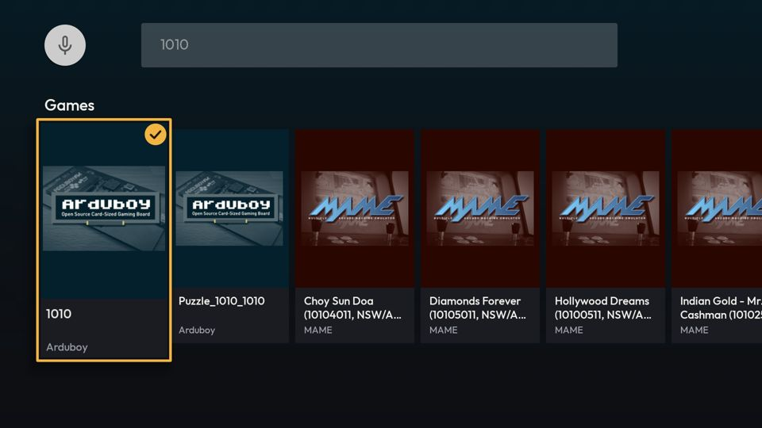

# [BUG] Jogos de arcade (MAME 0.289) com capa preta ou imagem genérica

**Data:** 2026-10-17
**Status:** corrigido e testado no AVD (ver `## Status`)
**Severidade:** baixa (visual; o jogo abre normalmente)
**Complexidade:** média — manifest + `GameDao` + `MANIFEST_SCHEMA_VERSION`; ver item 2 da causa
**Branch:** `version10`
**Origem:** observação da verificação 2 do redesenho (busca da TV, 2026-10-17)

## Sintoma

Na busca da TV por "1010", 3 dos 6 cartões de MAME (`mame289`) aparecem com a área da capa **toda preta**. Um quarto
("Hollywood Dreams") mostra uma arte genérica de MAME que não é do jogo. Nos dois casos, o esperado seria a capa
gerada (`GeneratedCover`/`TVCovers`), que é o que o app mostra quando não há capa.

## Evidência

- Banco do `lemu_tv_api25`: todos os jogos `mame289` têm `coverFrontUrl =
  https://adb.arcadeitalia.net/?mame=<rom>&type=title&resize=0` (a tela-título do jogo, não uma caixa).
- `curl` das capas: `csd`, `di4ever`, `indgldcm` → HTTP 200, `image/png`, ~1 KB, **640×480 com todos os pixels 0**.
  `holdrma6` → 140×105, 31 KB, md5 `d252a22533bc2ebece7f45a82278f641` (a arte genérica).
- Manifest: as **14.268** linhas `mame289/` usam essa mesma fonte (`catalog_manifest.txt` = cópia em `assets/`,
  `cmp` igual).
- Amostra aleatória de 400 (seed 42, script `sample_covers.py` no scratchpad da sessão): **357 imagem real, 33 preta
  (8%), 10 genérica (2,5%, sempre o mesmo md5)**. Projeção: ~1.200 pretas + ~350 genéricas.

## Causa-raiz

1. **Dado.** O arcadeitalia devolve uma tela-título capturada em branco para várias máquinas (caça-níqueis
   Aristocrat, sistemas sem vídeo na tela de título), e um placeholder próprio quando não tem imagem. Para o app, os
   dois são imagens válidas, então não há fallback. O lote veio no `b631880` (MAME 0.289).
2. **Propagação (achado lateral, mais grave).** Mudar a capa no manifest **não chega às instalações existentes**:
   - `ManifestQuickLoader.load()` grava `coverFrontUrl` só no `INSERT OR IGNORE` (linha ~423);
   - linha que já existe recebe `GameDao.updateManifestFieldsWithTitle`, que faz `UPDATE games SET title,
     popularityIndex, isRepresentative` — **sem capa**;
   - não há migração `loadedSchema < N` que mexa em capa (as que existem: `< 9`, `< 23`, `< 27`);
   - os outros escritores de `coverFrontUrl` são o scan da biblioteca (`LemuroidLibrary`, só arquivo em disco, via
     metadado) e o `SaveQueueManager` (fallback de `Game` em memória).
   Consequência: o passe de capas da **v31** (+4.711 capas, 3.577 capas erradas apagadas) só valeu para instalação
   nova (prebuilt) e para linhas inseridas depois. Quem já tinha o app segue com as capas antigas — inclusive as
   3.577 erradas. Não verificado em aparelho; a prova é o código acima.

## Hipóteses descartadas

- **Defeito do `TVCovers`/Coil** (imagem não carregou): falso. O download funciona e a imagem é preta de fato.
- **Problema só do AVD:** falso. É o conteúdo servido pelo arcadeitalia.

## Correção (proposta — aguarda decisões do dono)

1. **Dado:** varrer as 14.268 URLs (`GET` com 12 threads, ~20–40 min; respeitar o servidor) e **esvaziar** o campo 3
   das linhas pretas (todos os pixels 0) e das genéricas (md5 `d252a225…`), nos dois manifests. Esvaziar, nunca
   substituir por palpite (regra do passe v31).
2. **Propagação:** sem isto o passo 1 só vale para instalação nova. Opção recomendada:
   - `updateManifestFieldsWithTitle` passa a gravar `coverFrontUrl = :coverUrl` **quando o manifest tem capa**
     (não sobrescreve com `NULL` uma capa que o scan do LibretroDB tenha achado para ROM baixada);
   - o apagamento vai por migração única `loadedSchema < 42`: `UPDATE games SET coverFrontUrl = NULL WHERE
     coverFrontUrl = :url` para a lista de URLs esvaziadas no passo 1 (e, se o dono quiser, as 3.577 da v31).
   - Efeito colateral a aceitar: as +4.711 capas da v31 chegam de uma vez a quem já tinha o app.
3. Bump de `MANIFEST_SCHEMA_VERSION` (41 → 42) e linha na tabela do `CLAUDE.md`.
4. **Coordenar com a sessão de arcade/NAOMI**, dona do manifest de `mame289` nesta semana: a edição do manifest
   colide com ela.

**Decisões do dono:** (a) aprovar o desenho do item 2; (b) incluir ou não a limpeza retroativa das 3.577 capas da v31;
(c) fazer agora ou depois que a sessão de arcade fechar.

**Decidido (2026-10-18):** (a) aprovado. (b) e (c) sem resposta explícita → caminho conservador: **sem** limpeza
retroativa da v31 (fica para registro próprio) e feito agora (árvore limpa, sessão de arcade já commitou).

**Desenho final (substitui a migração por lista de URLs do item 2):** `GameDao.updateManifestFieldsWithTitle` ganha
`coverUrl: String?` e grava
`coverFrontUrl = CASE WHEN :coverUrl IS NOT NULL THEN :coverUrl WHEN coverFrontUrl LIKE 'https://adb.arcadeitalia.net/%'
THEN NULL ELSE coverFrontUrl END`. Ou seja: manifest com capa → vale a do manifest; manifest sem capa → só apaga a capa
do banco se ela veio do arcadeitalia (fonte que só o manifest usa; o scan do LibretroDB usa libretro-thumbnails), e
preserva qualquer outra. Roda em toda passada completa — sem migração `loadedSchema < N`, sem lista.
- Tasks: (1) `GameDao.updateManifestFieldsWithTitle` (+ KDoc); (2) `ManifestQuickLoader.load()` passa
  `coverUrl = game.coverFrontUrl` e comentário do bloco; (3) manifests (raiz + `assets/`) com o campo 3 vazio nas
  linhas pretas/genéricas da varredura; (4) `MANIFEST_SCHEMA_VERSION` 41 → 42 + histórico no `.kt` e tabela do
  `CLAUDE.md`; (5) nota no `CLAUDE.md` ("Pipeline de Carga": a passada completa agora também sincroniza a capa).
- Prova: query no AVD antes/depois (app instalado, sem limpar dados), captura da busca "1010", `ktlintCheck`, build.

## Correção aplicada

- **Varredura completa** das 14.268 capas `mame289` (`scan_covers.py`, 8 conexões, ~1h10): 12.791 imagem real,
  **1.263 pretas**, **212 genéricas** (md5 `d252a225…`), **3** com a mesma imagem em 3 títulos distintos
  (Bushido, Jurassic Park, Wize Move — md5 `11cf90ef…`, lixo pela regra ≥ 3 do passe v31) e **2** URLs inválidas
  (`asc88 (1)`, `ascsasi (1)`: espaço no nome). As **1.480** tiveram o campo 3 esvaziado nos dois manifests.
- `GameDao::updateManifestFieldsWithTitle` com `coverUrl` (desenho final acima) e `ManifestQuickLoader::load` passando
  `coverUrl = game.coverFrontUrl`.
- `MANIFEST_SCHEMA_VERSION` 41 → 42; tabela do `CLAUDE.md` (com a linha da v41, que faltava) e nota no
  "Pipeline de Carga".
- Baseline do ktlint do `retrograde-app-shared` regenerado: a edição deslocou passivo do `GameDao`/`ManifestQuickLoader`
  (nenhuma violação nova).

## Validação

`lemu_tv_api25`, app já instalado com o manifest antigo (dados preservados), APK x86 novo instalado por cima:

| | Antes | Depois |
|---|---|---|
| `mame289` com capa nula | 0 | **1.480** |
| `mame289` com URL do arcadeitalia | 14.268 | 12.788 |
| `csd`, `di4ever`, `indgldcm`, `holdrma6` | URL (preta / genérica) | `NULL` |
| `map1010` (capa boa) | URL | URL (mantida) |
| capas nulas fora do `mame289` | — | 23.348 = linhas sem capa no manifest (banco espelha o manifest) |

- Log: `ManifestQuickLoader: inserted=0 total=75140` — todas as linhas pelo UPDATE, ou seja, pelo caminho da
  instalação existente. `logcat` sem `FATAL`.
- Busca "1010": os cartões que eram pretos/genéricos mostram a capa gerada do sistema.
- `./gradlew ktlintCheck` BUILD SUCCESSFUL; build x86 (com `generatePrebuiltDb` validando o banco pré-montado) OK.

| Antes | Depois |
|---|---|
|  |  |

**Não verificado:** UI mobile (mesma regra `isNullOrBlank` no `LemuroidGameImage`, não aberta no aparelho);
instalação nova (prebuilt) — coberta só pela validação de build do `PrebuiltDbGenerator`.

## Lição

- **Capa no manifest não era sincronizada para quem já tinha o app.** Qualquer passe de capas futuro (e o v31,
  retroativamente) depende do `updateManifestFieldsWithTitle` gravar a capa — mexer nessa query exige manter o
  `CASE`. A limpeza retroativa das 3.577 capas erradas da v31 continua de fora (hosts variados; a regra só apaga
  arcadeitalia): registro próprio se o dono quiser.
- **Fonte de capa por tela-título (`type=title`) não é caixa**: tela capturada em branco e placeholder do servidor
  passam por imagem válida. Ao importar capas de uma fonte nova, classificar o conteúdo (pixels todos 0, md5
  repetido), não só o HTTP 200.
