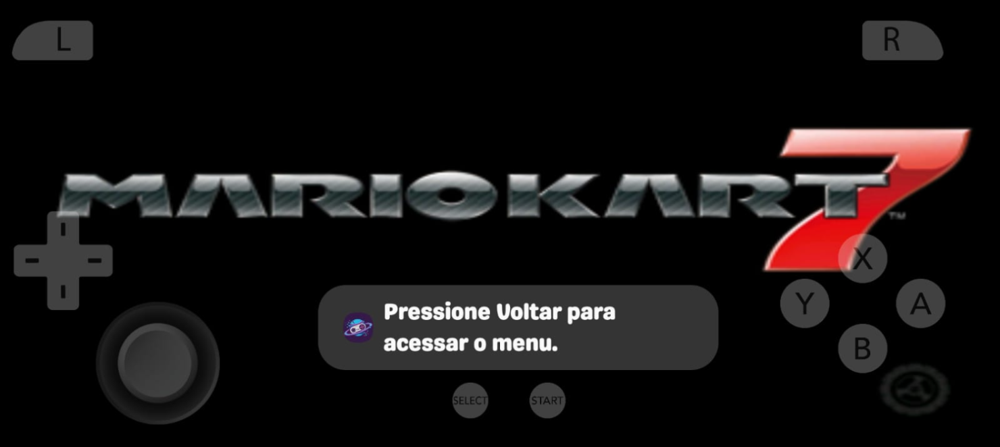
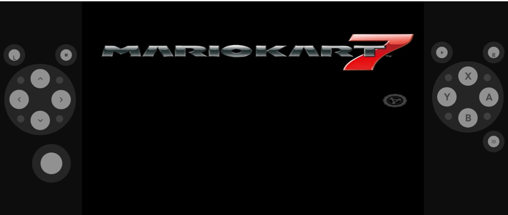
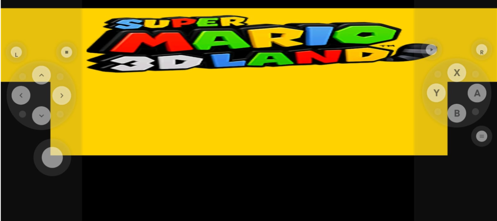

# [BUG] 3DS no celular: não dá para jogar em tela única, os controles ocupam colunas laterais e a imagem sai deformada

- **Data:** 2026-11-07
- **Status:** aberto. T1, T5 e T7 medidos no moto g86 (Mali), sem alterar código. Deformação reproduzida: é `Esticar para preencher` com colunas. A imagem esperada é Single Screen + Stretch com overlay. O Azahar em OpenGL roda o MK7 a ~57 fps contra ~43 do core atual. Dono decidiu em 2026-11-08: tela única esticada sem bordas, troca para o core Azahar (GL) e sem Vulkan. Tasks T2–T9 **abertas e não iniciadas**, especificadas em "Tasks abertas (2026-11-08)".
- **Severidade:** Alta para 3DS. Levou uma cliente a pedir reembolso do pacote poucas horas depois da compra.
- **Complexidade:** Média (uma opção de core é trivial; troca de tela, overlay e proporção por layout mexem em touch e na tela do jogo)
- **Branch:** redesenho-tv-jogos-salvos-tela (onde foi investigado; a correção ainda não tem branch)
- **Origem:** sessão de WhatsApp `45861677588562@lid`, chamado #330 (Galaxy S20 FE, Plataforma Multigames), e relato do dono com os prints abaixo

---

## Sintoma

A cliente jogava *Super Mario 3D Land* e *Mario Kart 7* no Retro Game System e reclamou, em ordem:

- "Como esticar a tela" [169526]
- "E deixa os controles transparente" [169533]
- "O jogo do super Mario 3d está Assim" [169874]
- "Eu queria deixar tela unica" [169876]; "Como deixar com tela inteira" [169878]; "Eu queria tirar essas bordas" [169883]
- "Não tem tela única" [169895]
- "Eu já cliquei e não preenche a tela só aparece tela superior e inferior / Esquerda e direita" [169897]
- "As duas opções não preenche a tela" e "Fica com a tela recortada" [169899, 169900]
- "Tem como dar o reembolso do app" [169914], logo depois de ouvir que não havia solução

**Esperado (dono):** ficar igual à imagem 1, de outro emulador: só a tela de cima, ocupando a tela do celular, sem distorção, com os controles por cima do jogo. Segundo o dono, a imagem e o padrão de controles desse emulador são superiores aos nossos. Tela única entra como **opção**, não como padrão (decisão do dono, 2026-11-07).

| | Print |
|---|---|
| 1. Outro emulador: o que a cliente quer |  |
| 2. Mario Kart 7 no nosso app |  |
| 3. Super Mario 3D Land no nosso app |  |

---

## Evidência

### Provado no código

- **Só duas opções de layout.** `GameSystem.kt:1866-1877` restringe `citra_layout_option` a `Default Top-Bottom Screen` e `Side by Side`, que em pt-BR viram "Superior — inferior" e "Esquerda — direita". É exatamente o que a cliente descreveu em [169897].
- **O core tem as outras.** `libretro/citra`, `citra_libretro.cpp:146-147`: `Default Top-Bottom Screen|Single Screen Only|Large Screen, Small Screen|Side by Side`. A string existe no binário que vai no app: `grep -a -c "Single Screen Only" libcitra_libretro_android.so` deu **1** (build `bundled-cores`, arm64). O fonte lido é o `master` de 2026-11-07; o `.so` pode ser de outro commit, então só a string foi conferida no binário.
- **Controles em colunas.** `ControllerConfigs.NINTENDO_3DS` tem `allowTouchOverlay = false` (`ControllerConfigs.kt:383`). Com isso, em paisagem, `GameScreenLayout.buildConstraintSet` usa `buildConstraintSetLandscapeNoOverlay`, que põe o `gameView` entre `leftPad` e `rightPad`. Vem do commit `1071b08`; o motivo não está registrado. O mesmo valor aparece em `ControllerConfigs.kt:258` e `:273`.
- **Não há botão de troca de tela.** O core troca a tela em `RETRO_DEVICE_ID_JOYPAD_L3` (`citra_libretro.cpp`, bloco `screen_swap_btn`). `Nintendo3DS.kt` tem L, Select, analógico, R, Start e Menu; não tem L3.
- **Em tela única de cima não há toque na tela de baixo.** `EmuWindow_LibRetro::UpdateLayout`, caso `SingleScreen` sem `swapped`: mostra a tela de cima e faz `enableEmulatedPointer = false`.
- **Geometria que o core reporta** (`UpdateLayout`): Top-Bottom 400×480 (0,83); Side by Side 720×240 (3,0); Single Screen 400×240 (1,67) ou 320×240 com a de baixo.
- **"Proporção da tela" é global.** `ScreenAspectRatio` lê uma preferência geral (`SettingsManager.screenAspectRatio`), não por sistema. O encaixe é "contain" (ver `docs/funcionalidades/proporcao-tela.md`).

### O emulador da imagem 1

- **Família identificada, app exato não.** O balão "Pressione Voltar para acessar o menu." é idêntico à string `emulation_menu_help` do Azahar em pt-BR (`values-b+pt+BR/strings.xml:471`). A frase vem do Citra Android (`Press Back to access the menu.`, commit do #6248, exibida em Toast ao iniciar o jogo). Logo, é um app da família Citra/Azahar, e não um core libretro nosso.
- **O ícone do balão não é de nenhum dos conferidos:** é um planeta azul com anel e um controle, em fundo roxo. Não é o Azahar (flor branca), nem o `com.theemulator.citra` da Play Store (laranja), nem o Retro Game System. Provavelmente é um app rebatizado. Fica pendente perguntar o nome à cliente.
- **Recursos que essa família tem nativamente** (`values/strings.xml` do Azahar): layouts `Single Screen`, `Large Screen`, `Side by Side` e `Portrait`, e aspect ratio `Default`, `16:9`, `4:3`, `21:9`, `16:10` e `Stretch`.
- **O logo do Mario Kart 7 está menos achatado na imagem 1** do que na imagem 2: cerca de 6,4:1 contra 8,2:1, por medida visual. Não foi comparado com a proporção nativa do jogo.
- **Resolução:** o core usa `1x (Native)` por padrão (`citra_libretro.cpp:310`) e o app não define outro valor; só expõe `citra_resolution_factor`. São 400×240 ampliados para a tela do S20 FE, candidato direto à imagem pior.
- **Existe core libretro do Azahar:** `src/citra_libretro/` no repositório `azahar-emu/azahar`, com `ENABLE_LIBRETRO` no CMake e `single_screen` nas opções. ~~O nome e os valores das opções mudam em relação ao `citra_layout_option` atual. O caminho `azahar_libretro_android.so.zip` testado no buildbot deu 404, então pode ser preciso compilar.~~ **Corrigido em 2026-11-07:** não é preciso compilar, e `citra_layout_option` continua igual. Ver "Comparação T7 + T1".

### Medido nos prints (ainda sem explicação)

- **Imagem 3, 1483×662:** a tela de cima ocupa x 2–1482, y 28–248, ou seja 1480×220 (6,7:1, quando o nativo é 5:3). A de baixo ocupa x 151–1334, y 248 até cerca de 468, ou seja 1183×220 (5,4:1, quando o nativo é 4:3). A razão entre as larguras é 0,80, igual a 320/400, então é a mesma tela Top-Bottom esticada cerca de **4× na horizontal**. O jogo passa por baixo das colunas e sobram 28 px pretos em cima e cerca de 195 px embaixo.
- **Imagem 2, 1536×653:** colunas até x≈248 e a partir de x≈1282 (luminância 13–14 contra 0), área central de 1034×653.
- Em Top-Bottom com `Automática`, o "contain" deveria dar cerca de 544×653 centrados. **Nenhum dos prints bate com isso**, e a imagem 3 também não bate com `Esticar para preencher`, que daria 331 px de altura por tela, e não 220.

---

## Causa-raiz

**Provada**, para "não dá para ter tela única": a opção existe no core, mas o app filtra a lista em `GameSystem.kt`. **Provada**, para as colunas: `allowTouchOverlay = false`.

**Provada no aparelho (T1)**, para a deformação do print 2: é a preferência global `Esticar para preencher` aplicada à coluna central entre os pads. Com `Automática`, o core mostra 5:3 exato. O core não deforma nada. O print 3 continua sem gatilho reproduzido (ver "Tabela de geometria").

~~Aberta, para a deformação. Falta medir no aparelho, com `printRetroVariables` e captura de tela...~~ Medido em 2026-11-07; ver "Tabela de geometria".

## Hipóteses descartadas

- **"O app não tem a opção porque o core não suporta":** caiu; o core suporta e a string está no `.so`.
- **"Isso é do próprio jogo", como o agente disse [169905]:** caiu; o limite é do que o app expõe.
- **"Basta adicionar Single Screen":** insuficiente. Em tela única de cima o toque na tela de baixo some e não há botão L3, então um jogo que exige toque ficaria sem saída. E 5:3 numa área de 2,2:1 ainda deixa bordas, que era a reclamação.

## Correção planejada

**Decidido pelo dono:** tela única é opção; o padrão continua `Default Top-Bottom Screen`.

**Decidido pelo dono em 2026-11-08:**

1. **A tela única abre esticada, sem bordas, como o print da cliente** (Single Screen + Stretch), e não com 5:3 e barras.
2. **Trocar o core 3DS pelo libretro do Azahar**, em OpenGL, pelo desempenho medido em T7.
3. **Vulkan no frontend fica fora.** Os dados de C × C2 não justificam.

**As tasks abaixo estão abertas e NÃO iniciadas** (pedido do dono: "abra estas tasks, não inicie por enquanto"). A especificação de cada uma está em "Tasks abertas (2026-11-08)".

~~**Pendente:** como a tela única preenche a área sem distorcer.~~ **Medido (T5):** não preenche sem distorcer. A imagem 1 é Single Screen + Stretch, esticada 1,27× no moto e 1,34× no S20 FE. "Sem bordas" e "sem distorção" não cabem juntos numa tela 20:9. O dono escolhe qual vira o padrão da tela única; o Azahar oferece os dois.

Tabela atualizada em 2026-11-07 ~22h45 com o que T1, T5 e T7 provaram. T1, T5 (medição) e T7 (medição) estão feitos; as linhas abaixo são o trabalho de código que resta.

| # | Parte | Onde | Prova |
|---|---|---|---|
| T1 | ✅ **Feito.** Deformação = `Esticar` com colunas; core sem culpa. Print 3 sem gatilho (falta split screen e janela flutuante) | — | "Tabela de geometria" |
| T2 | Expor `Single Screen Only` (avaliar `Large Screen, Small Screen`) com tradução pt-BR. **O core atual já aceita o valor** (400×240 medido via prefs), e o Azahar também (`GetLayoutOption`) | `GameSystem.kt`, `strings.xml` | Opção aparece e a tela muda em Mario Kart 7 |
| T3 | Botão de troca de tela (L3) no layout de toque | `Nintendo3DS.kt` | Tela de baixo acessível e tocável; confirmar se o toque responde com a tela trocada |
| T4 | Controles sobre o jogo em tela única; colunas só onde o toque na tela de baixo precisa da área livre | `allowTouchOverlay` hoje é fixo por `ControllerConfig`; precisa depender do layout | Print igual à imagem 1 e toque sem disparo acidental |
| T5 | Tela única com o jogo ocupando a tela: **Single Screen + `Esticar`, com overlay (T4)** reproduz a imagem 1 (Stretch 1,27× no moto, 1,34× no S20 FE). `Automática` dá 5:3 sem distorção com barras laterais. **Dono (2026-11-08): esticado, sem bordas.** `ScreenAspectRatio` é global, então para o 3DS ter o seu é preciso preferência por sistema ou por layout | `ScreenAspectRatio`, `SettingsManager` | Logo do MK7 em ~6,7 (Stretch) ou 5,27 (sem distorção) no S20 FE, conforme a escolha, sem colunas |
| T6 | A deformação de Top-Bottom e Side by Side é **só** `Esticar` aplicado à coluna central (1,35× no moto, 1,90× no S20 FE, 2,68× na vertical em Side by Side). Candidatos: ignorar `Esticar` para o 3DS quando há colunas, ou proporção por sistema (a mesma de T5). Não mexe no core | `GameViewModelRetroGameView` / `ScreenAspectRatio` | Top-Bottom e Side by Side com 5:3 por tela (logo do MK7 em 5,27) com `Esticar` ligado |
| T7 | **Aprovado pelo dono em 2026-11-08.** **Trocar `citra` pelo libretro do Azahar 2126.2** (sem compilar: binário da release). Medido no moto: 57 contra 42–45 fps de apresentação no MK7, 0 crash. **Obrigatório:** `citra_graphics_api=OpenGL` em `defaultSettings` (sem ela o core quebra no `context_reset`). Migrar as chaves da tabela "Core Azahar" e o `CoreCrashFallback` (`citra_use_hw_shader`). Antes de publicar: repetir num Adreno, conferir o crash de `2026-09-02-crashes-nativos-cores-citra-dolphin.md` e jogar uma corrida inteira | `CoreID.kt`, `GameSystem.kt`, `CoreCrashFallback.kt`, `lemuroid_core_citra` | `braco.sh` A/B no mesmo aparelho, 0 crash em 5 min e log `Using OpenGL hw renderer` |
| T8 | Resolução padrão do 3DS acima de 1x. **Entra, porque T7 foi aprovado:** o Azahar GL tem folga (~57 fps a 1x) que o core atual não tem (~42). Medir 2x com o Azahar no moto e num Adreno antes de fixar | `defaultSettings` do 3DS em `GameSystem.kt` | Print nítido sem queda abaixo de ~55 fps no demo do MK7 |
| T9 | Redesenhar o layout de toque do 3DS no padrão da imagem 1: L/R nos cantos, direcional e analógico à esquerda, ABXY à direita, Select/Start no centro | `Nintendo3DS.kt` | Print comparado à imagem 1 e controles sem sobrepor o essencial |

Depois de publicar, avisar o bug do agente no digitalstoregames: `docs/modules/chatbot-whatsapp/areas/prompt-kb/bugs/2026-11-07-agente-multigames-improvisa-menu-e-layout-do-3ds-no-android.md`.

### Tasks abertas (2026-11-08)

**Situação:** abertas, **não iniciadas** (pedido do dono). Registradas também no backlog [`docs/backlogs/2026-11-08-3ds-core-azahar-e-tela-unica-esticada.md`](../../backlogs/2026-11-08-3ds-core-azahar-e-tela-unica-esticada.md). Nenhuma tem branch ainda. Os símbolos citados foram conferidos em 2026-11-08 no `HEAD` local; quem implementar abre cada um de novo antes de editar.

**Ordem sugerida:** T7 → T2 → T4 + T5 → T6 → T3 → T9 → T8.

- **T7 primeiro** porque reescreve o bloco 3DS de `GameSystem.kt`, que T2 e T8 também editam. Fazer T2 antes obrigaria a refazer o trabalho.
- **T4, T5, T6, T3 e T9 não dependem do core:** a geometria reportada é a mesma nos dois.

**T7: trocar o core 3DS pelo libretro do Azahar (OpenGL).** Complexidade **Alta** (core em `lemuroid-cores`, JNI/LibretroDroid, ciclo do `:game`).

- **Entra:**
  - trocar o binário de `lemuroid-cores/lemuroid_core_citra` e de `bundled-cores/src/main/jniLibs/arm64-v8a/libcitra_libretro_android.so` pelo `azahar-libretro-android-arm64-v8a` da release 2126.2. **Sem patch nenhum:** os `.so` do scratchpad são só de medida.
  - seguir o fluxo do pitfall 15: commit no `lemuroid-cores` → push → tag nova → `CoreDownloader.CORES_VERSION` → ponteiro do submódulo.
  - em `GameSystem.kt`, no bloco 3DS, `defaultSettings` com **`citra_graphics_api=OpenGL`**: sem ela o core escolhe Vulkan e quebra no `context_reset`, provado na 1ª rodada do B. Ela não deve ser exposta.
  - migrar as chaves conforme a tabela "Core Azahar": `citra_use_hw_shader`, `citra_shaders_accurate_mul` (fixar `disabled`, como o nosso padrão atual), `citra_use_disk_shader_cache`, `citra_enable_touch_touchscreen`, `citra_enable_mouse_touchscreen`; remover `citra_render_touchscreen`.
  - em `CoreCrashFallback.kt`, a constante `CITRA_HW_SHADERS` passa a `citra_use_hw_shader`.
  - as prefs `cv_3ds_*` antigas de quem já usa: definir se migra o valor ou descarta.
  - `CoreID.CITRA` pode manter o nome do arquivo (`libcitra_libretro_android.so`). Decidir no design se o nome exibido muda para "Azahar".
- **Não entra:** Vulkan; resolução acima de 1x (é T8); qualquer mudança de layout.
- **Riscos a fechar antes de publicar:**
  - **Saves.** O Azahar usa `<files>/save` como pasta de usuário (`SetUserPath` no log). Conferir se save e extdata gravados pelo core atual abrem no Azahar. Perder o progresso de quem já joga é bloqueante.
  - O crash de shader de `2026-09-02-crashes-nativos-cores-citra-dolphin.md`.
  - Aparelho Adreno.
- **Prova:**
  - `braco.sh` A/B no moto com o APK de verdade: log `Using OpenGL hw renderer`, fps ≥ ao do braço B (57) e 0 crash em 5 min;
  - a mesma medida num Adreno;
  - uma corrida inteira jogada no MK7 e a primeira fase do SM3DL;
  - um save de antes da troca carregando depois dela.

**T2: expor `Single Screen Only`.** Complexidade **Baixa**. Depende de T7 só para não editar o bloco duas vezes.

- **Entra:**
  - um terceiro `ExposedSetting.Value("Single Screen Only", ...)` em `citra_layout_option`, no `GameSystem.kt`, bloco 3DS (hoje só tem `Default Top-Bottom Screen` e `Side by Side`);
  - as strings em `strings.xml` e `values-pt-rBR/strings.xml`.
  - O padrão continua Top-Bottom.
  - Avaliar `Large Screen, Small Screen` no mesmo passo, sem obrigação de expor.
- **Não entra:** proporção (T5) nem overlay (T4).
- **Prova:** a opção aparece no menu do jogo, e o MK7 passa a 400×240 sem reiniciar o jogo. Pelo core atual, via prefs, isso já foi medido.

**T4: controles sobre o jogo na tela única.** Complexidade **Média**.

- **Hoje:** `ControllerConfigs.NINTENDO_3DS` tem `allowTouchOverlay = false` (`ControllerConfigs.kt:383`). Em paisagem, `GameScreenLayout.buildConstraintSet` usa `buildConstraintSetLandscapeNoOverlay` (`GameScreenLayout.kt:123`), que põe o jogo entre as colunas.
- **Entra:** o overlay passa a depender do layout do core. Com `Single Screen Only`, os controles ficam sobre o jogo; com Top-Bottom e Side by Side, ficam como hoje, porque o toque na tela de baixo precisa da área livre. A troca de layout pelo menu com o jogo aberto precisa trocar o ConstraintSet.
- **Não entra:** a disposição dos botões (T9).
- **Prova:**
  - em tela única e paisagem, o jogo ocupa a largura inteira sob os controles;
  - em Top-Bottom, nada muda;
  - trocar o layout pelo menu com o jogo aberto atualiza os dois.

**T5: tela única esticada, sem bordas (decisão do dono).** Complexidade **Média**. Depende de T2 e T4.

- **Entra:** na tela única do 3DS, a imagem preenche a área (`TARGET_ASPECT_FILL`), independente da preferência global `screen_aspect_ratio`, que é uma só para todos os sistemas (`SettingsManager.screenAspectRatio`, `ScreenAspectRatio.kt`). O design decide entre duas formas:
  - (a) forçar FILL quando o 3DS está em `Single Screen Only`;
  - (b) proporção por sistema, com o 3DS em FILL por padrão. Esta também serve a T6.
- **Não entra:** mudar a proporção dos outros sistemas.
- **Prova:** o logo do MK7 mede **~6,7** (como o print 1, que mediu 6,72; no moto, o Azahar standalone em Stretch deu 6,69), sem faixa preta lateral, no moto e no S20 FE ou equivalente.

**T6: Top-Bottom e Side by Side sem deformação.** Complexidade **Média**. Ligada a T5.

- **Entra:** com colunas, `Esticar` deixa de deformar o 3DS. Ou o 3DS usa `Automática` nesses layouts, ou herda a proporção por sistema de T5 (b).
- **Não entra:** o core. Ele não deforma nada, como T1 provou.
- **Prova:** o logo do MK7 mede **5,27** em Top-Bottom e Side by Side, com a preferência global em `Esticar`.

**T3: botão de troca de tela.** Complexidade **Média**.

- **Hoje:** na tela única de cima, o core desliga o toque (`enableEmulatedPointer = false`), e `Nintendo3DS.kt` não tem L3, o botão que troca a tela no core atual (`screen_swap_btn`).
- **Entra:** um botão de troca no layout de toque do 3DS, visível ao menos na tela única. **Conferir no Azahar 2126.2 qual botão ou opção troca a tela**: no core atual é L3, e no Azahar ainda não foi aberto.
- **Prova:** na tela única, o botão mostra a tela de baixo, e um toque nela responde num jogo que exige toque.

**T9: layout de toque no padrão do print 1.** Complexidade **Média**. Depende de T4.

- **Entra:** em `lemuroid-touchinput/.../radial/layouts/Nintendo3DS.kt`:
  - L/R nos cantos superiores;
  - direcional e analógico à esquerda;
  - ABXY à direita;
  - Select/Start no centro, embaixo;
  - o botão de T3.
- **Prova:** print lado a lado com o print 1 e controles sem cobrir o centro da pista do MK7.

**T8: resolução padrão acima de 1x.** Complexidade **Baixa** no código e **Média** na medida. Depende de T7.

- **Entra:** medir o Azahar GL em 2x no moto e num Adreno com `braco.sh`. Se ficar em ≥ ~55 fps no demo do MK7, fixar o padrão em `defaultSettings`, talvez por faixa de aparelho.
- **Prova:** captura 1x × 2x da mesma cena e fps.

## Comparação T7 + T1 (registro de 2026-11-07)

> **Estado (atualizado ~22h45):** T1, T5 e T7 medidos no moto (braços A1, B, A2, C e C2). Conclusão em "Conclusão de T7": trocar o core por desempenho, com GL obrigatório; imagem e layout não dependem do core. Antes disso (~21h): T7 só com o braço A1, conclusão provisória "manter o core". Abaixo, o estado anterior. Análise sem aparelho concluída. T1 medido em parte no moto: a deformação é a preferência `Esticar para preencher`, não o core (ver "Tabela de geometria"). O print 3 não foi reproduzido. Comparação de core (T7) e Azahar standalone (T5) **não feitas**. Nenhum código foi alterado. **Trocar ou manter o core ainda não está decidido.** A sessão de 2026-11-07 parou aqui e passou o bastão: a continuação está em "Próximo passo".

### Aparelho

`moto g86 5G` (`ZY32LMNN9B`, codinome `nice`): Android 16 (API 36), MediaTek MT6878, Mali-G615 MC2, GLES 3.2 `r44p1`, 7,5 GB de RAM, 1220×2712 (20:9), 450 dpi. Não é o S20 FE da cliente, que tem a mesma proporção 20:9 e GPU Adreno ou Mali conforme a versão. Em 2026-11-07 não tinha o Retro Game System, nem Azahar, nem nenhuma ROM de 3DS em `/sdcard`. As `.3ds` em `roms/3ds` do repositório têm 0 byte.

### O que os prints provam (medido por pixel)

Medição com Pillow: limiar vermelho (`R>170, G<70, B<70`) para o "7" e cinza (`|R-G|<14, |G-B|<14, R>95`) para as letras. Substitui as medidas "por visual" de 6,4:1 e 8,2:1.

| Print | Logo do MK7 | Razão | Fração de X do logo na área | Área da tela de cima | Esticamento pela geometria | Razão nativa inferida |
|---|---|---|---|---|---|---|
| 1 (outro emulador) | 1347×201 | 6,70 | 0,057–0,966 de 1480 | 1480×662 | 1,34× | **5,00** |
| 2 (nosso app) | 936×98 | 9,55 | 0,059–0,963 de 1034 | 1034×326 | 1,90× | **5,03** |

- **A imagem 1 também está deformada.** A fração de X é a mesma nas duas, então a tela de cima ocupa a largura inteira do celular na imagem 1. Em 5:3 sem distorção, 662 px de altura dariam 1103 px de largura, e o logo sozinho tem 1347 px. A imagem que a cliente quer é a tela de cima **esticada 1,34× na horizontal**. O "sem distorção" do Esperado não descreve esse print. Falta confirmar no Azahar qual opção produz isso; o candidato é `Stretch`.
- **A imagem 2 é Top-Bottom com `Esticar para preencher` na coluna central.** 1034×653 divididos em duas telas dão 326 px cada, e o modelo prevê 5,0 × 1,90 = 9,5, contra 9,55 medido. Duas imagens independentes dão a mesma razão nativa, o que sustenta o modelo. A causa da deformação da imagem 2 seria a preferência, não o core. **Inferido dos prints; falta reproduzir.**
- **A imagem 3 parece ser o viewport do retrato preso em paisagem.** Em y, a área vai de 0,042 a 0,707 da altura, com largura total, e o jogo passa por baixo das colunas. Em 1080×2400 isso daria 101 px no topo, compatível com o recuo de `displayCutout` em `MobileGameScreen`, e 703 px livres embaixo, compatível com a área dos pads em retrato. Com `Esticar para preencher`, cada tela fica com 1480×220, que é o medido. Isso explica os números que o doc listava como sem explicação. **É hipótese: o gatilho não foi encontrado no código.**

### Core Azahar: o que se sabe sem rodar

- **Há binário pronto.** `azahar-libretro-android-arm64-v8a-<versão>.zip` em cada release do `azahar-emu/azahar` (2126.2 estável, 11,7 MB) e `azahar_libretro.so.zip` no buildbot (arm64, 2026-11-06). O 404 do doc veio do nome: é sem `_android`.
- **Pacote:** o APK `vanilla` 2126.2 é `org.azahar_emu.azahar`, não `io.github.lime3ds.android`.
- **ELF:** Azahar 2126.2, RC2, nightly, Citra nightly e o nosso declaram API 21 e têm `LOAD` de 16 KB. Azahar precisa só de `liblog`, `libm`, `libdl` e `libc`. Nosso core: NDK r26d, 32 MB. Azahar: r29, 38 MB. API 21 na nota do ELF não prova que rode em Android antigo.
- **ABI:** só arm64, igual ao nosso. `supportedOnlyArchitectures = setOf("arm64-v8a")` em `GameSystem.kt` já restringe 3DS. O `.so` de 92 bytes no APK armv7 é o texto de um symlink do git, sem efeito.
- **Bloqueio de T7: o core força Vulkan.** `environment.cpp::GetPreferredRenderer` retorna Vulkan em Android sem perguntar ao frontend. O LibretroDroid só fala GLES, e `environment_handle_set_hw_render` aceita qualquer `context_type` sem conferir. Sem `citra_graphics_api=OpenGL`, é esperado falhar. O app só repassa chaves de `defaultSettings` e `exposedSettings`, então a troca exige declarar essa chave. Consequência: o Azahar dentro do nosso app roda em **OpenGL**, e o desempenho do Azahar standalone em Vulkan não vale como previsão.
- **Proporção:** o core reporta a mesma geometria do atual em `ComputeLayoutGeometry` e também não oferece proporção. Em tela única de cima também desliga o ponteiro emulado (`emulated_pointer = false`). Trocar o core **não resolve** T4, T5 nem o toque.
- **Quem usa as chaves no app:** só `GameSystem.kt` e `CoreCrashFallback.kt` (`citra_use_hw_shaders`). `citra_swap_screen` não é usada.

| Chave atual | No Azahar 2126.2 | Migração |
|---|---|---|
| `citra_layout_option` | igual | `GetLayoutOption` aceita os valores antigos, inclusive `Single Screen Only` |
| `citra_resolution_factor` | igual | `std::stoi`: "1x (Native)" e "2x" continuam legíveis, os rótulos mudam |
| `citra_use_acc_mul` | `citra_shaders_accurate_mul` | chave nova; default `enabled`, o nosso é `disabled` |
| `citra_use_hw_shaders` | `citra_use_hw_shader` | ajustar `CoreCrashFallback` |
| `citra_use_hw_shader_cache` | `citra_use_disk_shader_cache` | chave nova |
| `citra_touch_touchscreen` | `citra_enable_touch_touchscreen` | chave nova |
| `citra_mouse_touchscreen` | `citra_enable_mouse_touchscreen` | chave nova |
| `citra_render_touchscreen` | removida | apagar |
| não existe | `citra_graphics_api` | **obrigatória:** `OpenGL` |

### Hipóteses descartadas nesta rodada

- **"A proporção fica velha porque `SET_GEOMETRY` não chama `refreshAspectRatio`":** caiu. `libretrodroid.cpp:515-523` marca `dirtyVideo`, e `libretrodroidjni.cpp:550-555` chama `GLRetroView.refreshAspectRatio` no fim do `step`. Ainda falta testar a troca com o jogo aberto.
- **"O viewport se perde com o jogo pausado":** caiu. `queueCoreEvent` só descarta com o core destruído ou não criado (`CoreWorkGuard.begin`), e `GLSurfaceView.guardedRun` drena `mEventQueue` antes de tratar a pausa (`GLSurfaceView.java:1330`, API 35).
- **"É preciso compilar o Azahar":** caiu, ver acima.
- **"O Azahar quebra no Mali dentro do nosso app"** (1ª rodada do B, ~22h): caiu. O crash era a chave de OpenGL que não chegava ao core (`citra_use_acc_mupi`). Com o nome certo, o core roda 5 min sem crash.
- **"O Azahar precisa de Vulkan para render bem":** caiu no Mali-G615. O standalone em OpenGL deu 62,4 fps contra 58,9 em Vulkan, na mesma cena. Não testado em Adreno.

### Bancada sem alterar código

- **Ajuste por jogo sem UI:** `CoreVariablesManager` lê `cv_3ds_<chave>` das prefs Harmony (`harmony_options`), e o valor em String passa direto ao core. Dá para testar `cv_3ds_citra_layout_option=Single Screen Only` no core atual sem tocar em `GameSystem.kt`. A proporção é a pref `screen_aspect_ratio`. O app só repassa chaves expostas, então `citra_graphics_api` não entra por aqui.
- **Azahar no nosso frontend:** reempacotar o APK debug trocando `lib/arm64-v8a/libcitra_libretro_android.so` pelo `azahar_libretro.so`, com `zipalign` e `apksigner` usando `debug.keystore` (mesma chave do debug, SHA-256 `CE:3E:BF:1D…`). `install -r` alterna os braços sem perder ROM nem prefs.
- **Para forçar OpenGL sem editar o app:** só na cópia de teste do `.so`, renomear a string `citra_graphics_api` (uma ocorrência, offset `0xd3534d` no 2126.2) para `citra_use_acc_mul` e gravar `cv_3ds_citra_use_acc_mul=OpenGL`. Não abrir a tela de opções do core com isso, porque a preferência é booleana. **Serve só para medir, nunca para publicar.**
- **APK debug disponível:** `app.retrogamesystem.debug` 1.17.27 (vc 258), `debuggable=true`, de 2026-10-29.

### Tabela de geometria (medida no moto g86 5G em 2026-11-07, 15h–16h)

`app.retrogamesystem.debug` 1.17.27 (vc 258), core atual, Super Mario 3D Land (Europe) (Rev 1) baixado pelo catálogo do app. O core **roda e renderiza** no Mali-G615. Medido por captura de tela (2712×1220 em paisagem) com `quadro.py`, que acha o amarelo do título; a tela de baixo mostra uma caixa branca, por isso só a de cima entra na razão. Rotação travada por `cmd window user-rotation lock N`: `settings put system accelerometer_rotation 0` **não** trava neste Motorola (`mUserRotationMode` continua `FREE`).

| Layout | Proporção | Cenário | Tela de cima medida | Razão | Resultado |
|---|---|---|---|---|---|
| Top-Bottom | `Automática` | paisagem | 1017×610, x 0,310–0,685 | **1,667 (5:3)** | sem deformação, barras laterais |
| Top-Bottom | `Automática` | retrato | 1220×732 | 1,667 | sem deformação |
| Top-Bottom | `Automática` | retrato → paisagem com o jogo rodando | 1017×610 | 1,667 | viewport atualiza |
| Top-Bottom | `Esticar` | paisagem | 1369×610, x 0,245–0,750 | **2,244 = 5:3 × 1,35** | **deformado: é o mecanismo da imagem 2** |
| Top-Bottom | `Esticar` | retrato | 1220×790 | 1,544 | levemente achatado na vertical |
| Top-Bottom | `Esticar` | retrato → paisagem com o jogo rodando | 1369×610 | 2,244 | viewport atualiza |
| Top-Bottom | `Esticar` | retrato, menu aberto (☰ segurado 2 s), gira, fecha o menu | 1369×610 | 2,244 | viewport atualiza |
| Top-Bottom | `Esticar` | abre em retrato, gira aos 2 s, 5 s e 10 s do carregamento | 1369×610 nas três | 2,244 | viewport atualiza |
| Top-Bottom → Side by Side **pelo menu, com o jogo aberto** (SM3DL e MK7) | `Esticar` | paisagem | 760×1220 (SM3DL); logo do MK7 1,91 | 0,623 | viewport atualiza ao fechar o menu (core passa a 720×240); **não gera o print 3** |
| Side by Side → Top-Bottom pelo menu (SM3DL e MK7) | `Esticar` | paisagem | 1369×610; logo do MK7 6,90 | 2,244 | volta ao estado inicial; **não gera o print 3** |
| Side by Side | `Automática` | retrato | 677×407 | 1,663 | sem deformação |
| Side by Side | `Automática` | paisagem | 760×456 | 1,667 | sem deformação; faixas pretas em cima e embaixo na coluna |
| Side by Side | `Esticar` | paisagem | 760×1220 | 0,623 = 5:3 ÷ 2,68 | deformado na vertical |
| Single Screen (via prefs) | `Esticar` | paisagem | 1369×1220 | 1,122 = 5:3 ÷ 1,49 | **funciona no core atual** (400×240); deformado na vertical |
| Single Screen (via prefs) | `Automática` | paisagem | 1369×822 | 1,665 | sem deformação; 199 px pretos em cima e embaixo, por causa das colunas |
| Single Screen (via prefs) | `Automática` | retrato | 1220×732 | 1,667 | sem deformação |
| MK7 Top-Bottom | `Automática` | paisagem | logo 5,27 | — | **referência real do logo do MK7: 5,27** (o 5,00 "inferido" dos prints era 5% baixo) |
| MK7 Top-Bottom | `Esticar` | paisagem | logo 6,90 | 1,31× | mesmo mecanismo do print 2 |

Medido em 2026-11-07, 19h–20h30, com o mesmo APK debug e o core atual. `cv_3ds_citra_layout_option` gravado direto no JSON das prefs Harmony (`files/harmony_prefs/harmony_options/prefs.data`, app parado, `prefs.transaction.*` apagados) é aceito: a chave é exposta e o valor em String passa ao core. **O print 3 continua sem gatilho**: não sai trocando o layout pelo menu, nos dois sentidos e nos dois jogos. Falta só split screen e janela flutuante, que não foram testados.

### T5: Azahar standalone (medido no moto em 2026-11-07, 20h–20h40)

`org.azahar_emu.azahar` 2126.2, renderer padrão (Vulkan), MK7 e SM3DL copiados para `/sdcard/AzaharTeste/jogos`, pasta de usuário `/sdcard/AzaharTeste`. Layout e proporção trocados em `config/config.ini` (`[Layout] layout_option`, `aspect_ratio`) com o app parado; o shell consegue gravar nesse arquivo.

| Layout | `aspect_ratio` | Tela de cima (SM3DL) | Razão | Resultado |
|---|---|---|---|---|
| Padrão (`Large Screen`) | Default | 1908×1145, tela de baixo pequena à direita | 1,666 | sem deformação, controles sobre a imagem |
| Single Screen | 0 Default | 2033×1220 | 1,666 | altura inteira, sem deformação, barras laterais |
| Single Screen | 1 16:9 | 2161×1220 | 1,771 | força 16:9 |
| Single Screen | 2 4:3 | 1627×1220 | 1,334 | força 4:3 |
| Single Screen | 3 21:9 | 2587×1109 | 2,333 | força 21:9, faixas em cima e embaixo |
| Single Screen | 4 16:10 | 1952×1220 | 1,600 | força 16:10 |
| Single Screen | **5 Stretch** | **2587×1220** (janela inteira menos o recorte de 125 px) | 2,120 = **1,27×** | preenche tudo, esticado na horizontal |
| Single Screen, **MK7** | **5 Stretch** | logo **6,69** | 6,69 ÷ 5,27 = **1,27×** | **igual ao print 1 (6,72)** |

**Conclusão de T5:** a imagem 1 é **Single Screen + Stretch** de um app da família Azahar. O esticamento é a proporção da janela dividida por 5:3: 1,27× no moto e 1,34× no S20 FE da cliente. Os controles do Azahar ficam sobre a imagem, sem colunas: L/R nos cantos, direcional e analógico à esquerda, ABXY à direita e Select/Start no centro. É o layout da imagem 1. O "sem distorção" do Esperado não descreve a imagem 1, que é distorcida. O que a cliente chama de "tela inteira" é o Stretch.

**Conclusão de T1 (parcial):**

- **A deformação dos prints 2 e 3 é a preferência `Esticar para preencher`, aplicada à área entre as colunas.** Com `Automática`, o core atual mostra 5:3 exato. O fator depende da largura da coluna central em cada aparelho: 1,35× no moto e 1,90× no S20 FE da cliente (print 2). O core não deforma nada; ele reporta 400×480 e o LibretroDroid estica até a área.
- **O print 3 não foi reproduzido** em 6 cenários de rotação (tabela acima). O retângulo dele (largura total, y 0,038–0,702, medido de novo por `quadro.py`; o 0,042–0,707 anterior era estimativa visual) continua batendo com a área de jogo do retrato, mas o gatilho segue desconhecido. Não testado ainda: trocar o layout pelo menu com o jogo aberto (a cliente relata ter clicado nas duas opções), split screen e janela flutuante.
- `BACK` no jogo **fecha** o jogo (`BaseGameActivity.handleOnBackPressed` → `requestFinish`); o menu abre segurando ☰ por 500 ms (`MENU_LOADING_ANIMATION_MILLIS`). `input tap` e ESC por adb não abrem.

**Rodada interrompida às ~16h:** o moto saiu da rede (adb sem fio e TCP sem resposta). Às ~17h o dono pareou de novo; estado atualizado em "Próximo passo". Na interrupção: menu do jogo aberto em paisagem, `screen_aspect_ratio` = `Esticar para preencher` (**devolver para `Automática`**), rotação travada em 1 (**devolver**: `cmd window user-rotation free`), Mario Kart 7 na fila de download, Azahar 2126.2 instalado e não aberto. O ARMSX2 do dono tinha um `DownloadForegroundService` ativo (extração do GoW2) e não foi tocado.

### Comparação do core (T7: medido no moto em 2026-11-07, 20h50–22h45)

Braços: core atual, Azahar 2126.2 em OpenGL no nosso app e Azahar standalone. Medir no mesmo aparelho e na mesma cena, intercalado A/B/A: imagem, fps e crash em 5 min.

**Protocolo fixado em 2026-11-07** (script `braco.sh`, ver "Próximo passo"):

- MK7 em paisagem, partindo de `force-stop`.
- A partir de 35 s, procura o diálogo "no Mii characters" pelo amarelo do OK numa captura a cada ~3 s. Quando aparece (49 s no core atual), aperta A e 7 s depois B.
- Com isso o jogo volta à tela de título, e o **demo de corrida** (3D em cima, mapa embaixo) começa sozinho. Esse demo é a cena.
- O timestats começa 30 s depois do B e vai até 300 s.
- Medidas:
  - fps de apresentação pelo `dumpsys SurfaceFlinger --timestats`, camada `SurfaceView[...]`. É a mesma métrica nos três braços.
  - fps do core pelo `VIDEOFRAMES` (`logcat -s libretrodroid` contínuo), nos braços do app.
  - Captura aos 2 e aos 5 min.
  - Processo vivo e buffer `crash`.
- A pref `screen_aspect_ratio` ficou em `Esticar` nos braços do app. Ela só escala o viewport e é igual em A e em B.
- No standalone usar o layout padrão (`Large Screen`), porque o diálogo só é detectável com a tela de baixo à vista. A imagem em Single Screen já está coberta por T5.

**Receitas descobertas:** `input tap` no overlay do nosso app **não** aperta botão. É preciso pressionar com duração, com `input swipe x y x y+1 150`. A em paisagem fica em (2457, 486) e B em (2310, 640). Um deep link `play-game` com o jogo já aberto **não** reinicia o jogo, por isso o script faz `force-stop` antes. O Azahar pede o microfone a cada abertura: "Não permitir" fica em (1418, 917) e o diálogo do app fecha em "Fechar" (2003, 814), em paisagem.

| Braço | Janela | fps apresentação (SF) | fps core (`VIDEOFRAMES`) | Crash | Imagem |
|---|---|---|---|---|---|
| A1 core atual (tentativas descartadas) | 218–246 s | 44–53 | 48–60 | 0 | **inválidas**: o A caiu antes do diálogo e a cena ficou parada no diálogo |
| A1 core atual (protocolo final, 20h50) | 357 s (o script não dormiu o resto: `sleep` com argumento negativo; corrigir) | **44,9** (9.493 quadros, 0 descartados) | **35,9** médio; pior bloco de 180 quadros **16,1** (o MK7 roda **abaixo de 60** no core atual) | 0, processo vivo | **corrigido em 22h45:** menu principal aos 2 min e demo de corrida aos 5 min (antes registrado como "demo nas duas"); sem artefato visível |
| B Azahar GL no app (1ª rodada, 21h54) | — | — | — | **SIGSEGV** em `onSurfaceCreated` → `libcitra_libretro_android.so`, fault addr 0x30 | **inválida**: defeito da bancada, não do core (ver abaixo) |
| B Azahar GL no app (`azahar-gl2.apk`, 22h19) | 214 s | **57,2** (11.272 quadros, 0 descartados) | **54,1** médio; mediana 59,6; p10 52,0; pior bloco 16,2 | 0, `:game` vivo | demo e menu, sem artefato visível |
| A2 core atual (22h26) | 232 s | **41,7** (9.003 quadros, 0 descartados) | **40,6** médio; mediana 52,9; p10 25,8; pior bloco 17,8 | 0, `:game` vivo | transição e demo, sem artefato visível |
| C Azahar standalone, Vulkan (padrão), `Large Screen` (22h33) | 182 s | **58,9** (10.022 quadros, 0 descartados) | não há (`VIDEOFRAMES` é do LibretroDroid) | 0, processo vivo | demo e menu |
| C2 Azahar standalone, **OpenGL** (`graphics_api = 1`), `Large Screen` (22h40) | 182 s | **62,4** (10.709 quadros, 0 descartados) | não há | 0, processo vivo | demo e menu |

Medida avulsa, sem protocolo: o standalone com o MK7 parado na tela de título deu 51 fps de apresentação em 10 s.

**Cauda do fps de apresentação** (histograma `present2present` da camada `SurfaceView` do jogo no timestats; `p2p.py`). O fps calculado do histograma bate com o `averageFPS` do SurfaceFlinger em todos os braços.

| Braço | fps | Quadros > 20 ms (< 50 fps) | > 34 ms (< 30 fps) | > 50 ms |
|---|---|---|---|---|
| A1 core atual | 44,9 | 5,6% | 4,1% | 3,3% |
| A2 core atual | 41,7 | 7,8% | 5,7% | 4,6% |
| B Azahar GL no app | 57,2 | 1,2% | 0,5% | 0,4% |
| C Azahar standalone, Vulkan | 58,9 | 2,8% | 1,1% | 0,6% |
| C2 Azahar standalone, OpenGL | 62,4 | 0,1% | 0,0% | 0,0% |

Fps do core por bloco de 180 quadros (`dist.py`, mesma janela do timestats): no core atual, **52% (A1) e 44% (A2) dos blocos ficam abaixo de 50 fps**, e 33% e 18% abaixo de 30. No Azahar GL, 7% abaixo de 50 e 3% abaixo de 30. O pior bloco é ~16–18 fps nos três: é a mesma transição de cena, não instabilidade de um core só.

**Ressalvas da medida:**

- Um aparelho (Mali-G615), uma rodada de B, C e C2. A repetição A1/A2 do core atual variou 7% (44,9 → 41,7), o que dá a escala do ruído. A diferença B × A é 3 a 4 vezes maior que isso.
- O MK7 alterna sozinho entre menu, título e demo de corrida, e esse ciclo anda por quadros emulados. O core mais lento chega a cada cena mais tarde. Por isso as capturas no mesmo minuto mostram cenas diferentes (A1 aos 2 min estava no menu, e não no demo, como registrado antes). Os braços cobrem o mesmo ciclo, em velocidades diferentes.
- As janelas variam de 182 a 357 s, porque a detecção do diálogo variou de 38 a 84 s. No standalone, a pergunta do microfone atrasa a abertura.
- **As opções não são idênticas entre os braços.** Standalone (log do Azahar): `UseHwShader true`, `ShadersAccurateMul false`, `ResolutionFactor 1`. No B, o app não passa nenhuma chave nova do Azahar, então `citra_shaders_accurate_mul` fica no default do core, que esta doc registra como `enabled`, mais pesado. A chave `citra_use_acc_mul` foi usada para carregar o `OpenGL`. A resolução do B é o default do core, não conferido em log. Logo, o B rodou com uma configuração **no mínimo tão pesada** quanto a do standalone e ainda ficou a 5 fps dele.

**Defeito da bancada achado nesta rodada (registrar para não repetir):**

- **O `azahar-gl.apk` da sessão anterior não forçava OpenGL.** O core montou o nome da chave como `citra_use_acc_mupi` (`FetchVariable ... citra_use_acc_mupi failed`), caiu no padrão (`Using Vulkan hw renderer`) e quebrou no `context_reset`, dentro do contexto GL do LibretroDroid.
  - **Causa:** o compilador montou a `std::string` de 18 caracteres (`citra_graphics_api`) com `LDR q0` dos primeiros 16 bytes da string e um `MOVZ w10,#0x6970` (`pi`) embutido no código, em `0x1af5618` do `.so` 2126.2. O slot `0x22e67c8` tem relocação `RELATIVE` para `0xd3534d`. Renomear só a string mudava 16 dos 18 bytes.
  - **Correção, só no binário de teste:** `MOVZ w10,#0x006c` (`l\0`, word `0x52800d8a`), com `patch_pi.py` sobre `azahar-2126.2-gl.so`, depois `repack.py`, `zipalign` e `apksigner` com `debug.keystore`. O resultado é `azahar-gl2.apk`, com o log `Using OpenGL hw renderer`.
  - **Lição:** ao renomear chave em binário, conferir no logcat o nome que o core realmente pede, antes de medir.
- **O crash disparou o `CoreCrashFallback`.**
  - Ele gravou nas prefs Harmony `cv_3ds_citra_use_hw_shaders=false`, `core_fallback_3ds_hw_shaders_applied=true`, `core_crash_pending_notice` e `core_crash_last_notified_exit_at` (`CoreCrashFallback.applyCitraFallback`, uma vez só).
  - Isso teria rodado o A2 sem shaders de hardware. As quatro chaves foram apagadas antes do A2; o JSON voltou aos mesmos 5.824 bytes do A1.
  - **Depois de qualquer crash de 3DS na bancada, conferir e limpar essas chaves.**
- **O `okdet.py` dá falso positivo no launcher:** o ícone amarelo do Meet passa do limiar. Por isso a primeira rodada do B "detectou o diálogo aos 38 s" com o jogo já morto.
  - O `braco.sh` agora exige o pacote em `mCurrentFocus` para aceitar a detecção.
  - No fim, ele confere o processo `:game` (antes conferia o processo principal, que continua vivo depois do crash do jogo).
  - O `sleep` negativo também foi corrigido.

**Vulkan × OpenGL no próprio Azahar (C × C2):** no Mali-G615, o standalone em OpenGL (62,4 fps, 0,1% de quadros acima de 20 ms) foi **igual ou melhor** que em Vulkan (58,9 fps, 2,8%). O log do Azahar confirma `Renderer_GraphicsAPI: Vulkan` no C e `OpenGL` no C2. Neste aparelho, o OpenGL a que o nosso frontend está preso não custa desempenho. Não foi medido em Adreno (o S20 FE da cliente é Snapdragon 865/Adreno 650 ou Exynos 990/Mali-G77, conforme a versão).

### Conclusão de T7 (2026-11-07, ~22h45): trocar o core, por desempenho

**A conclusão provisória abaixo ("manter o core") cai na parte de desempenho e fica de pé na parte de imagem.**

- **O Azahar GL no nosso app ganha com folga.** São 57,2 contra 41,7–44,9 fps de apresentação, e 54,1 contra 35,9–40,6 fps de core. A fatia de quadros abaixo de 50 fps cai de 5,6–7,8% para 1,2%. O MK7 passa de "jogável abaixo de 60" para praticamente 60.
- **Nenhum crash em 5 min**, nos dois cores, desde que o Azahar receba `citra_graphics_api=OpenGL`.
- **Sem essa chave, o Azahar quebra na hora no nosso frontend:** o padrão em Android é Vulkan, e o LibretroDroid só tem GL. A rodada inválida do B prova isso. **A chave é obrigatória** na migração e precisa estar em `defaultSettings`, nunca exposta ao usuário.
- **Imagem e layout continuam valendo para os dois cores:** Single Screen, a deformação vinda de `Esticar` e o overlay (T2, T4, T5, T6, T9). Trocar o core não resolve nenhum deles e não piora nenhum deles.
- **Vulkan no frontend não se justifica por estes números.** No Mali o Azahar em GL é tão rápido quanto em Vulkan (C2 × C), e o B já fica perto do standalone.
  - O LibretroDroid não tem nenhum caminho Vulkan: `environment_handle_set_hw_render` entrega sempre `eglGetProcAddress`, sem olhar `context_type`, e a view é `GLRetroView`.
  - O caminho viável seria uma ponte Vulkan → `AHardwareBuffer` → textura GL, da ordem de semanas, com risco de driver.
  - Reavaliar só se uma medida em Adreno mostrar ganho grande.
- **Falta para decidir de vez:**
  - repetir B e A num Adreno, de preferência no S20 FE ou equivalente;
  - rodar o MK7 com o Azahar GL em corrida jogada, não só no demo;
  - conferir o crash de shader de `2026-09-02-crashes-nativos-cores-citra-dolphin.md` com o Azahar.
  - A decisão de trocar é do dono.

### Conclusão provisória: trocar ou manter o core (registro anterior, ~21h)

**O que já está provado, sem T7:** nada do que a cliente pede exige trocar o core.

- O core atual faz Single Screen, com 400×240 medidos.
- Ele não deforma nada. A deformação vem de `Esticar para preencher` aplicado à coluna central.
- A imagem 1 sai de Single Screen + Stretch, que o nosso app reproduz com `Single Screen Only` + `Esticar`, desde que os controles fiquem sobre o jogo em vez de colunas (T4).
- O Azahar libretro reporta a mesma geometria e também não tem proporção própria (ver "Core Azahar").

Logo, T2, T4, T5 e T9 valem para qualquer um dos dois cores. **Decisão provisória: manter o core** para o problema de imagem e layout. T7 decide só desempenho e crash. Se o Azahar GL não ganhar com folga em fps ou estabilidade, a troca custa a migração das chaves (tabela acima) e o risco do GL forçado sem ganho visível. **Fechar a decisão depois de B/A2/C.**

## Próximo passo (passagem de bastão, 2026-11-07 ~22h45)

**Feito nesta sessão.** Tarefas 1 a 5 da passagem das ~21h, sem alterar código do app.

- T7 medido: braços B, A2, C e C2.
- "Conclusão de T7" gravada.
- Tabela "Correção planejada" reescrita.
- Aparelho devolvido.

**Estado do aparelho (devolvido às ~22h45):**

- `app.retrogamesystem.debug` com o **APK base**: o `libcitra_libretro_android.so` instalado tem o mesmo SHA-256 do `base-citra-atual.apk` (`a733a6db…`).
- Prefs Harmony:
  - `screen_aspect_ratio=auto`;
  - nenhuma chave `cv_3ds_*`;
  - nenhuma `core_crash_*` nem `core_fallback_*`. Foram gravadas pelo crash da 1ª rodada do B e apagadas.
- `/sdcard/AzaharTeste` apagada. Tinha só as duas cópias de ROM e o que o Azahar gerou.
- Rotação: `user-rotation free` e `accelerometer_rotation=1`.
- **Continuam instalados:**
  - o Azahar `org.azahar_emu.azahar`, porque desinstalar depende do dono;
  - MK7 e SM3DL no nosso app, baixados pelo catálogo.

**Bancada desta sessão:** `C:/Users/luist/AppData/Local/Temp/claude/b0d04a72ef87d0dc/9b9581cc-de0d-49ad-8e9d-2c5faadab776/scratchpad`.

- `harness/azahar-2126.2-gl2.so`: o `.so` com a correção do `pi` (ver "Defeito da bancada").
- `harness/azahar-gl2.apk`: o APK de teste correto, que força OpenGL. **O `azahar-gl.apk` antigo não serve.**
- `scripts/patch_pi.py`.
- Os scripts de medida continuam no scratchpad `d631b5c2…`:
  - `braco.sh`, agora com foco, `:game` e `sleep` corrigidos;
  - `dist.py`, com o fps do core por bloco;
  - `p2p.py`, com a cauda do timestats;
  - resultados em `t7/<braço>/`.

**Decisões do dono:**

1. ✅ (2026-11-08) **Trocar o core 3DS pelo Azahar em OpenGL (T7).** A medida num Adreno e a corrida jogada passam a ser prova de T7 antes de publicar, não condição para começar.
2. ✅ (2026-11-08) **A tela única abre esticada, sem bordas (T5).**
3. ✅ (2026-11-08) **Sem Vulkan no frontend.**
4. Pendente: desinstalar o Azahar do moto e o destino do AVD `lemu_3ds_api34`.

**Próximo passo:** começar pela T7 quando o dono liberar ("Tasks abertas (2026-11-08)"). Para a próxima sessão, basta ler a seção "Tasks abertas (2026-11-08)" deste doc e a "Conclusão de T7".

**Ainda aberto, sem decisão:** o gatilho do print 3 (split screen e janela flutuante não testados).

## Próximo passo (registro anterior, 2026-11-07 ~21h)

Feito nesta sessão: **T1 completo** (falta só split screen e janela flutuante para o print 3), **T5 completo** e **T7 com o braço A1**. A conclusão provisória está em "Conclusão provisória: trocar ou manter o core". Nenhum código foi alterado. A sessão foi cortada a pedido do dono por tamanho de contexto.

**Aparelho.** Moto g86 5G `ZY32LMNN9B`, mDNS `adb-ZY32LMNN9B-6mRvcH._adb-tls-connect._tcp`.

- O aparelho é de uso pessoal. Nesta sessão houve duas ligações e o WhatsApp foi aberto no meio do teste. Antes de cada braço, conferir `mCurrentFocus`.
- O dono liberou continuar.
- O aparelho chegou a bloquear com PIN uma vez. Nesse caso, pedir ao dono para desbloquear.
- Não usar `RX8R90G1D6E`.
- Não tocar em `come.nanodata.armsx2`.

**Estado do aparelho na passagem (2026-11-07 ~21h):**

- **Nosso app.** Está instalado o **APK base**, com o core atual; o `azahar-gl.apk` ainda **não** foi instalado. Nas prefs Harmony:
  - `screen_aspect_ratio` = `fill`;
  - `cv_3ds_citra_layout_option` = `Default Top-Bottom Screen`, gravado explicitamente;
  - sem `cv_3ds_citra_use_acc_mul`.
- **Rotação** travada em 1 (paisagem). A tela fica ligada no carregador, porque `stay_on_while_plugged_in` já era 15 antes desta sessão e não foi mudado.
- **Azahar standalone.** O setup foi feito e a pasta de usuário é `/sdcard/AzaharTeste`. Em `config.ini`, `layout_option = 1` e `aspect_ratio = 5`; **para T7 o protocolo usa o layout padrão**, então voltar `layout_option` para vazio ou 2. O microfone foi negado: ele pergunta a cada abertura, e `azmic` trata isso. Está concedido `MANAGE_EXTERNAL_STORAGE` e `POST_NOTIFICATIONS`.
- **Cópias das ROMs:** `/sdcard/AzaharTeste/jogos`, 1,5 GB. Apagar ao devolver.

**Bancada.**

- Os APKs e os scripts antigos continuam em `C:/Users/luist/AppData/Local/Temp/claude/b0d04a72ef87d0dc/1a92fc82-da13-4fe7-b662-6e1e966462e7/scratchpad`: `harness/`, `scripts/quadro.py` e `scripts/ui.sh`.
- Os scripts novos estão em `C:/Users/luist/AppData/Local/Temp/claude/b0d04a72ef87d0dc/d631b5c2-16f1-4652-9629-d6a45cb135ec/scratchpad`:
  - `env.sh`, a carregar com `source`. Define:
    - `shot <nome>` e `quadro <nome> [claro]`;
    - `play <gameId>`;
    - `setpref <chave> <valor|->`, que para o app e edita o JSON Harmony;
    - `fps`;
    - `azcfg <chave> <valor>`, que edita o `config.ini` do Azahar;
    - `azplay <x>`, com 906 para o MK7 e 2017 para o SM3DL, na lista em paisagem;
    - `azmic`.
  - `logo.py <png>`: mede o logo do MK7. A referência sem deformação é **5,27**.
  - `okdet.py`: detecta o diálogo do MK7.
  - `braco.sh <nome> app|az`: um braço de T7 de 5 min. Os resultados vão para `t7/<nome>/`: `timestats.txt`, `lr.txt`, `crash.txt` e as capturas.
  - **Corrigir antes de rodar:** `sleep $((300-...))` pode ficar negativo quando a detecção demora, e a janela passou de 300 s. Usar `s=$((300-...)); [ $s -gt 0 ] && sleep $s`.
- Cada braço leva cerca de 6 min. Rodar com `run_in_background`, porque passa do timeout de 7 min.

**Tarefas, em ordem:**

1. **T7, braço B:**
   - `adb -s $D install -r <OLD>/harness/azahar-gl.apk`;
   - `setpref cv_3ds_citra_use_acc_mul OpenGL`;
   - `bash braco.sh B-azahar-gl app`.
   - Se o core não renderizar ou fechar, registrar isso como resultado: é dado, não falha do teste.
2. **T7, braço A2:**
   - `install -r <OLD>/harness/base-citra-atual.apk`;
   - `setpref cv_3ds_citra_use_acc_mul -`;
   - `bash braco.sh A2-citra app`.
3. **T7, braço C:**
   - `azcfg layout_option 2`;
   - `bash braco.sh C-azahar-standalone az`. Conferir antes as coordenadas de A e B no overlay do Azahar: A em (2690, 829), meio fora da tela, e B em (2543, 943).
   - Se sobrar tempo, rodar uma vez também com `azcfg graphics_api 1` (OpenGL), para separar o efeito do core do efeito do Vulkan.
4. **Fechar "Comparação do core" e a conclusão.** Com os números, confirmar ou derrubar "manter o core". Só então escrever T2 a T9 com o que T1 e T5 provaram:
   - T5 = Single Screen + `Esticar`, com overlay;
   - T6 = a deformação é só `Esticar` com colunas;
   - T8 entra se B for mais nítido ou mais rápido.
5. **Devolver o aparelho:**
   - `setpref screen_aspect_ratio auto`;
   - `setpref cv_3ds_citra_layout_option -`;
   - garantir que o APK base está instalado;
   - `adb shell rm -rf /sdcard/AzaharTeste`, depois de confirmar que só tem as cópias;
   - `cmd window user-rotation free` e `settings put system accelerometer_rotation 1`;
   - avisar o dono. Desinstalar o Azahar só se o dono pedir.
6. O AVD `lemu_3ds_api34` está desligado; apagar ou manter conforme o dono.

Pendente com a cliente: o nome do app da imagem 1. Depois de T5 isso só confirma a família, então deixou de ser útil para a correção.

## Validação

Mario Kart 7 e Super Mario 3D Land no S20 FE ou aparelho equivalente, sem bordas e sem deformação, com controles sobre o jogo, e um jogo que exige toque na tela de baixo jogável até o fim da primeira fase.
