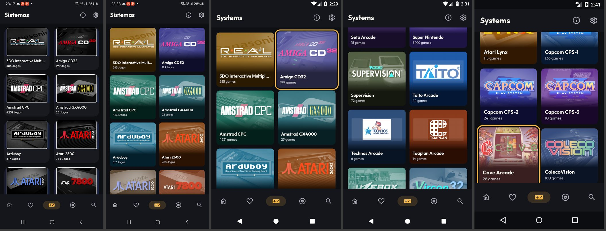
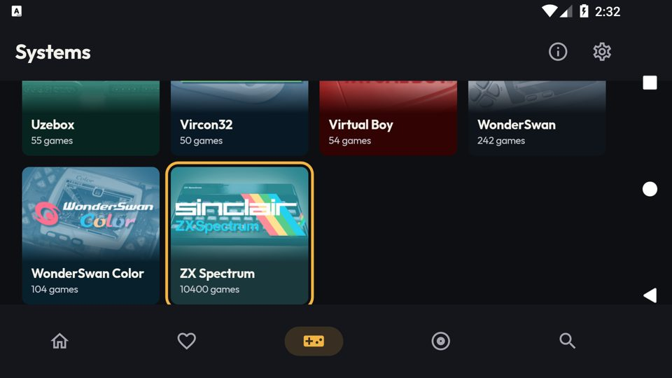

# [FEATURE] Redesenho visual — entrega 2.1: tela Sistemas

**Data:** 2026-10-13
**Branch:** version10
**Plano:** [`docs/backlogs/2026-10-13-redesenho-visual-inspirado-pegasus.md`](../backlogs/2026-10-13-redesenho-visual-inspirado-pegasus.md)
(o registro analítico e os números completos estão no "Andamento", entradas da entrega 2.1).

## O que é

A aba **Sistemas** da UI mobile passa a mostrar cada sistema como um bloco na cor dele:

- em cima, a arte do console sobre a cor do sistema (`SystemPalette`), em mistura *screen* e sem a moldura
  branca que vem embutida no PNG;
- embaixo, um rodapé no tom escuro da mesma cor, com o nome (negrito, 1 linha) e a contagem de jogos;
- a arte esmaece até o rodapé.

Nada mudou no comportamento: a lista é a mesma (`MetaSystemsViewModel`, com o filtro por RAM), o toque
navega para `systems/{id}`, e no foco por D-pad a arte troca pela versão de foco, agora com o contorno
âmbar do `focusHighlight`.

Da esquerda para a direita: antes (celular), depois (celular), foco por D-pad (Android 7.1), marcas de
arcade com arte fora do padrão (Android 7.1), foco no Android 5.0 de 1 GB.

## Arquivos

| Arquivo | Mudança |
|---|---|
| `mobile/shared/compose/ui/LemuroidSystemImage.kt` | Recebe `MetaSystemID`. Desenha cor + arte (*screen*) + esmaecimento opcional (`fadeTo`), na proporção 277:192 (`SYSTEM_ART_ASPECT`). Serve também para o carrossel de Sistemas da 2.3. |
| `mobile/shared/compose/ui/LemuroidSystemCard.kt` | Bloco novo no lugar do `ElevatedCard`. Assinatura igual. A contagem agora acompanha `system.count`. |
| `mobile/feature/systems/MetaSystemScreen.kt` | Margem, espaço e largura mínima da grade vêm de `LocalDimens` (144 dp; 208 dp na TV box). |
| `mobile/shared/compose/ui/GeneratedCover.kt` | `rememberSystemArt` passa a ser indexado pelo `resId` (antes, trocar o id não trocava a arte). `SystemArtCache` limitado por bytes: 6 MB, ou 3 MB em `LITE`. |

## A arte `game_system_*` não é uniforme

- 69 sistemas: 277×192 (foco: 333×230), com moldura branca de 3–4 px e canto arredondado. O corte de 2,2%
  da largura em cada lado remove a moldura; a arte então preenche a área.
- 10 sistemas fora do padrão: nove marcas de arcade em 479×221 (Data East, Galaxian, Kaneko, PGM, Psikyo,
  Seta, Taito, Technos, Toaplan) e o SC-3000 em 720×332. A proporção é 2,17, então a arte é encaixada
  inteira e centrada, a 90% da largura.
- A arte de foco não é a arte normal ampliada: o fundo muda por sistema.

## Validação

| Onde | O que foi feito | Resultado |
|---|---|---|
| Build | `assembleFreeBundleDebug -PdevAbi=x86_64` | OK |
| ktlint | `:lemuroid-app:ktlintMainSourceSetCheck` | Nenhum apontamento nos 4 arquivos. A task continua falhando por violações que já existiam em outros arquivos. |
| Lint | `:lemuroid-app:lintFreeBundleDebug --no-build-cache` | OK. Sem `--no-build-cache` a task caiu numa entrada corrompida do cache do Gradle (`:bundled-cores:lintAnalyzeDebugAndroidTest`, "invalid stored block lengths"), sem relação com o código. |
| `lemu_api25_2gb` (Android 7.1, `LITE`) | Toque num sistema, voltar, D-pad até um bloco e OK, rolagem até o fim, deitar e voltar | Tudo funciona; sem crash. Deitado: 4 colunas, a posição da rolagem é mantida. |
| `lemu_api21_1gb` (Android 5.0, `LITE`) | Abrir Sistemas, rolar, D-pad e OK | Funciona; a mistura *screen* aparece certa na API 21; sem crash. |
| SM-A127M (Android 13, `FULL`) | Abrir Sistemas e rolar | Funciona; sem crash. |

**Rolagem no `lemu_api25_2gb`** (16 gestos por rodada, `dumpsys gfxinfo`):

| Build | Quadros lentos (3 rodadas) | p90 | PSS |
|---|---|---|---|
| 1.17.24 (antes do redesenho) | 31,3% / 53,2% / 26,9% | 19–32 ms | 84–87 MB |
| 2.1 | 0,9% / 4,7% / 3,4% | 9–12 ms | 96–99 MB |

A melhora vem de a arte deixar de ser decodificada na thread principal e ampliada para a densidade da tela
(`painterResource`); agora é decodificada fora dela, no tamanho original, e fica em cache. A comparação de
PSS não é limpa: o processo da build antiga vinha do snapshot do AVD, e o da 2.1 foi aberto na hora.

## Pendências

- **Contorno de foco cortado embaixo.** Ao descer com o D-pad, a grade rola só até a borda do bloco, e os
  6 dp do contorno que ficam abaixo dele saem da área visível (três lados aparecem). Vale para qualquer
  lista que use `focusHighlight`; resolver na 2.2, antes de o catálogo adotá-lo.
- **Celular sem linha de base própria.** No SM-A127M a rolagem deu 60–90% de quadros lentos (p90
  109–150 ms), a mesma faixa que a Fase 1 mediu ali no catálogo do ZX Spectrum antes e depois. Não medi a
  tela Sistemas no celular antes de instalar a 2.1, então não há comparação direta.
- **Não testado:** TalkBack; o SC-3000 (não aparece em nenhum dos três aparelhos); TV box real (tamanho
  "deitado grande", 208 dp); `lemu_tv_api25` não se aplica, porque abre a UI Leanback.
