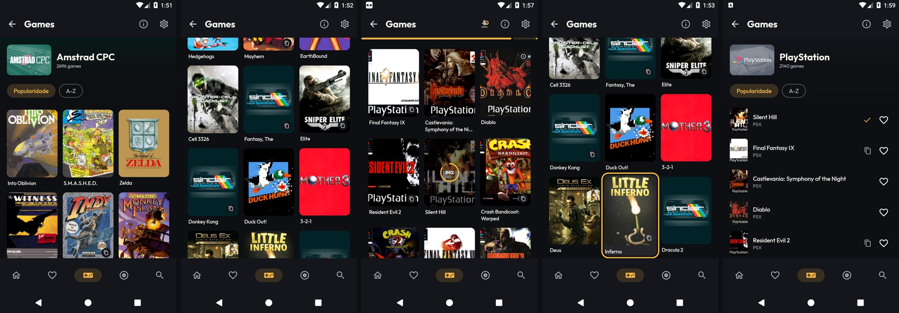
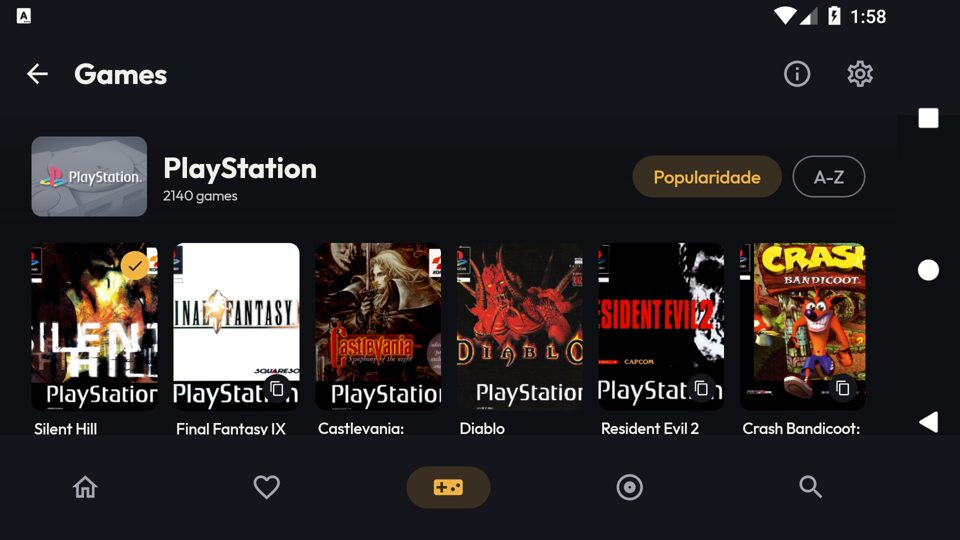

# [FEATURE] Redesenho visual — entrega 2.2: catálogo do sistema

**Data:** 2026-10-14
**Branch:** version10
**Plano:** [`docs/backlogs/2026-10-13-redesenho-visual-inspirado-pegasus.md`](../backlogs/2026-10-13-redesenho-visual-inspirado-pegasus.md)
(o registro analítico, as hipóteses descartadas e os números estão no "Andamento", entradas da entrega 2.2).

## O que é

O catálogo de um sistema (rota `systems/{id}`) ganha o visual da direção A:

- **Cabeçalho do sistema** (rola junto com a grade): fundo ambiente com a arte do sistema, o bloco do
  sistema da tela Sistemas, o nome, a contagem de jogos e os chips de ordenação (na mesma linha do nome
  quando o aparelho está deitado).
- **Cartão novo**: capa 3:4 com canto de 10 dp (8 deitado), título de até 2 linhas embaixo, à esquerda.
- **Estado de salvamento sobre a capa**: relógio (na fila), anel com a porcentagem e capa escurecida
  (salvando), pausa, "!" vermelho (erro), "✓" âmbar (salvo). Variantes ficam no canto inferior direito.
- **Capa gerada** sem título no cartão (o título já vem embaixo) e com a arte do sistema centrada e sem a
  moldura branca do PNG.
- **Grade adaptativa**: quantas colunas couberem com capa de no mínimo 96 dp (84 deitado, 120 na TV box),
  nunca menos de 3. Antes eram 3 fixas.
- **Lista** (preferência "Grid View for Catalogs" desligada): capa 3:4 pequena, título, sistema, ícone de
  variantes, estado de salvamento em linha e favorito. Foco por D-pad = fundo em pílula âmbar. A mesma
  linha é usada pela Busca.
- **Foco por D-pad**: o contorno âmbar agora pede à lista que role até ele, e não fica mais cortado na
  borda de baixo (pendência da 2.1, que vale também para a tela Sistemas).

Nada mudou no comportamento: as chaves `"id_$id"`/`"idx_$it"`, a volta ao topo no `ON_RESUME`, a
preferência grade/lista, a ordenação (salvos primeiro), o selo de variantes, o toque, o toque longo e o
fluxo de salvar são os de antes.

Da esquerda para a direita (`lemu_api25_2gb`, Android 7.1, `LITE`): Amstrad CPC com capas; ZX Spectrum com
capas geradas; PlayStation com Diablo na fila e Silent Hill salvando (84%); foco por D-pad na última linha
visível; modo lista com jogo salvo e variantes.

## Arquivos

| Arquivo | Mudança |
|---|---|
| `mobile/feature/games/GamesScreen.kt` | Cabeçalho (`GamesCatalogHeader`), grade `CatalogGridCells` (mínimo 3 colunas), parâmetros opcionais `metaSystem` e `saveQueueEntries`. |
| `mobile/feature/main/MainActivity.kt` | Rota `SYSTEM_GAMES` passa `metaSystem` e `saveQueueEntries` (como `State`). |
| `mobile/feature/main/SaveQueueViewModel.kt` | `entriesByKey`: as entradas da fila por `"$systemId/$fileName"` (= `Game.downloadKey`). Leitura aditiva; o `SaveQueueManager` não mudou. |
| `mobile/shared/compose/ui/LemuroidGameGridItem.kt` | Cartão novo; parâmetro opcional `saveState`. |
| `mobile/shared/compose/ui/LemuroidGameListRow.kt` | Linha nova; parâmetro opcional `saveState`. |
| `mobile/shared/compose/ui/SaveStateBadge.kt` | `rememberCoverSaveState` (lê a fila por chave com `derivedStateOf`) e `SaveStateIndicator` (versão em linha). |
| `mobile/shared/compose/ui/LemuroidGameImage.kt` | Parâmetros opcionais `generatedCoverTitle` e `compact` (decode em 160 px). |
| `mobile/shared/compose/ui/GeneratedCover.kt` | `showTitle`; arte desenhada por `drawSystemArt` (sem moldura) e centrada quando não há título. |
| `mobile/shared/compose/ui/LemuroidSystemImage.kt` | `drawSystemArt` passa a aceitar uma área (`internal`), para a capa gerada usar o mesmo corte. |
| `mobile/shared/compose/ui/effects/FocusHighlight.kt` | `BringIntoViewRequester` com o retângulo do contorno e da escala. |
| `mobile/shared/compose/ui/Dimens.kt` | `gridCoverMinWidth`. |

## Por que o progresso não recompõe a grade

O `progress` da fila muda várias vezes por segundo e o `Game` não é estável para o compilador do Compose
(vem de outro módulo). Por isso a `MainActivity` não lê o valor da fila: passa o `State` até o item, e cada
item lê só a própria entrada por `derivedStateOf`, com a porcentagem já arredondada para 1%. Só o cartão
cujo estado mudou recompõe.

## Verificação

- `assembleFreeBundleDebug -PdevAbi=x86_64` OK. ktlint e lint **não foram rodados** nesta entrega.
- `lemu_api25_2gb` (`LITE`): grade com capas e com capas geradas; variantes → modal; jogo não salvo →
  "Save ROM?" → fila → "Play now?"; os estados na fila, salvando (anel com %), pausado (pelo modal), salvo e
  cancelado (o selo some) aparecem no cartão; toque longo → menu de contexto; A-Z e Popularidade; lista;
  deitado (chips na linha do nome, 6 colunas em ~683 dp, estado mantido na rotação); D-pad até a última
  linha com o contorno inteiro. `logcat -b crash` vazio.
- **Rolagem** (ZX Spectrum, 3 rodadas de 16 gestos, mesmo roteiro da linha de base): **3,06% / 0% / 0%** de
  quadros lentos, p90 8–9 ms, PSS 128–129 MB. Base (Fase 1 + 2.1): 0% / 0,47% / 0%, p90 6–7 ms,
  PSS 127–129 MB. Dentro do critério (+5 pontos, +20 MB).

## Ajustes pedidos pelo dono (14/10/2026)

- **Contagem do cabeçalho = total com variantes**, a mesma da tela Sistemas (regra do dono: toda contagem de
  jogos mostra o total, nunca só os agrupados). Vem de `GamesViewModel.totalGames`, que soma
  `GameDao.selectSystemsWithCount()` (a query que já alimenta Sistemas no mobile e na TV) nos `systemIDs` do
  meta-sistema. Amstrad CPC: 2.696 (agrupados) → **4.231**, igual ao bloco. As outras contagens do app
  (Sistemas mobile e TV, aviso de DS na Home) já eram total.
- **"Popularidade" → "Popularity"** no padrão (`values/strings.xml`); o pt-BR ganhou a própria string.
- **Espanhol:** `values-es-rES` tinha 170 de 404 strings do app e 116 de 311 do `retrograde-app-shared`.
  Entraram as 224 + 24 de texto que faltavam (fila de salvamento, variantes, Jogos salvos, transferência,
  romset, atualização, idioma, travamento de core, opções de core…). Ficam no padrão só os que não se
  traduzem: nomes e siglas de sistema, proporções (4:3, 16:9…), "English"/"Português" e dimensões.
- **pt-BR:** faltavam 9 strings no app (`sort_*`, `variants_*`, `save_confirm_title`,
  `notification_rom_queue_*`) e 14 opções de core no `retrograde-app-shared`. Entraram.
- Verificado no `lemu_api25_2gb` em en-US, es-ES e pt-BR: cabeçalho, chips, "¿Guardar ROM?", "Descarga
  completada", fila, selo "Guardado", menu de contexto, aba Juegos guardados e Ajustes inteiros.

## Pendências

- Não testado: `lemu_api21_1gb`, SM-A127M, TV box ("deitado grande"), TalkBack, estado de erro no cartão.
- No foco, o `combinedClickable` ainda pinta a indicação padrão do Material (faixa cinza sob o título),
  além do contorno.
- ktlint e lint não rodados nesta entrega.
