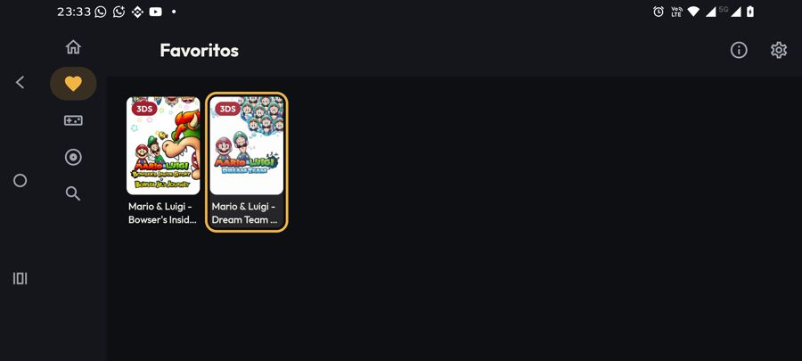
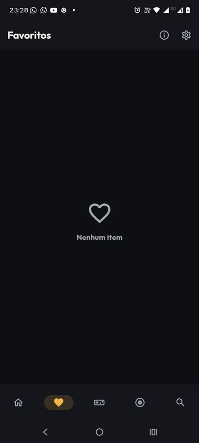
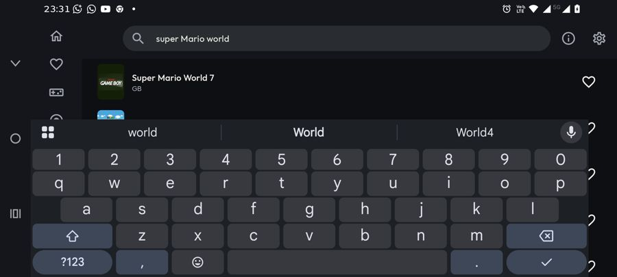
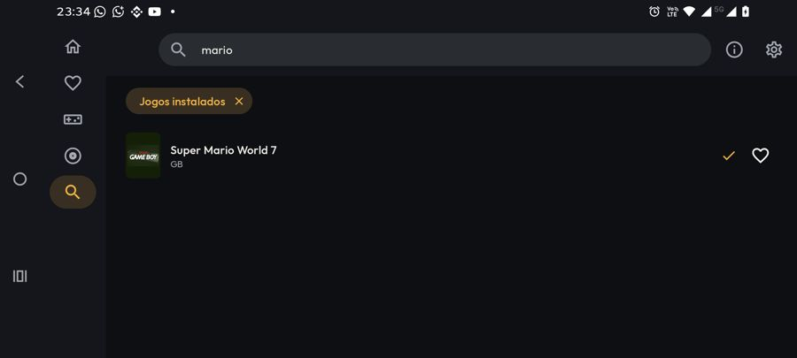
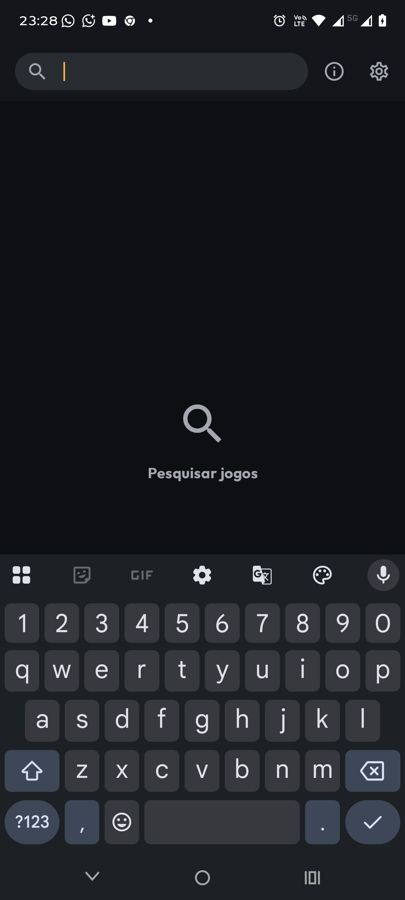
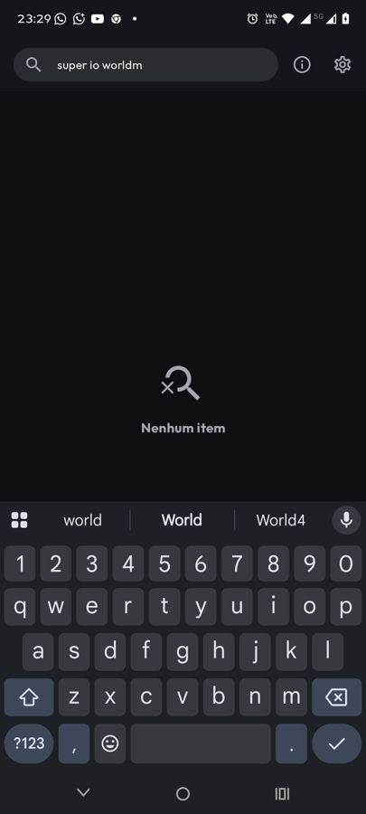

# [FEATURE] Redesenho visual — entrega 2.5: Favoritos e Busca

**Data:** 2026-10-14
**Branch:** version10
**Plano:** [`docs/backlogs/2026-10-13-redesenho-visual-inspirado-pegasus.md`](../backlogs/2026-10-13-redesenho-visual-inspirado-pegasus.md)
(o registro analítico e as hipóteses descartadas estão no "Andamento", entradas da entrega 2.5).

## O que é

Favoritos e Busca no visual da direção A. ViewModels, queries e roteamento não mudam: `FavoritesViewModel`,
`SearchViewModel` e o `onGameClick` próprio da Busca com "só salvos" (`MainActivity`) estão intocados.

- **Favoritos:** a grade do catálogo (`CoverGridCells` + `LemuroidGameGridItem`), no mínimo 3 colunas em pé e
  mais deitado. Como a lista mistura sistemas, o cartão leva o chip do sistema sobre a capa (como em Jogos
  salvos). O cartão mostra o estado de salvamento (fila, salvando com %, pausado, erro, salvo) e o selo de
  variantes.
- **Busca:** continua em lista (cruza sistemas e tem o favorito na linha). A linha da 2.2 agora recebe o estado
  de salvamento e o selo de variantes. Os chips de escopo (sistema, "Jogos instalados") ficam em pílula, com a
  margem do design system.
- **Estados vazios com ícone:** `LemuroidEmptyView` ganhou `icon` e ação opcionais, texto em cor de apoio.
  Favoritos vazio = coração; Busca inicial = lupa; sem resultado = lupa riscada; sem resultado com escopo de
  sistema = lupa riscada + botão em pílula "Buscar em todos os sistemas" (mesma ação de antes). Textos de antes;
  nenhuma string nova.

## Mudanças de comportamento (só de apresentação)

- **Selo de variantes em Favoritos e Busca.** Antes só o catálogo mostrava; o toque já abria o modal nas duas
  telas. `CLAUDE.md` ("Comportamentos Conhecidos") atualizado.
- **D-pad em Favoritos.** O cartão antigo (`LemuroidGameCard`) usava `bounceClick`, que não é focável: numa TV
  box os favoritos não eram alcançáveis. O cartão novo tem `focusHighlight` + `combinedClickable`.
- **Favoritos não pisca "Nenhum item" ao abrir.** O vazio só aparece com a primeira página carregada, como no
  catálogo.
- `LemuroidGameCard.kt` ficou sem chamador e foi apagado.

## Arquivos

| Arquivo | Mudança |
|---|---|
| `shared/compose/ui/LemuroidEmptyView.kt` | `icon`, `actionText`/`onActionClick` opcionais |
| `shared/compose/ui/LemuroidGameGridItem.kt` | `showSystemChip` opcional (padrão desligado: catálogo igual) |
| `shared/compose/ui/LemuroidGameCard.kt` | apagado |
| `feature/favorites/FavoritesScreen.kt` | grade nova; `titlesWithVariants` e `saveQueueEntries` opcionais |
| `feature/search/SearchScreen.kt` | chips, vazios, `titlesWithVariants` e `saveQueueEntries` opcionais |
| `feature/main/MainActivity.kt` | passa os dois parâmetros às rotas `FAVORITES` e `SEARCH` |

## Verificação

- `assembleFreeBundleDebug -PdevAbi=x86_64` OK; `ktlintMainSourceSetCheck` OK; `lintFreeBundleDebug` OK.
- **moto g86 5G** (Android 16, pt-BR, debug arm64 instalado limpo; único aparelho conectado):
  - Favoritos vazio (coração) → marcar 2 jogos pelo coração da Busca → Favoritos mostra os 2 com chip "3DS".
  - Deitado (o aparelho girou): trilho, grade, D-pad com contorno âmbar nos cartões de Favoritos.
  - Toque longo num favorito → menu de contexto (Continuar, Reiniciar, Remover dos favoritos, Fixar…).
  - Busca: inicial (lupa), sem resultado (lupa riscada), resultados com selo "Várias versões disponíveis";
    toque num jogo com variantes → modal "2 versões disponíveis"; toque em jogo não salvo (Super Mario World 7,
    GB) → "Salvar ROM?" → fila → "Jogar agora?" → a linha mostra "Salvo" (✓).
  - Jogos salvos → Buscar: chip "Jogos instalados" e só o jogo salvo, com ✓.
  - `logcat -b crash` sem ocorrência do app.
- **Não testado:** estados intermediários da fila na Busca/Favoritos (o download de GB terminou antes da
  captura; os mesmos componentes foram verificados no catálogo na 2.2), escopo de sistema com o botão de ação
  (vem do catálogo ▸ Buscar), AVDs `lemu_api21_1gb`/`lemu_api25_2gb`, TV box, TalkBack, medição de quadros
  (as duas telas usam as mesmas peças do catálogo, medido na 2.2).
