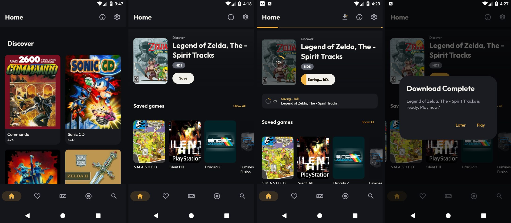
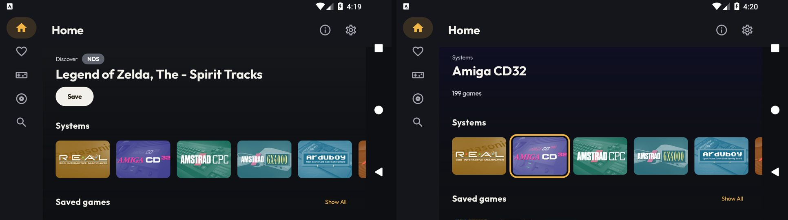

# [FEATURE] Redesenho visual — entrega 2.3: Início (Home) e moldura deitada

**Data:** 2026-10-14
**Branch:** version10
**Plano:** [`docs/backlogs/2026-10-13-redesenho-visual-inspirado-pegasus.md`](../backlogs/2026-10-13-redesenho-visual-inspirado-pegasus.md)
(o registro analítico, as hipóteses descartadas e os números estão no "Andamento", entradas da entrega 2.3).

## O que é

### Em pé

A grade de cartões grandes vira a vitrine da direção A, numa lista vertical:

1. **Avisos do topo** (varredura, permissões, DeSmuME, download do catálogo): os mesmos cartões de antes. Agora
   não deixam espaço vazio quando estão todos escondidos.
2. **Destaque**: o último jogo jogado (ou, sem recentes, o primeiro do Descubra) sobre o fundo ambiente da
   própria capa. Mostra a capa 3:4 com o estado de salvamento, o rótulo "Continue jogando"/"Descubra", o título,
   o chip do sistema na cor dele e o botão:
   - **Jogar** (âmbar): jogo salvo, ou ROM importada de uma pasta, que joga sem estar em `downloaded_roms`.
     O botão faz o mesmo teste de arquivo vazio do `MainActivity.isGamePlaceholder`, fora da main.
   - **Salvar** (claro): jogo ainda não salvo.
   - **Salvando… 42%**, com a barra de progresso dentro do botão, ou o estado da fila (aguardando, pausado, erro).

   O toque no botão ou na capa é o mesmo `onGameClick` de sempre; o toque longo na capa abre o menu de contexto.
3. **Faixa "Salvando agora"**: só aparece com fila ativa. Mostra o jogo em andamento (ou o próximo), o progresso
   e "+N" com o resto da fila. Toque abre o mesmo `SaveQueueModal` da barra superior.
4. **Fileiras** (`LazyRow`, capa 104×139 com título embaixo e estado de salvamento): **Jogos salvos** (com
   "Mostrar todos" → aba Jogos salvos), Recentes, Favoritos e Descubra. Favoritos continua, embora a especificação
   não a cite: tirar seria mudar função.

### Deitado (largura maior que a altura: celular deitado e TV box com a UI mobile)

- **Trilho lateral** no lugar da barra inferior, em toda rota que tem barra inferior: as mesmas 5 abas, com o
  indicador da fila no pé (anel com a porcentagem e o número de jogos restantes). O toque abre o modal da fila.
  A barra superior perde o ícone da fila, porque o trilho já o mostra.
- **A barra superior some ao rolar para baixo e volta ao rolar para cima** (`enterAlwaysScrollBehavior`), menos na
  Busca, onde mora o campo de texto. Toda tela abre com a barra visível.
- **Início = desenho da TV:** fundo ambiente na tela toda; no topo o rótulo + chip, o título e o botão; depois
  fileiras só de capas (72×96 no celular, 150×200 na TV box), na ordem Recentes, **Sistemas**, Jogos salvos,
  Favoritos e Descubra.
- **Carrossel de Sistemas:** a arte de cada sistema (101×70 / 208×144). A lista vem do mesmo
  `MetaSystemsViewModel` da aba Sistemas, com o mesmo filtro por RAM e a mesma contagem total. Ele só é criado
  deitado: em pé a Início não paga a query. O toque navega para `systems/{id}`, e o voltar retorna à Início.
- **D-pad:** o topo acompanha o foco na hora. Num jogo, mostra o título, o chip e o botão, com o rótulo da
  fileira. Num sistema, mostra o nome e a contagem. O fundo troca depois de 300 ms parado no item.

Da esquerda para a direita (`lemu_api25_2gb`, Android 7.1, `LITE`): antes; depois; Zelda salvando (anel na capa,
botão "Saving… 16%", faixa); salvo (✓, botão Play) com o "Play now?" de sempre.

Deitado: trilho, cabeçalho e carrossel; foco do D-pad num sistema (Amiga CD32, 199 jogos) leva o nome ao topo.

## O que não mudou

- **Roteamento:** `onGameClick`, `onGameLongClick`, os diálogos de salvar/variantes/"Jogar agora?" e o menu de
  contexto. O toque da aba Jogos salvos virou um `val onInstalledGameClick` no `MainActivity`, com o mesmo corpo,
  usado pela aba e pela fileira da Início: mídia inacessível avisa, mais de uma versão salva abre o seletor só das
  salvas, uma versão joga ou salva.
- **`HomeViewModel`:** recentes, favoritos, descubra, avisos e prompt de download como antes. Ganhou só o fluxo
  `savedGames`, uma leitura aditiva com a mesma query (`observeInstalledGameGroups`) e o mesmo `isAvailable` da aba.
  Ele é frio e começa a ser coletado só depois do primeiro quadro. O `InstalledGamesViewModel` não é usado na
  Início, porque o `init` dele varre a pasta de ROMs.
- **`HomeScreen`:** os parâmetros de antes. Os novos são todos opcionais (`saveQueueEntries`, `metaSystems`,
  `onSystemClick`, `onSavedGameClick`, `onShowAllSavedGames`, `onOpenSaveQueue`).
- Banco, DAO, manifest, dependências: nada.

## Arquivos

| Arquivo | Mudança |
|---|---|
| `M/feature/home/HomeLayouts.kt` (novo) | `HomePortrait`, `HomeLandscape`, destaque, botão, faixa, fileiras, carrossel |
| `M/feature/home/HomeScreen.kt` | Parâmetros opcionais; coleta de `savedGames` após o 1º quadro; avisos sem espaço morto; troca da grade pelos layouts |
| `M/feature/home/HomeViewModel.kt` | `savedGames`; `Factory` recebe `DirectoriesManager` |
| `M/feature/main/MainActivity.kt` | `Row { trilho; Scaffold }` deitado, `scrollBehavior`, insets; parâmetros da Início; `onInstalledGameClick` |
| `M/feature/main/MainNavigationBar.kt` | `navigateToTab` comum; `MainNavigationRail` (itens de 48 dp, abas roláveis, fila no pé) |
| `M/feature/main/MainTopBar.kt` | `scrollBehavior` e `showSaveQueueAction` opcionais |
| `M/feature/main/SaveQueueViewModel.kt` | `activeCount` |
| `M/shared/compose/ui/Dimens.kt` | Comentários: os tamanhos de fileira/carrossel deixaram de ser provisórios |
| `res/values*/strings.xml` | `home_hero_continue` (en, pt-BR, es-ES) |

## Verificação

- `assembleFreeBundleDebug -PdevAbi=x86_64` OK; `lintFreeBundleDebug` **BUILD SUCCESSFUL**. A primeira rodada
  acusou `ProduceStateDoesNotAssignValue` no botão do destaque; o `produceState` virou `remember` +
  `LaunchedEffect`.
- `ktlintMainSourceSetCheck`: nenhum apontamento em `HomeLayouts`, `MainNavigationBar`, `MainTopBar`, `Dimens`
  nem nas linhas novas dos outros arquivos. A task segue falhando pelo passivo: envolver o `Scaffold` num `Row`
  reindentou ~350 linhas do `MainActivity`, e as violações antigas delas (linhas > 120, `multiline-expression-
  wrapping`) aparecem em outra linha do relatório.
- `lemu_api25_2gb` (`LITE`), em pé: destaque e Jogos salvos aparecem. Salvar pelo botão do destaque leva à mesma
  confirmação; depois o anel aparece na capa, o botão mostra "Saving… 16%" e a faixa aparece. Ao terminar: ✓,
  botão "Play" e "Play now?". `logcat -b crash` vazio.
- Deitado: trilho com as 5 abas; barra superior some ao rolar; D-pad entra e sai do trilho, o contorno aparece
  inteiro, o topo segue o foco (jogo e sistema) e o fundo troca; OK num sistema abre o catálogo (5 colunas, trilho
  marcando Sistemas), e o voltar retorna à Início.
- **Desempenho: sem regressão** (A/B intercalado num aparelho real, 14/10). moto g86 5G (Android 16, 120 Hz),
  debug arm64 por `install -r`; APK da base compilado do `06c7911` num `git worktree`. Ordem: depois → antes →
  depois → antes, 30 s de aquecimento após cada instalação. Cada medição: `force-stop`, abre, 3 rodadas de
  [6 gestos para cima + 6 para baixo] com `gfxinfo reset` entre elas.

  | Tela | Lado | Quadros lentos | p50 | p90 | p99 | PSS |
  |------|------|----------------|-----|-----|-----|-----|
  | Início | antes (2 × 3) | 0–0,08% | 6 ms | 12–14 ms | 22–23 (1ª rodada 44–48) | 214–216 MB |
  | Início | depois (2 × 3) | 0–0,18% | 5 ms | 11–13 ms | 21–22 (1ª rodada 30–40) | 207–217 MB |
  | Sistemas (controle) | antes | 0–0,07% | 6–8 ms | 12–15 ms | 17–23 ms | 292–307 MB |
  | Sistemas (controle) | depois | 0–0,07% | 6–8 ms | 11–14 ms | 15–23 ms | 299–319 MB |

  O controle bate entre os lados, então a medição vale. A Início nova renderiza ~1.140 quadros por rodada, contra
  ~1.300 da antiga: ela é mais curta (fileiras horizontais) e os gestos chegam ao fim da lista. O pico da primeira
  rodada é a composição inicial das fileiras e caiu. A medição anterior no emulador (42–90% de quadros lentos)
  ficou descartada: o controle também dava 54–81%, com outro emulador (`pp_api34`) disputando a CPU do host.
  **Limite:** o g86 é bem mais forte que as TV box do público-alvo. Esta medição prova que não houve regressão,
  mas não diz como fica num aparelho fraco.
- `lemu_api21_1gb` (Android 5.0, tier `ULTRA_WEAK`), x86_64 com `-PdevAbi`: a Início abre (TotalTime 1,1 s
  a frio) com destaque ("Discover" + "Save"), Jogos salvos e Descubra, e rola. Desde a instalação, nenhum
  `FATAL EXCEPTION` no logcat. Os `NoSuchMethodError` do padkit que aparecem no buffer são de 05/10, de antes da
  correção. Observação: a fileira Jogos salvos mostra um jogo de PSP, sistema escondido nesse tier. É o mesmo
  comportamento da aba (mesma query, sem `HeavySystemFilter`), não uma regressão. **Decisão do dono
  (14/10/2026): fica assim.** Jogos salvos mostram tudo o que está salvo, em qualquer tier.
- **Não testados:** SM-A127M, TV box (tamanho "deitado grande"), TalkBack, pausar/retomar/erro pela faixa.

## Limitações conhecidas

- Deitado, a `TopAppBar` ainda aplica o recuo esquerdo da barra de sistema. Com a barra de navegação (ou o
  recorte) à esquerda, ela ganha um recuo a mais ao lado do trilho. O visual das barras é da entrega 2.6.
- Depois de voltar do catálogo, o foco do D-pad volta ao trilho, não ao bloco do sistema.
- O cabeçalho deitado repete "Systems" (rótulo do item focado e título da fileira).
