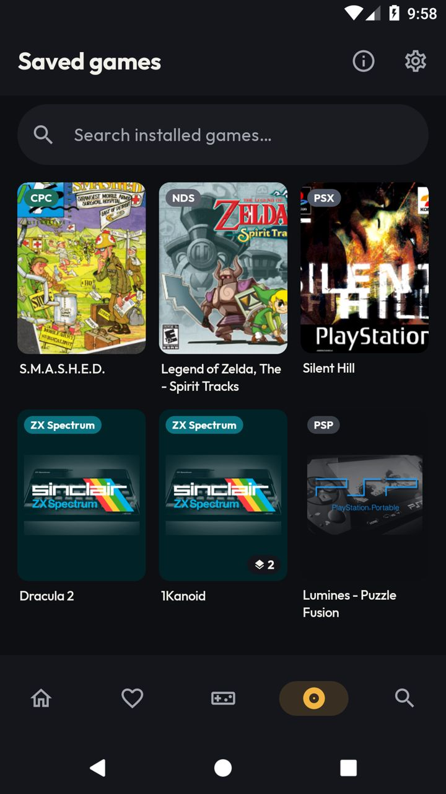
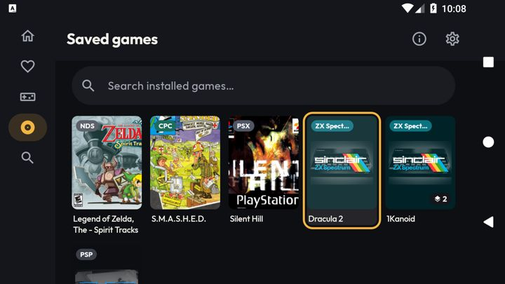

# [FEATURE] Redesenho visual — entrega 2.4: Jogos salvos

**Data:** 2026-10-14
**Branch:** version10
**Plano:** [`docs/backlogs/2026-10-13-redesenho-visual-inspirado-pegasus.md`](../backlogs/2026-10-13-redesenho-visual-inspirado-pegasus.md)
(o registro analítico e as hipóteses descartadas estão no "Andamento", entradas da entrega 2.4).
**Requisitos da aba:** [`docs/backlogs/2026-10-08-aba-jogos-instalados-salvos.md`](../backlogs/2026-10-08-aba-jogos-instalados-salvos.md) (R1–R9).

## O que é

A aba Jogos salvos ganha o visual de biblioteca da direção A. Dados, ordem, busca e regras de toque são os de
antes: o `InstalledGamesViewModel`, as queries do `GameDao` e o `onInstalledGameClick` da `MainActivity` não
foram tocados.

- **Busca:** campo em pílula na cor de superfície, sem contorno. Fica âmbar quando focado (digitando ou pelo
  D-pad). Mesma busca instantânea por título, nome de arquivo ou nome de sistema, e o mesmo "x" para limpar.
- **Grade:** a mesma do catálogo (`CoverGridCells`). No mínimo 3 colunas em pé, mais deitado (5 no AVD de
  ~683 dp ao lado do trilho), com as margens e o espaço de `LocalDimens`.
- **Cartão:** capa 3:4 com o canto do design system, título embaixo em 2 linhas e contorno âmbar no foco.
  Sobre a capa:
  - chip do sistema na cor dele (topo esquerdo, versão compacta);
  - aviso de mídia inacessível em vermelho (topo direito), com a capa a 60% (R4);
  - pílula com o número de versões salvas quando há mais de uma (inferior direito).

  Não tem selo de "salvo": todo jogo aqui está salvo.
- **D-pad:** um campo de texto de linha única consome as setas para mover o cursor, então a grade não era
  alcançável depois de passar pelo campo. Agora "para baixo" e "para cima" sempre saem do campo, e "para a
  esquerda" sai quando o campo está vazio (vai para o trilho, deitado).

### Peças compartilhadas (novas)

| Arquivo | O que é | Quem usa |
|---|---|---|
| `shared/compose/ui/CoverGridCells.kt` | A grade de no mínimo 3 colunas, que era privada do `GamesScreen` (`CatalogGridCells`). Conta sem mudança. | Catálogo, Jogos salvos |
| `shared/compose/ui/SystemChip.kt` | Chip do sistema, que era privado da Início, com variante `compact`. | Destaque da Início, cartão de Jogos salvos |
| `feature/installed/SavedGameBadges.kt` | Selos de mídia inacessível e de versões, mais `SAVED_GAME_UNAVAILABLE_ALPHA`. | Fileira Jogos salvos da Início, cartão da aba |

## Verificação

`assembleFreeBundleDebug -PdevAbi=x86_64` OK; `lintFreeBundleDebug` **BUILD SUCCESSFUL**. `ktlintMainSourceSetCheck`:
zero apontamentos nos arquivos desta entrega. Os 9 antigos do `GamesScreen`, que se deslocaram de linha e saíram do
baseline, foram corrigidos. A task ainda falhava por outros 12 arquivos (191 apontamentos: `HomeViewModel`
50, `RomOnDemandManager` 46, `MainActivity` 31, `HomeScreen` 24…). Foram corrigidos no commit seguinte
(`ktlintMainSourceSetFormat` restrito a esses 12, mais 6 à mão: 5 linhas > 120 e `_pausedFlow` → `_isPaused`).
**Desde então, `:lemuroid-app:ktlintMainSourceSetCheck` passa sem mexer no baseline.**

Roteiro no `lemu_api25_2gb` (instância própria, `emulator-5556`),
com 5 jogos salvos e uma segunda variante colocada à mão na pasta gerenciada (dois `.tap` do 1Kanoid). A
reconciliação da aba (R5) registrou os dois arquivos.

| Item | Resultado |
|---|---|
| Grade em pé | 3 colunas, chip do sistema em todas as capas, selo "2" no 1Kanoid |
| Busca por sistema | "zx" → Dracula 2 e 1Kanoid, com o selo "2" mantido. "spectrum" não casa: o resolvedor compara pelo começo do nome (`SystemSearchResolver`, sem mudança) |
| Busca por título | "zelda" → Spirit Tracks |
| Ordem por última ação | jogar o Zelda o levou ao topo da grade |
| Toque, 1 versão | joga direto (Zelda, Dracula 2) |
| Toque, 2 versões | seletor só com as 2 versões salvas |
| Toque longo | menu de contexto (Resume, Restart, favoritos, apagar ROM, remover do catálogo) |
| Deitado | 5 colunas ao lado do trilho; chip truncado com "…" ("ZX Spect…") |
| D-pad | trilho → campo → grade → direita; contorno âmbar inteiro no cartão |
| Modo avião (`airplane_mode_on` + broadcast como root; Wi-Fi desligado, nenhuma rede ativa) | a aba abre a frio com todas as capas e o Dracula 2 roda |
| Jogos salvos → Busca | chip "Installed games ×" (escopo restrito, R8/R9) |
| Início | fileira Jogos salvos e destaque iguais à 2.3 depois da troca para as peças compartilhadas |
| `logcat -b crash` | nada do app. A única entrada é do `svc wifi disable` do próprio roteiro (sem permissão no `shell`) |

O resto da matriz da seção 8 (limpeza segura, realinhamento, concorrência, desduplicação) é camada de dados, que
esta entrega não tocou.

**Não testados:** mídia inacessível de verdade (o AVD não tem SD; o selo é o mesmo componente da fileira da
Início), TalkBack, SM-A127M, TV box.

## Limitações conhecidas

- No seletor de versões, a versão salva leva o ícone `Download` (seta para baixo). O código está certo: o ícone
  só aparece com `isDownloaded` e a descrição é `rom_download_badge_downloaded`. Mas a seta parece "baixar", não
  "salvo". O `GameVariantsModal` não é desta entrega; candidato a trocar pelo selo ✓ do design system quando as
  folhas forem redesenhadas.
- O foco pelo D-pad no campo de busca abre o teclado na tela. É o comportamento padrão do Android para campo de
  texto, e já acontecia antes.
- No foco, o `combinedClickable` ainda pinta a indicação padrão do Material além do contorno (a mesma pendência do
  catálogo, 2.2).
- A tela mostra o vazio ("nenhum jogo") por um instante antes dos dados chegarem (`initialValue = emptyList()` no
  ViewModel, como antes).
- **Dado de teste no AVD:** dois `1Kanoid (…).tap` em `roms/zxspectrum` do `lemu_api25_2gb` (cópias do
  Dracula 2) e as linhas deles em `downloaded_roms`. Servem de fixture para "2 versões salvas".
