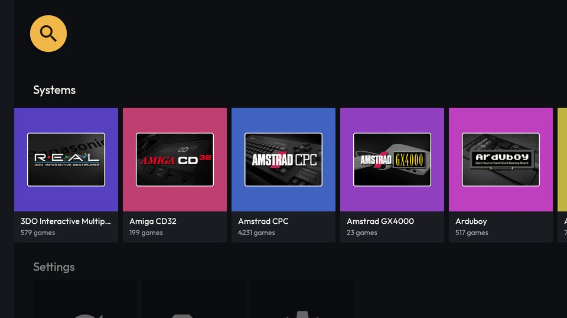
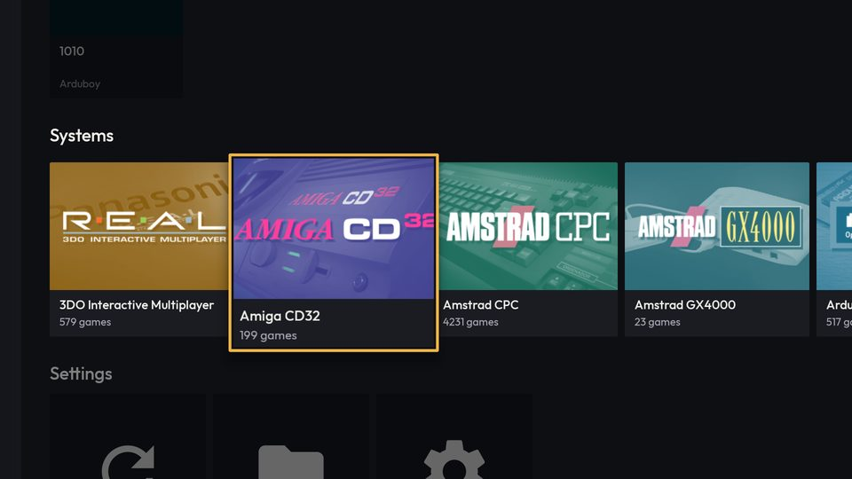
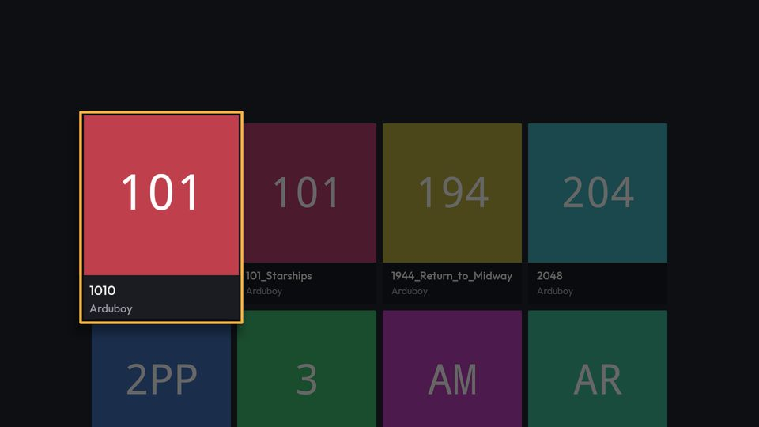
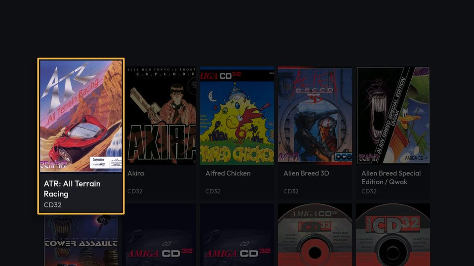
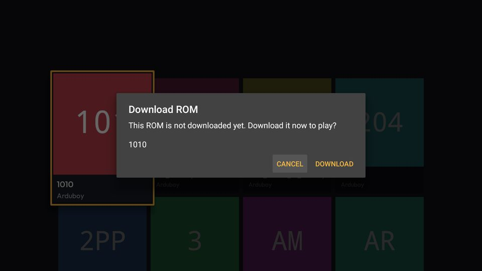
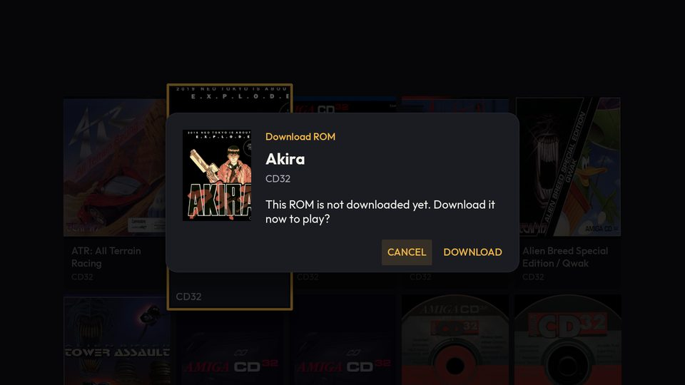

# [FEATURE] Redesenho visual — entrega 3.2: cartões e diálogo de salvar da TV

**Data:** 2026-10-15
**Status:** implementada e verificada no `lemu_tv_api25` (Android 7.1), **sem commit**
**Branch:** version10
**Plano:** [`docs/backlogs/2026-10-13-redesenho-visual-inspirado-pegasus.md`](../backlogs/2026-10-13-redesenho-visual-inspirado-pegasus.md), Fase 3, item 3.2

## O que mudou

A UI Leanback (TV) passa a ter os cartões e o diálogo de salvar da direção A. Fluxos, toques, menu de contexto e
dados não mudam.

| Onde | Antes | Depois |
|---|---|---|
| Cartão de jogo | quadrado de 176 dp, título em 1 linha | capa 3:4 de 150×200 dp, título em 2 linhas fixas |
| Jogo sem capa (ou capa que falhou) | iniciais em cor aleatória (`TextDrawable`) | capa gerada: tom escuro da cor do sistema + arte do console em *screen* |
| Capa carregando | vazio | tom escuro da cor do sistema |
| Cartão de sistema | quadrado de 176 dp, arte com moldura branca sobre `MetaSystemID.color()` | bloco 208×144 dp, arte sem moldura em *screen* sobre a cor da `SystemPalette` |
| Grades (catálogo, favoritos) | 4 colunas | 5 colunas |
| "Ver todos" na fileira Favoritos | quadrado de 176 dp | tamanho do cartão de jogo (a fileira mantém uma altura) |
| Diálogo de salvar | `AlertDialog` cinza, título + mensagem + nome do jogo | superfície `#1A1C22` com cantos de 16 dp, capa, rótulo âmbar, título do jogo em Outfit, sistema, mensagem; botões âmbar com foco em âmbar translúcido; progresso âmbar |

### Arquivos

- `TV/shared/TVCovers.kt` (novo) — `TVCovers.loadCover` (sem URL = capa gerada; com URL = Coil com o tom do sistema
  enquanto carrega e a capa gerada no `onError`), `generatedCover`, `systemCard`, e `SystemArtDrawable` (mesmo
  desenho de `LemuroidSystemImage.drawSystemArt`: recorte de 2,2% da moldura, preenche a área ou ajusta a arte
  larga inteira, `PorterDuff.Mode.SCREEN`).
- `M/shared/compose/ui/GeneratedCover.kt` — `SystemArtCache` passou de `private` a `internal`: a TV usa o mesmo cache.
- `TV/shared/GamePresenter.kt` — sem parâmetro de tamanho; dimensões, `CENTER_CROP` e 2 linhas de título no
  `onCreateViewHolder`; capa por `TVCovers.loadCover`.
- `TV/home/SystemPresenter.kt` — sem parâmetros; `TVCovers.systemCard` no bind e na troca de arte no foco.
- `TV/home/SettingPresenter.kt` — largura e altura separadas.
- `TV/shared/TVGridPresenters.kt` — `TV_GAME_GRID_COLUMNS = 5`, usado por `TVGamesFragment` e `TVFavoritesFragment`.
- `TVHomeFragment`, `TVSearchFragment` — chamadores atualizados.
- `TV/game/TVRomDownloadDialog.kt` — corpo comum (`res/layout/tv_rom_download_dialog.xml`) nos três diálogos;
  tema `LemuroidTVDialog`; Outfit no corpo e nos botões. Botões, handlers, `setCancelable(false)` do progresso e a
  guarda do diálogo de erro iguais.
- `res/values/dimens.xml` (`tv_game_card_*`, `tv_system_card_*`, `tv_dialog_cover_*`),
  `res/values/leanback-colors.xml` (`leanback_border`, `leanback_accent_focus`), `res/values/leanback-themes.xml`
  (`LemuroidTVDialog`), `res/drawable/tv_dialog_background.xml`.

### Decisões

- **Capa gerada sem título.** O título já está embaixo do cartão (`infoVisibility=always`); a arte fica centrada,
  como no cartão do catálogo do celular.
- **Título em 2 linhas por código, só no cartão de jogo.** Pelo tema valeria para todo `ImageCardView`. Linhas
  fixas (não só máximo) para os cartões de uma linha da grade terminarem na mesma altura.
- **5 colunas.** A tela de TV tem 960×540 dp; 5 cartões de 150 dp ocupam ~780 dp, 6 não cabem com o zoom do foco.
- **Imagem visível explicitamente no bind.** O `ImageCardView` deixa o `mainImageView` `INVISIBLE` quando é criado
  sem drawable e depois de `mainImage = null` (unbind) — conferido no bytecode do Leanback 1.1.0-rc01 — e o Coil
  põe o drawable direto no `ImageView`.
- **Tema do diálogo pelo id no `AlertDialog.Builder(activity, R.style.LemuroidTVDialog)`.** Com
  `Builder(ContextThemeWrapper)` o diálogo saiu cinza e sem cantos: o construtor resolve o
  `?android:alertDialogTheme` do contexto (o do Leanback), não o tema do wrapper. O wrapper fica só para inflar o
  corpo.
- **O tema não virou `alertDialogTheme` da Activity.** Mudaria também o `TVAppUpdateDialog`, fora desta entrega.

## Capturas (`lemu_tv_api25`, build debug x86)

| Antes | Depois |
|---|---|
|  |  |
|  |  |
|  |  |

Também: [Início](img/2026-10-15-redesenho-cartoes-tv-depois-inicio.jpg),
[capa gerada com foco](img/2026-10-15-redesenho-cartoes-tv-depois-capa-gerada.jpg),
[progresso](img/2026-10-15-redesenho-cartoes-tv-depois-dialogo-progresso.jpg),
[busca](img/2026-10-15-redesenho-cartoes-tv-depois-busca.jpg).

## Verificação

- `./gradlew :lemuroid-app:assembleFreeBundleDebug -PdevAbi=x86`, `:lemuroid-app:ktlintMainSourceSetCheck` e
  `:lemuroid-app:lintFreeBundleDebug`: OK (o ktlint acusou 4 imports nos fragments de grade, corrigidos).
- `lemu_tv_api25`, só D-pad:
  - Início: Recentes com a capa gerada (Arduboy), Sistemas com a cor da paleta e a arte de foco trocando, foco âmbar;
  - catálogo da Amiga CD32: 5 colunas, capas 3:4, títulos longos em 2 linhas, capas geradas na segunda linha;
  - busca ("akira"): cartões novos na fileira de resultados;
  - jogo não salvo → confirmação → progresso → **Cancelar**: volta ao catálogo, sem diálogo de erro;
  - jogo salvo (Recentes) → abre o jogo direto;
  - `logcat -b crash` vazio.

**Não verificado:**
- diálogo de erro (exige falha de rede ou ROM ausente no servidor; o código só troca o corpo);
- "Download → Jogar" ponta a ponta com o diálogo novo (o jogo baixado nesta sessão, Arduboy, foi salvo pelo
  diálogo antigo, durante a captura do "antes");
- Favoritos (o AVD não tem favoritos), menu de contexto (o `adb` não reproduz o toque longo neste AVD; código não
  tocado), TV box real;
- captura "antes" do diálogo de progresso (o download do Arduboy terminou antes).

## Pendências

- O foco do botão do diálogo é âmbar a 25%: visível no AVD, conferir numa TV box real.
- `systems_card_padding` (`retrograde-app-shared`) ficou sem uso na TV; não foi apagado (o lint não acusou).
