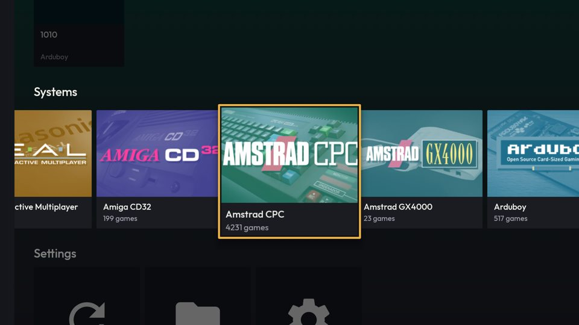
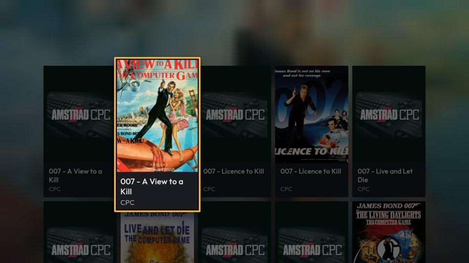
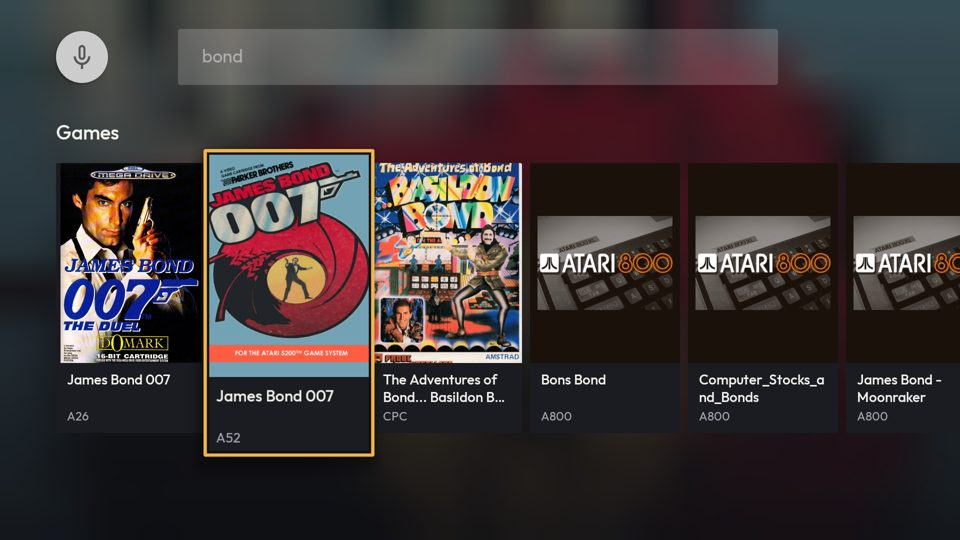
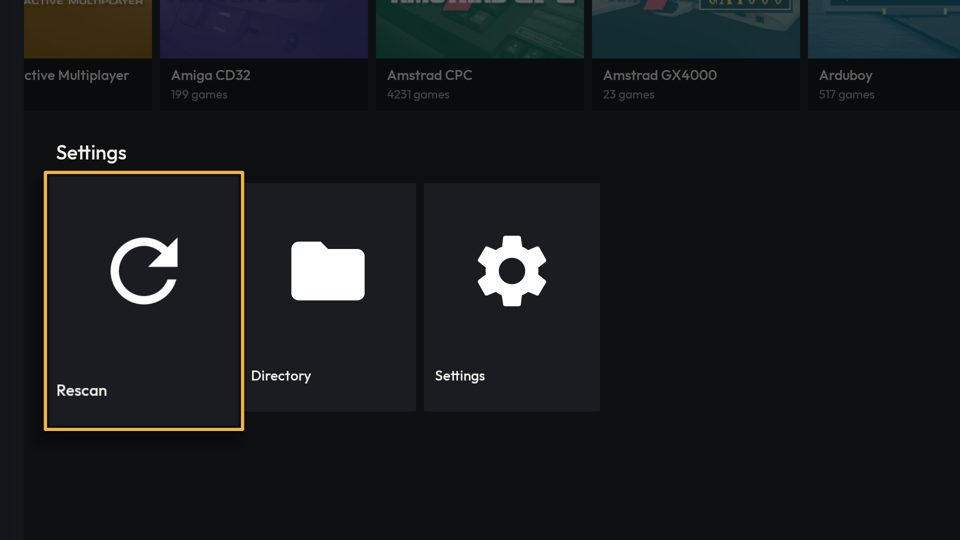
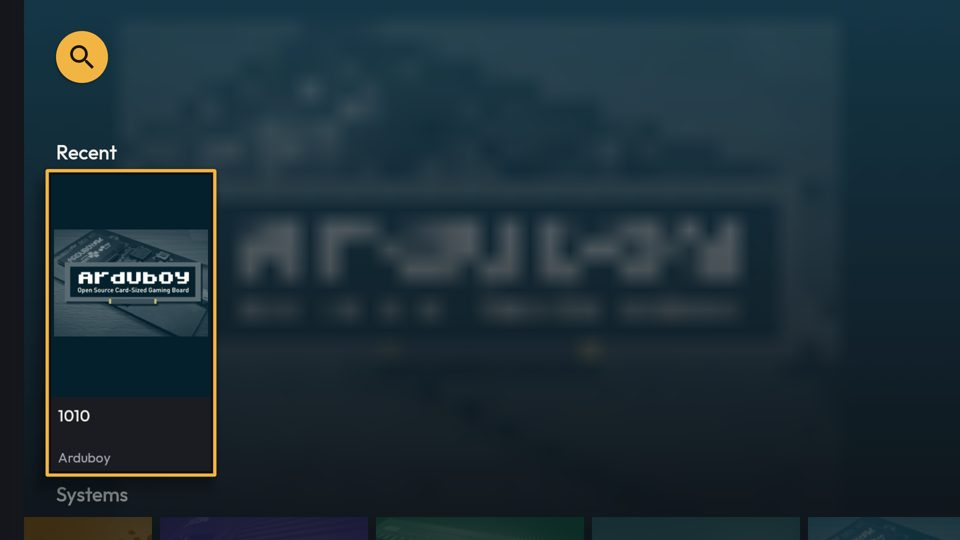

# [FEATURE] Redesenho visual — entrega 3.3: fundo ambiente da TV

**Data:** 2026-10-15
**Status:** implementada e verificada no `lemu_tv_api25` (Android 7.1); commit `2dc9412`
**Branch:** version10
**Plano:** [`docs/backlogs/2026-10-13-redesenho-visual-inspirado-pegasus.md`](../backlogs/2026-10-13-redesenho-visual-inspirado-pegasus.md), Fase 3, item 3.3

## O que mudou

Na UI Leanback (TV), o fundo atrás das fileiras e grades mostra o item em foco, desfocado, com degradê para o fundo
da página. Fluxos, toques, foco e dados não mudam.

| Item em foco | `FULL` | `LITE` |
|---|---|---|
| Jogo com capa | capa (decodificada a 32 px) recortada ao centro, alpha 0,6 | degradê do tom escuro da cor do sistema |
| Jogo sem capa (ou capa que falhou) | arte do console (`SystemArtDrawable`, sem a moldura) sobre a cor do sistema | idem |
| Sistema | arte do console sobre a cor do sistema | idem |
| Ajuste ("Rescan", "Ver todos"…) | fundo neutro (`leanback_background`) | idem |
| Placeholder do paging (`null`) | mantém o fundo atual | idem |

- **Início:** segue o foco nas fileiras Favoritos, Recentes, Sistemas e Ajustes. Ao voltar de outra tela, o Leanback
  refaz a seleção e o fundo volta ao item focado.
- **Catálogo:** começa com a arte do sistema; depois segue o jogo em foco.
- **Favoritos:** segue o jogo em foco.
- **Busca:** começa neutra (campo de texto legível); depois segue o resultado em foco.
- O fundo só troca depois de **300 ms** parado no item, e o `BackgroundManager` ainda faz fade de 500 ms (e no máximo
  uma troca a cada 500 ms). Rolar uma fileira não decodifica capa por capa.
- O painel de cabeçalhos (lateral esquerda da Início) continua opaco.

### Como o "desfoque" é feito

`Modifier.blur`/`RenderEffect` só existem no Android 12+. O fundo é composto num bitmap de **48×27** (fundo da página,
arte com alpha 0,6, degradê de proteção 0,3 → 0,6 → 0,9 de cima para baixo) e entregue ao `BackgroundManager` como
`BitmapDrawable`, que o amplia com filtro bilinear até a tela. A proteção é mais leve que a do celular (0,35 → 0,8 → 1)
porque na TV as fileiras cobrem quase toda a tela.

### Arquivos

- `TV/shared/TVAmbientBackground.kt` (novo) — `attach(fragment)` liga o `BackgroundManager` da Activity uma vez
  (`isAttached`) com `isAutoReleaseOnStop = false`; `onItemSelected(item)`, `showSystem(metaSystem)`, `showNeutral()`.
  Espera de 300 ms no `viewLifecycleOwner.lifecycleScope` (cancelada a cada nova seleção e ao destruir a view); alvo
  igual ao atual não repinta. Capa pelo `imageLoader` do app com `size(32)` e `allowHardware(false)`.
- `TV/shared/TVCovers.kt` — `systemArt` passou de `private` a `internal`.
- `TV/home/TVHomeFragment.kt`, `TV/games/TVGamesFragment.kt`, `TV/favorites/TVFavoritesFragment.kt`,
  `TV/search/TVSearchFragment.kt` — `TVAmbientBackground.attach(this)` + `setOnItemViewSelectedListener`.

## Decisões e armadilhas (bytecode do Leanback 1.1.0-rc01)

- **Tem de ser `BitmapDrawable`.** Uma Activity recriada recupera o último fundo pelo `BackgroundContinuityService`,
  via `drawable.getConstantState().newDrawable()`. Um `Drawable` próprio sem `ConstantState` daria NPE ali.
- **`isAutoReleaseOnStop = false`.** Com o padrão, o `onStop` (abrir o jogo, apertar Home) solta o drawable e o
  `onStart` **não** o recupera — só o `attach` lê o serviço. Medido: ao voltar, o fundo estava neutro com o foco no
  Amstrad CPC. O bitmap tem ~5 KB; não há o que liberar.
- **`allowHardware(false)`.** Bitmap de hardware não desenha no `Canvas` de software do bitmap pequeno.
- **Sem `runCatching` em volta do `execute` do Coil.** Falha vem como `ErrorResult`; a única exceção é o
  cancelamento, e engoli-la faria a corrotina cancelada aplicar um fundo velho.
- **Arte do sistema pelo `SystemArtDrawable`, não pelo Coil.** A 32 px a moldura branca do PNG viraria uma faixa clara
  nas bordas da tela.
- **`attach` duas vezes lança `IllegalStateException`** — por isso o guard por `isAttached` (cada fragment chama).

## Verificação

- `./gradlew :lemuroid-app:assembleFreeBundleDebug -PdevAbi=x86`, `ktlintMainSourceSetCheck` e
  `lintFreeBundleDebug`: ver "Andamento" do plano.
- `lemu_tv_api25` (Android 7.1, 2 GB → tier `WEAK` → **`LITE`**): Início com o degradê do sistema em foco; troca entre
  sistemas; Ajustes neutros.
- **`FULL`** num build temporário com `quality = VisualQuality.FULL` forçado (o AVD de 2 GB é `LITE`; revertido e
  conferido por `grep` antes do build final): Início (sistema), catálogo do Amstrad CPC (capa do jogo em foco), voltar
  ao Início (fundo do item focado de novo), Ajustes (neutro), busca "bond" (capa do resultado em foco), Home + reabrir
  (fundo mantido), jogar "1010" (Arduboy) e voltar (fundo mantido, sem crash).
- `logcat -b crash` vazio.

| | |
|---|---|
| `LITE`, Início, sistema em foco |  |
| `FULL`, Início, sistema em foco |  |
| `FULL`, catálogo, capa em foco |  |
| `FULL`, busca |  |
| `FULL`, Ajustes (neutro) |  |
| `FULL`, de volta do jogo |  |

**Não verificado:** Favoritos (o AVD não tem favoritos), TV box real, desempenho medido (`gfxinfo`) — a decodificação
é de 32 px e só depois de 300 ms parado, mas não foi medida.

## Pendências

- Em `LITE` o fade de 500 ms do `BackgroundManager` continua (a regra "sem animação" do `LITE` não é atendida aqui;
  o `BackgroundManager` não expõe a duração).
- Com uma capa clara em foco, o campo de busca (cinza translúcido do Leanback) perde um pouco de contraste.
