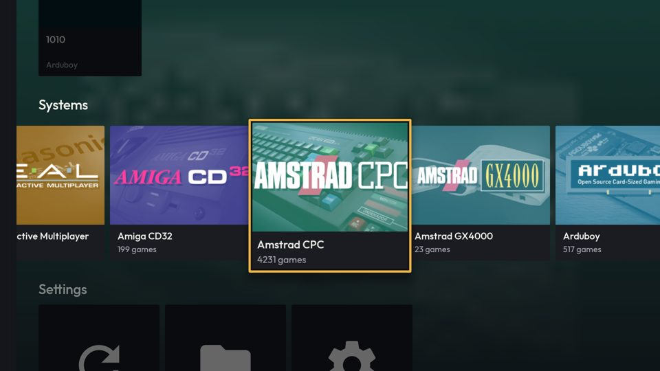
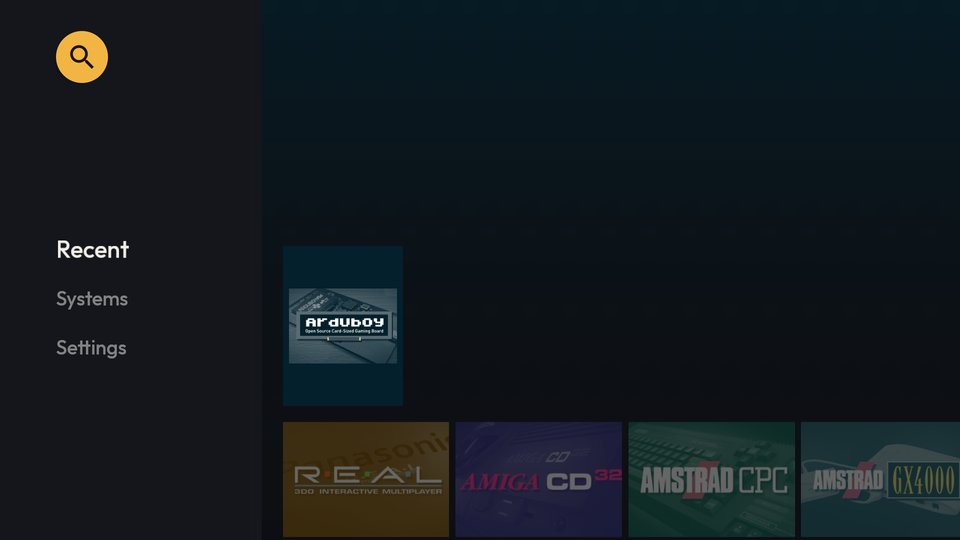
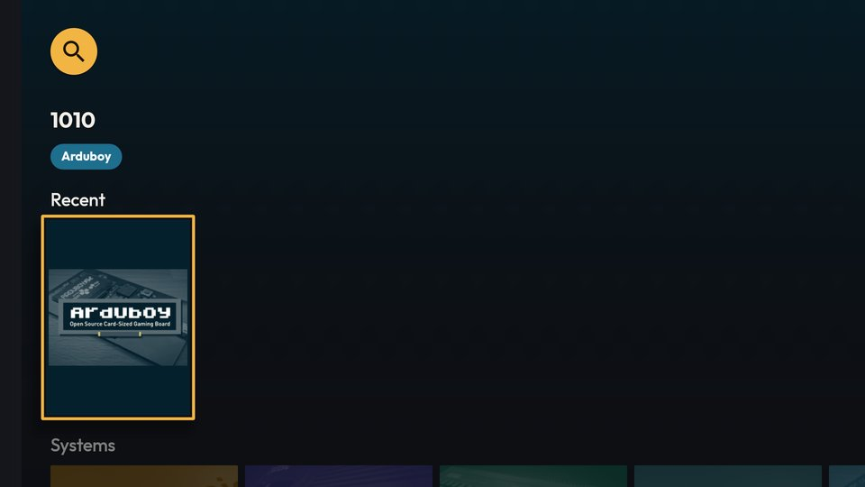
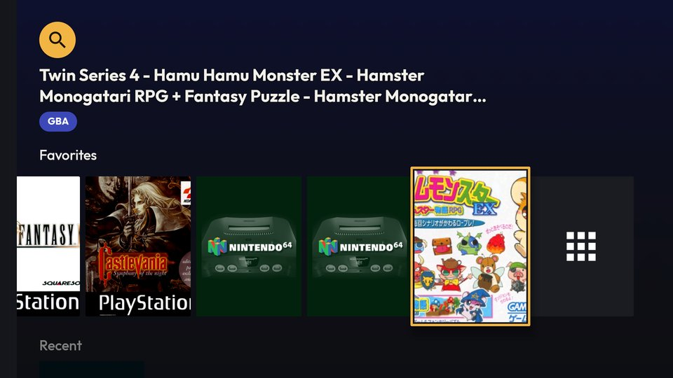
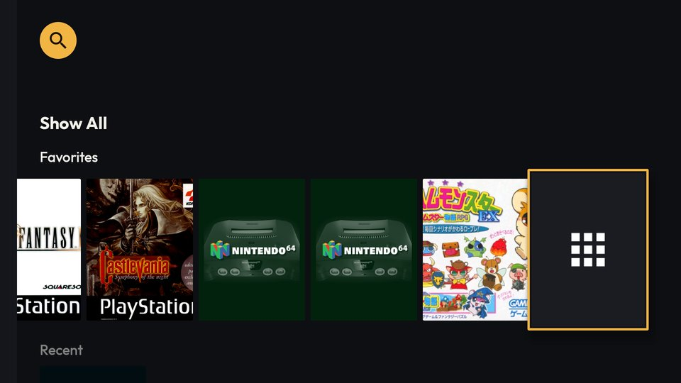
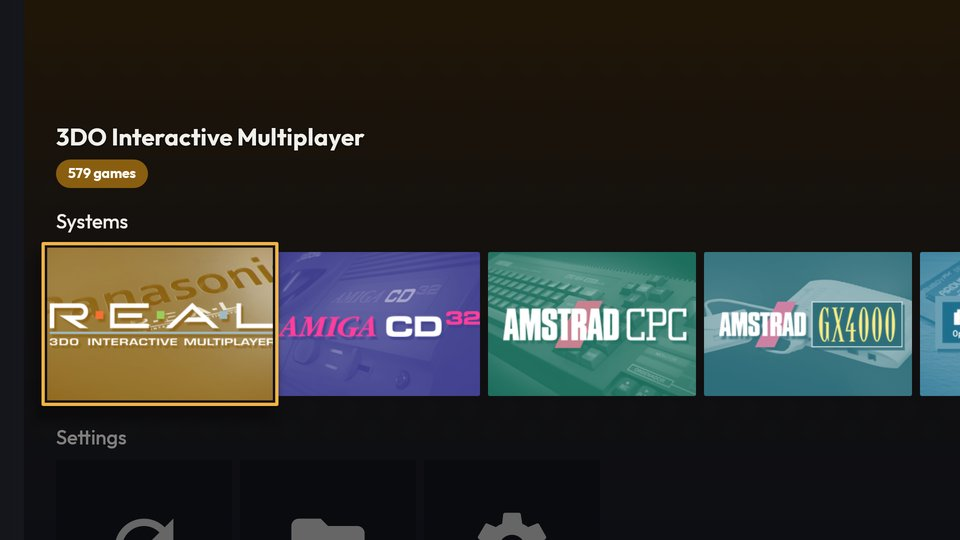
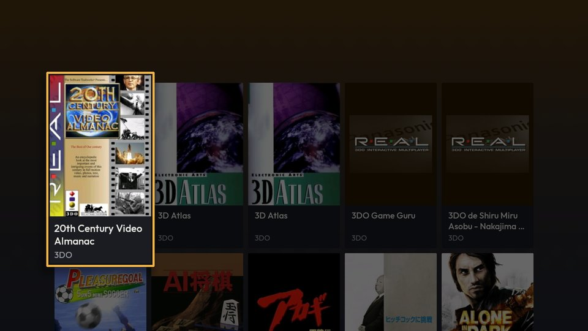
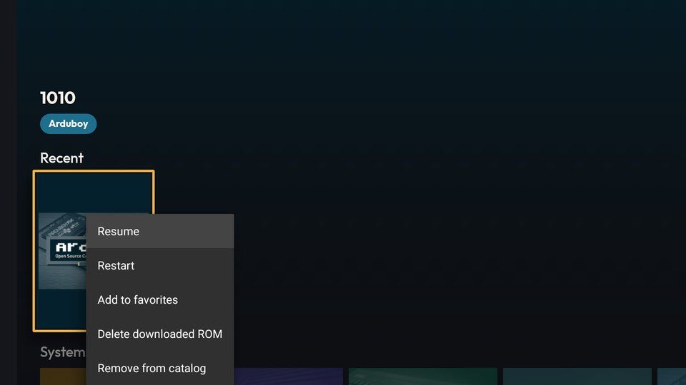
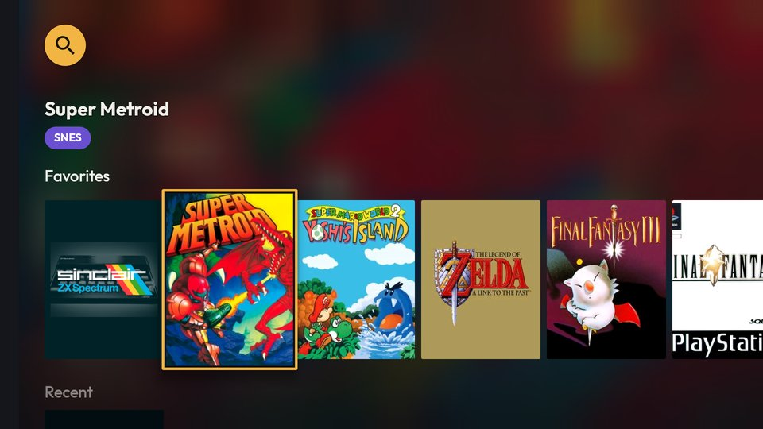
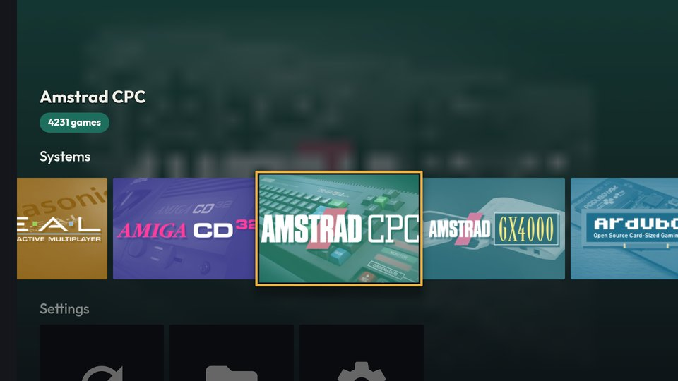

# [FEATURE] Redesenho visual — entrega 3.4: painel do item em foco na Início da TV

**Data:** 2026-10-15
**Status:** implementada e verificada no `lemu_tv_api25` (Android 7.1), **sem commit**
**Branch:** version10
**Plano:** [`docs/backlogs/2026-10-13-redesenho-visual-inspirado-pegasus.md`](../backlogs/2026-10-13-redesenho-visual-inspirado-pegasus.md), Fase 3, item 3.4 (opção A)

## O que mudou

Na Início da UI Leanback (TV), uma faixa no topo mostra o item em foco, e os cartões da Início passam a mostrar só a
imagem. É o mesmo arranjo da Início deitada do celular. Fluxos, toques, foco, menu de contexto e dados não mudam.

| Item em foco | Título (Outfit 700, 24sp, até 2 linhas) | Chip (pílula na cor da `SystemPalette`) |
|---|---|---|
| Jogo (Favoritos, Recentes) | título do jogo | nome curto do sistema (o mesmo do `SystemChip` do celular) |
| Sistema | nome do sistema | "N jogos" |
| Ajuste e "Ver todos" | rótulo | sem chip |
| Placeholder (`null`) ou orbe de busca | mantém o anterior | |

- **Cartões só-imagem:** jogos, sistemas e o "Ver todos" da fileira de Favoritos. A fileira Ajustes mantém o rótulo.
  Catálogo, Favoritos (tela) e Busca continuam com título e sistema embaixo da capa.
- **Fileiras acima da selecionada não aparecem:** elas ficariam embaixo do painel (na 3.3, com Sistemas em foco, o
  "1010" de Recentes aparecia no topo). A grade das fileiras é cortada em y = 196 dp.
- **Cabeçalhos laterais abertos:** o painel some (ficaria por cima deles) e volta quando eles fecham.
- `FULL`: o novo conteúdo entra com fade de 150 ms. `LITE`: troca seca.
- TalkBack: o painel fica fora da acessibilidade; o cartão só-imagem ganha `contentDescription` (título / nome /
  rótulo).

### Geometria (960×540 dp)

| Elemento | y (dp) |
|---|---|
| Orbe de busca (só na 1ª fileira) | 31–83 |
| Painel: título de 2 linhas (o mais alto) | 92–151 |
| Painel: chip | 160–188 (`tv_focus_panel_bottom`) |
| Corte das fileiras de cima | 196 (`tv_home_rows_clip_top`) |
| Cabeçalho da fileira selecionada | 208–236 |
| Linha de alinhamento (`browseRowsMarginTop`) | 236 (era 167) |
| Cartão de jogo em foco (com zoom) | 238–466 |

## Arquivos

- `TV/home/TVFocusPanel.kt` (novo) e `res/layout/tv_focus_panel.xml` (novo) — o painel; `attach(root)` o põe sobre a
  raiz do `BrowseSupportFragment`; `clipRowsAboveSelection(fragment)` registra, no `onCreate`, o corte na
  `VerticalGridView` da `RowsSupportFragment` (por `FragmentLifecycleCallbacks`, como o `TVTypography` faz com os
  cabeçalhos: a view das fileiras é recriada a cada volta à Início).
- `TV/home/TVHomeFragment.kt` — cria o painel, alimenta pelo mesmo `onItemViewSelectedListener` da 3.3, esconde/mostra
  por `setBrowseTransitionListener`; presenters da Início com `showInfo = false`.
- `TV/shared/GamePresenter.kt` (+ `newTVCardView`), `TV/home/SystemPresenter.kt`, `TV/home/SettingPresenter.kt` —
  parâmetro `showInfo` (padrão `true`).
- `res/values/leanback-themes.xml` — `browseRowsMarginTop` = 236 dp; `itemsVerticalGridStyle` com `paddingTop` fixo em
  167 dp; overlay `LemuroidLeanbackTheme.ImageOnlyCards` (`lbImageCardViewType = ImageOnly`).
- `res/values/dimens.xml` — as medidas da tabela acima.

## Decisões e armadilhas (Leanback 1.1.0-rc01, por `javap -c`)

- **`browseRowsMarginTop` não é só da Início.** O `BrowseSupportFragment` o lê em `onCreate` (via `getContext()`, a
  Activity) e reaplica o alinhamento em todo `onStart` e em cada transição de cabeçalhos — por isso vai pelo tema, não
  por código. Mas o mesmo atributo é o `paddingTop` de `Widget.Leanback.GridItems.VerticalGridView`, a grade do
  catálogo e dos favoritos: sem fixar `itemsVerticalGridStyle`, essas telas desceriam 69 dp. A busca não é afetada (o
  estilo das fileiras não tem `paddingTop`; a busca alinha por `lb_search_browse_rows_align_top`).
- **Não há `infoVisibility` "nunca".** São `always`/`activated`/`selected`, e `selected` mostraria o título justamente
  no cartão em foco. O cartão só-imagem é um `ImageCardView` criado sobre um `ContextThemeWrapper` cujo
  `imageCardViewStyle` tem `lbImageCardViewType = ImageOnly`: o construtor remove a área de texto.
- **O conteúdo do painel é aplicado num `post`.** Ao voltar de outra tela, o Leanback despacha a seleção de dentro da
  passada de layout das fileiras; o `requestLayout` do `setText` feito ali se perdia e o painel ficava medido com os
  textos vazios (título com largura 0 no `dumpsys activity top`). Medido: o evento chegava (`MetaSystemInfo`), o painel
  não aparecia.
- **Corte por `View.clipBounds`** (API 18), não por `clipToPadding`: o `paddingTop` da grade das fileiras é também o
  da busca, e o cabeçalho da fileira selecionada fica 28 dp acima da linha de alinhamento.

## Verificação

- `./gradlew :lemuroid-app:assembleFreeBundleDebug -PdevAbi=x86`, `ktlintMainSourceSetCheck` e `lintFreeBundleDebug`:
  BUILD SUCCESSFUL nos três.
- `lemu_tv_api25` (2 GB → `LITE`), com 11 favoritos temporários (para ter a fileira de Favoritos com "Ver todos" e um
  título de 2 linhas; desfeitos depois): cabeçalhos abertos no início (painel escondido) → fileiras (painel aparece);
  Favoritos, Recentes, Sistemas, Ajustes; título longo (2 linhas, reticências, abaixo do orbe); "Ver todos"; abrir o
  catálogo e voltar (painel com o sistema em foco); grade do catálogo na mesma altura da captura da 3.2 (cartões em
  135 dp); abrir e fechar cabeçalhos; busca e voltar; menu de contexto num cartão só-imagem (toque longo por
  `sendevent` — o `input keyevent --longpress` não abre o menu); jogar "1010" e voltar.
- **`FULL`** num build temporário (`animate = true` no painel e `quality = FULL` no `TVAmbientBackground`; revertido e
  conferido por `grep` antes do build final): Favoritos com capa ao fundo, Sistemas, catálogo e voltar.
- `logcat -b crash` vazio.

| | |
|---|---|
| Antes (3.3), Sistemas em foco: o "1010" de Recentes aparece no topo |  |
| `LITE`, cabeçalhos abertos: painel escondido |  |
| `LITE`, primeira fileira (orbe acima do painel) |  |
| `LITE`, Sistemas: fileira de cima cortada |  |
| `LITE`, título longo em 2 linhas |  |
| `LITE`, "Ver todos" |  |
| `LITE`, de volta do catálogo |  |
| `LITE`, catálogo (inalterado, com títulos) |  |
| `LITE`, menu de contexto no cartão só-imagem |  |
| `FULL`, Favoritos |  |
| `FULL`, Sistemas |  |

**Não verificado:** TV box real; escala de fonte do sistema acima de 1,0 (o cabeçalho cresce em direção ao corte:
há 12 dp de folga, ~1,3× de escala); digitar na busca (o `input text` não chega ao campo do Leanback — só abrir e
voltar foi testado); `gfxinfo`.

## Pendências

- Jogo sem capa na fileira vira só a capa gerada (sem título), por decisão da opção A: dois jogos de ZX Spectrum lado a
  lado nos Favoritos ficam iguais até o foco chegar neles.
- Com o foco no orbe de busca, o painel mantém o último item (o orbe não é item de fileira).
