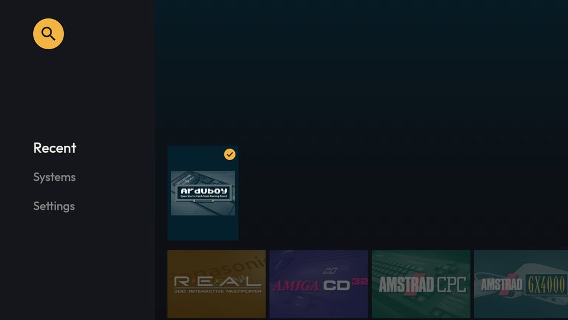
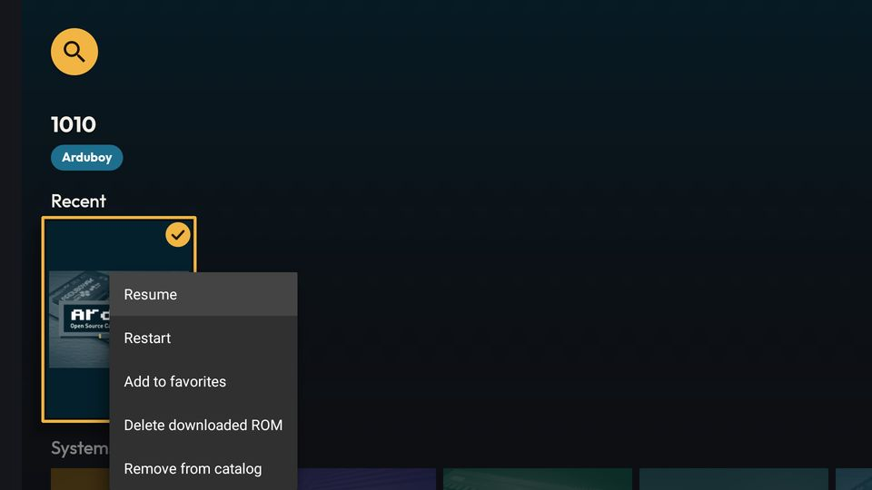
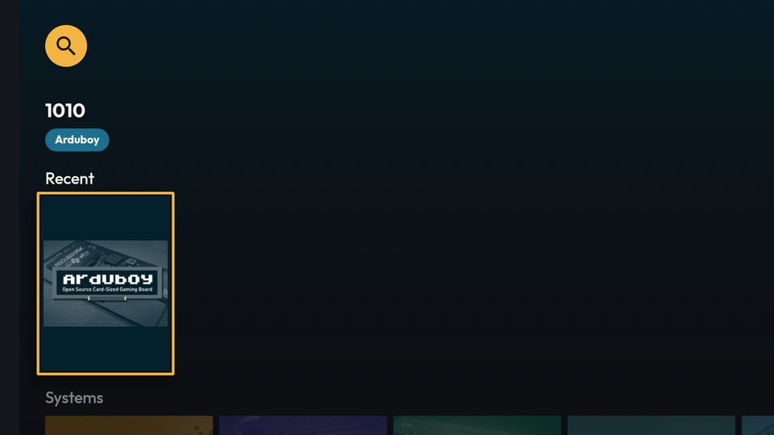
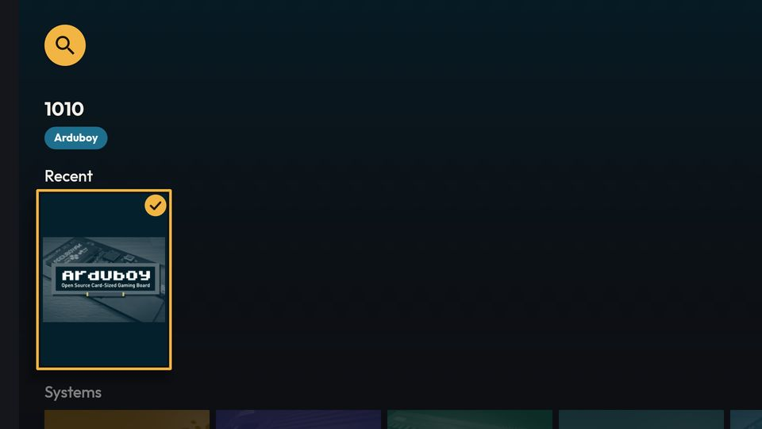
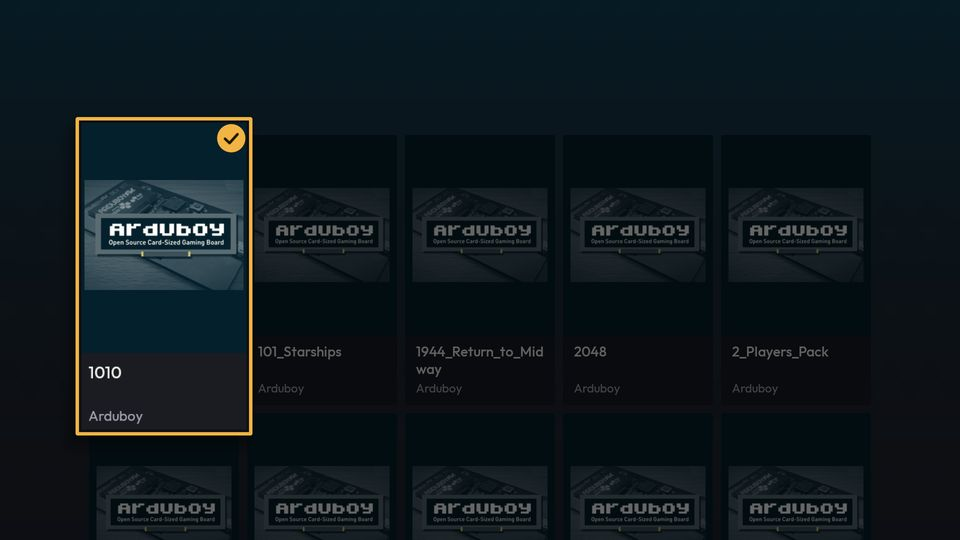
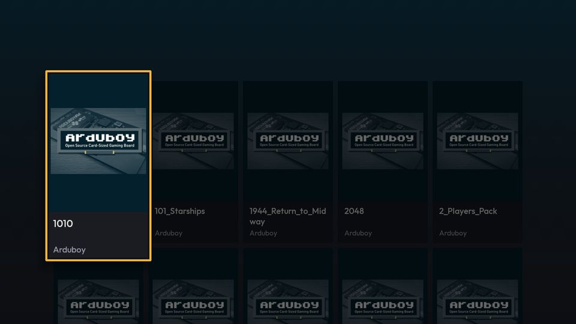
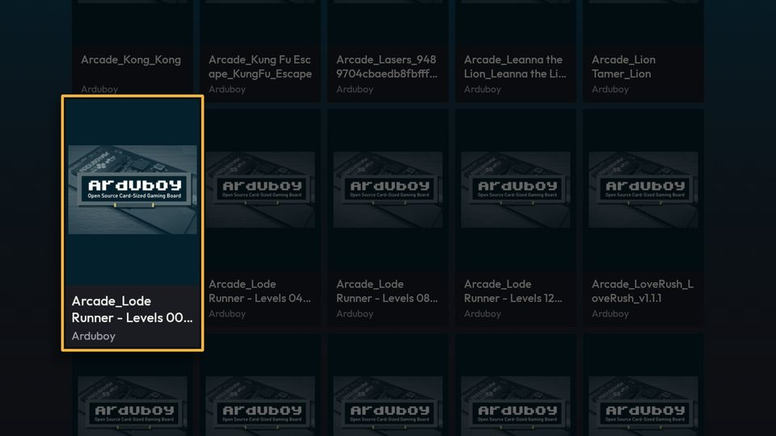
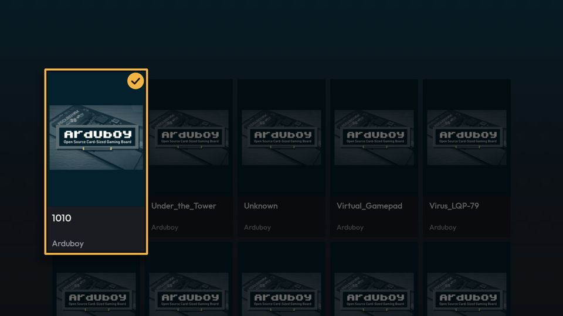
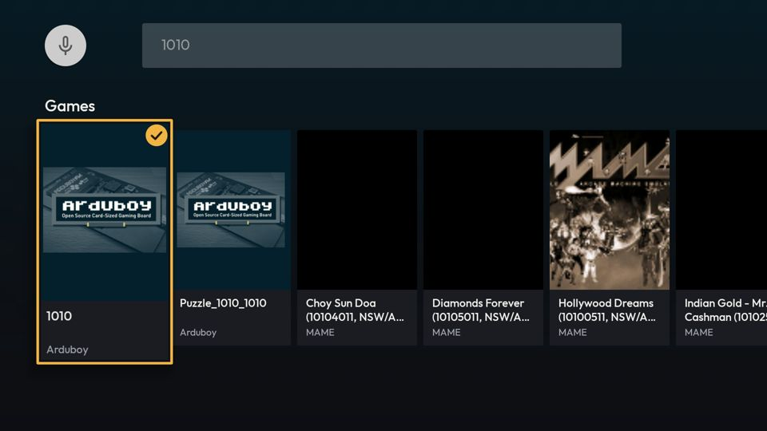

# [FEATURE] Redesenho visual — entrega 3.5: selo de salvo nos cartões da TV

**Data:** 2026-10-15
**Status:** implementada e verificada no `lemu_tv_api25` (Android 7.1); commit `e50c567`
**Branch:** version10 (feita no worktree `redesenho-3.5-selo-tv`)
**Plano:** [`docs/backlogs/2026-10-13-redesenho-visual-inspirado-pegasus.md`](../backlogs/2026-10-13-redesenho-visual-inspirado-pegasus.md), Fase 3, item 3.5

## O que mudou

Na UI Leanback (TV), todo cartão de jogo cuja ROM está salva mostra o selo ✓ no canto superior direito da capa:
círculo âmbar (`leanback_accent`) com o ✓ em `leanback_on_accent`, 24 dp, margem de 6 dp. É o `Saved` do mobile
(`SaveStateBadge.kt`), um pouco maior porque o cartão da TV tem 150 dp de largura.

- **Onde:** Início (Favoritos e Recentes, cartões só-imagem), catálogo do sistema, tela de Favoritos e Busca — os
  quatro usos do `GamePresenter`.
- **Ao vivo:** salvar pelo `TVRomDownloadDialog` ou "Excluir ROM baixada" pelo menu de contexto atualiza os cartões
  visíveis na hora, sem reconstruir as grades paginadas nem reabrir a tela.
- **Só "salvo".** A TV não usa a fila de salvamento (`SaveQueueManager`): salvar é o diálogo modal e síncrono, então
  não há "na fila"/"salvando" a mostrar no cartão.
- **`LITE`:** o selo é estático, sem animação — o mesmo desenho nos dois modos.
- Fluxos, toques, foco, menu de contexto e dados não mudam. Nenhuma query nova.

## Como funciona

| Peça | Arquivo | Papel |
|---|---|---|
| `TVSavedGames` | `tv/shared/TVSavedGames.kt` | Um por fragment. `attach(fragment, retrogradeDb)` coleta `DownloadedRomDao.observeAllDownloadedKeys()` no ciclo de vida da view (`STARTED`); guarda o conjunto de chaves `systemId/fileName` (`Game.downloadKey`) e os cartões ligados (`WeakHashMap`). Quando o conjunto muda, repinta só os cartões ligados. |
| `TVSavedBadge` / `SavedBadgeDrawable` | idem | Põe e tira o `Drawable` (círculo + ✓ por `Path`) no `ViewOverlay` do `mainImageView`. |
| `GamePresenter` | `tv/shared/GamePresenter.kt` | Parâmetro opcional `savedGames`: registra o cartão no bind, tira no unbind. |
| Fragments | `TVHomeFragment`, `TVGamesFragment`, `TVFavoritesFragment`, `TVSearchFragment` | Criam o `TVSavedGames` em `onViewCreated` e o passam aos presenters. Na Início, os presenters que o `recreateAdapter` recria compartilham a mesma instância. |

Por que o `ViewOverlay` e não outra coisa: o `foreground` do cartão já é a borda de foco (`TVCardFocusHighlight`), e o
`badgeImage` do `ImageCardView` fica na área de informações, que os cartões da Início não têm.

Por que o fluxo é coletado no fragment e não no ViewModel: a 3.6 (fileira "Jogos salvos") mexe no `TVHomeViewModel`
em paralelo; o molde é o mesmo do `TVAmbientBackground.attach`. A tabela `downloaded_roms` é pequena, e recoletar a
cada `onStart` é barato.

## Verificação

- `./gradlew :lemuroid-app:assembleFreeBundleDebug -PdevAbi=x86`, `:lemuroid-app:ktlintMainSourceSetCheck` e
  `:lemuroid-app:lintFreeBundleDebug` (0 erros; os 7 avisos não estão nos arquivos tocados): BUILD SUCCESSFUL.
  O `ktlintKotlinScriptCheck` falha no worktree por apontamentos do `build.gradle.kts` (arquivo não tocado; o baseline
  não casa o caminho dentro de `.claude/worktrees/`).
- `lemu_tv_api25` (segunda instância `-read-only`, porta 5600 — a outra sessão usava a primeira), jogo "1010"
  (Arduboy):
  1. Início: selo no cartão de Recentes, junto da borda de foco.
  2. Menu de contexto (toque longo por `sendevent`) ▸ "Excluir ROM baixada" ▸ Excluir: o selo some na hora.
  3. Tocar no cartão ▸ diálogo de salvar ▸ Baixar: salva, abre o jogo; ao voltar, o selo está de volta.
  4. Catálogo do Arduboy: selo só no "1010". Excluir pelo menu dentro da grade paginada: some na hora.
  5. Salvar de novo, rolar 25 linhas da grade para baixo e voltar: nenhum cartão reciclado leva o selo, e o "1010"
     continua com ele.
- `logcat`: sem `FATAL`.

| | |
|---|---|
| Início, Recentes com o jogo salvo |  |
| Menu de contexto |  |
| Depois de excluir a ROM |  |
| Depois de salvar pelo diálogo |  |
| Catálogo |  |
| Catálogo, depois de excluir |  |
| Catálogo rolado (cartões reciclados sem selo) |  |

**Favoritos e Busca (2026-10-17, `lemu_tv_api25`, build de `ddf3267`).** Com o "1010" salvo, favoritado por SQL
junto com 11 jogos de Arduboy não salvos (app parado; desfeito depois):
1. `TVFavoritesFragment` (Início ▸ fileira Favoritos ▸ "Show All"): ✓ só no "1010", nenhum nos outros 11.
2. `TVSearchFragment`, busca "1010": ✓ só no "1010"; "Puzzle_1010_1010" (mesmo sistema, não salvo) e os 6 de MAME
   sem selo.
3. `logcat`: sem `FATAL`.

| | |
|---|---|
| Tela de Favoritos |  |
| Busca "1010" |  |

**Não verificado:** `FULL` (o selo não tem variante); TV box real; `gfxinfo`.

## Pendências

- Na fileira "Jogos salvos" da 3.6, todos os cartões terão o selo, se ela usar o `GamePresenter` com `savedGames`.
  Decidir lá se a fileira passa `savedGames = null`.
- O selo não é anunciado pelo TalkBack (o cartão só-imagem tem `contentDescription` = título).
