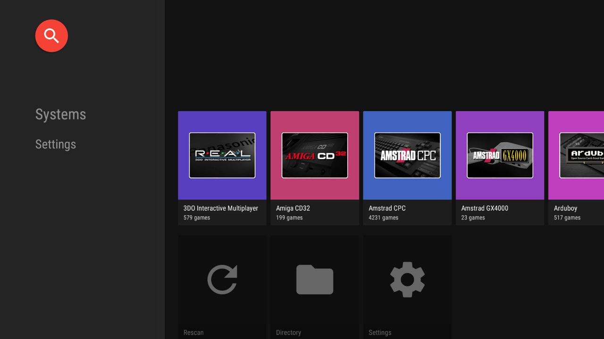
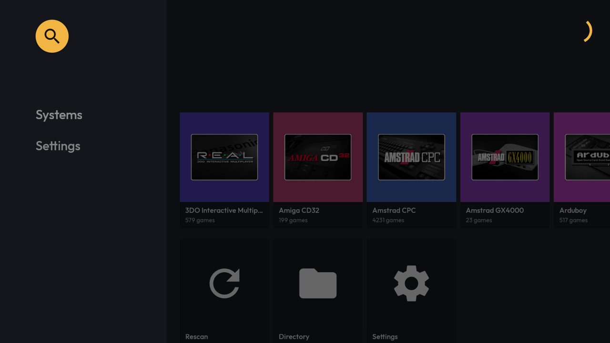
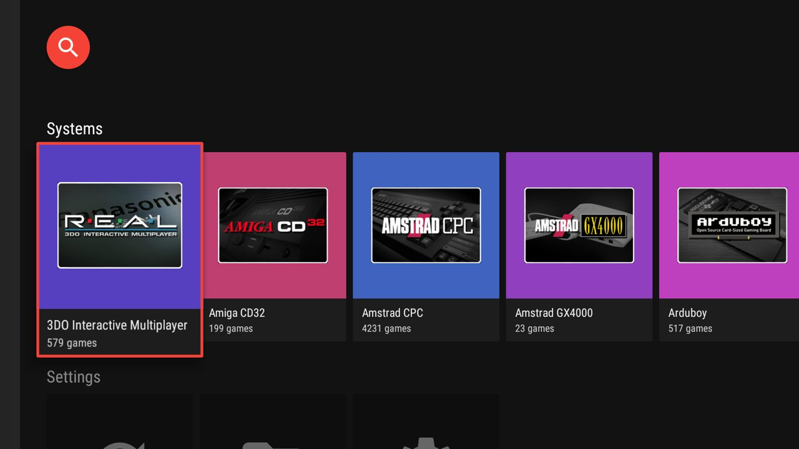
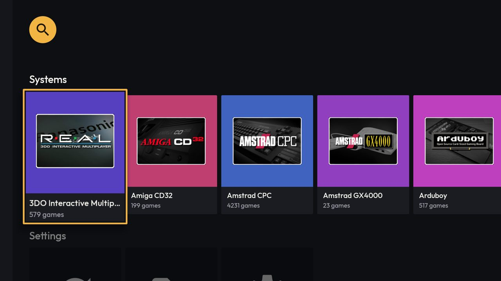
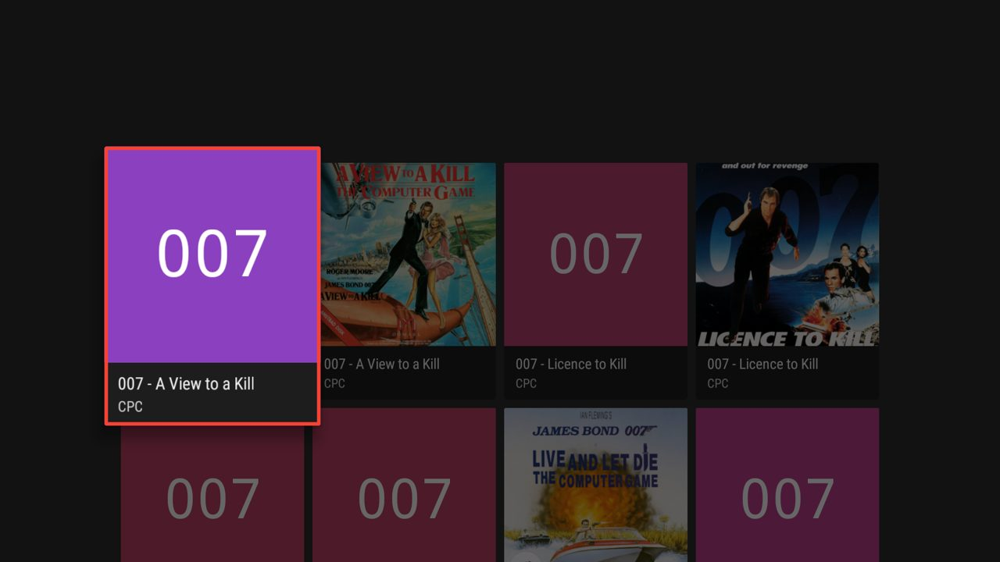
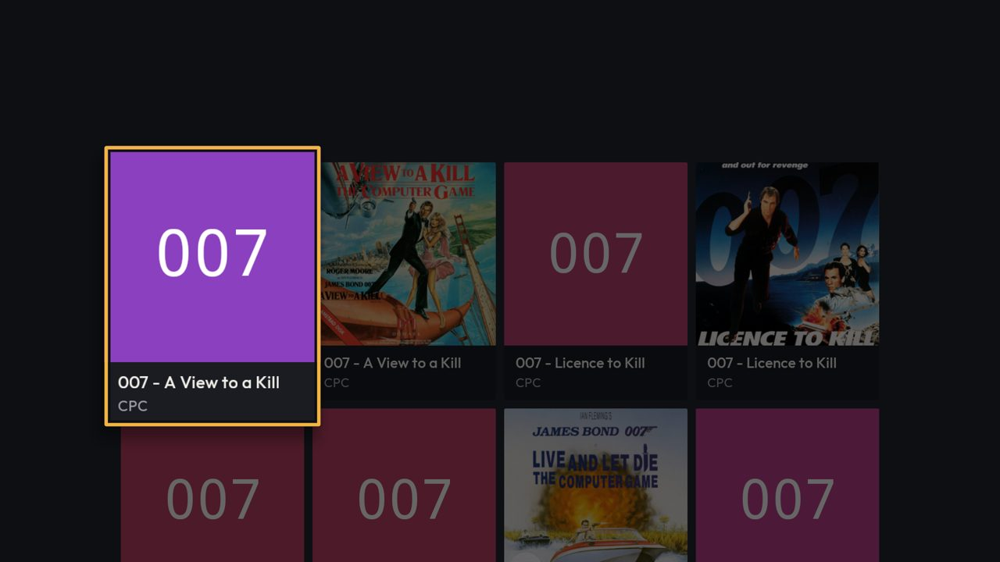

# [FEATURE] Redesenho visual — entrega 3.1: tema da TV

**Data:** 2026-10-15
**Status:** implementada e verificada no `lemu_tv_api25` (Android 7.1), **sem commit**
**Branch:** version10
**Plano:** [`docs/backlogs/2026-10-13-redesenho-visual-inspirado-pegasus.md`](../backlogs/2026-10-13-redesenho-visual-inspirado-pegasus.md), Fase 3, item 3.1

## O que mudou

A UI Leanback (TV) passa a usar os tokens da direção A, os mesmos de `LemuroidColors` no celular. O layout
não muda: cartões quadrados, 4 colunas e diálogo de salvar ficam para a 3.2.

| Onde | Antes | Depois |
|---|---|---|
| Fundo / painel lateral / cartão | `#121212` / `#242424` / `#242424` | `#0E0F13` / `#14161B` / `#1A1C22` |
| Texto do cartão | `#EEEEEE`; apoio `Color.LTGRAY` por código | `#F2F0EA`; apoio `#A4A7B0` por recurso |
| Orbe da busca, botões de diálogo, progresso | `main_color` (verde; **vermelho no debug**) | âmbar `#F2B544`, ícone da busca `#1A1300` |
| Foco do cartão | borda de 3 dp em `main_color` | anel âmbar de 3 dp + anel escuro de 2 dp por dentro |
| Fonte | a do sistema | Outfit: cartões, cabeçalhos das fileiras, painel lateral, campo da busca |
| Ajustes da TV e menu do jogo da TV | acento verde | acento âmbar (chaves, slider, categoria) |

### Arquivos

- `res/values/leanback-colors.xml` — tokens `leanback_*`. A cópia idêntica de `src/debug/res/values` foi apagada.
- `res/values/leanback-themes.xml` — sobrescreve `lb_basic_card_*` e `lb_browse_header_*`; tema com marca nas
  barras e acento/busca em âmbar; Ajustes com `colorPrimary`/`colorAccent` âmbar.
- `res/layout/activity_tv_main.xml` — progresso em `leanback_accent`.
- `TV/shared/TVCardFocusHighlight.kt` — cor por `R.color.leanback_accent` (sai o `getIdentifier("main_color")`);
  `buildBorder` monta o anel duplo num `LayerDrawable`.
- `TV/shared/TVTypography.kt` (novo) — Outfit por `ResourcesCompat.getFont`, cache por peso; falha = fonte do
  sistema. `styleCard`, `styleBrowseHeaders` e `TVRowHeaderPresenter`.
- `GamePresenter`, `SystemPresenter`, `SettingPresenter` chamam `styleCard`; `TVListRowPresenter` usa
  `TVRowHeaderPresenter`; `TVHomeFragment.onCreate` chama `styleBrowseHeaders`; `TVSearchFragment` aplica a fonte
  no campo de texto.

### Decisões

- **`main_color` ficou como estava.** Ele também pinta o ícone e a splash, e o debug o sobrescreve em vermelho.
- **A fonte é aplicada por código.** `android:fontFamily` com `res/font` só funciona a partir do Android 8.
- **Painel lateral por `addOnChildAttachStateChangeListener`.** O `RowHeaderPresenter(layout)` que ele usa é
  `@RestrictTo`. Percorrer a árvore no layout global também não serve: o `RecyclerView` segura o `requestLayout`
  durante a rolagem.
- **Anel por dentro do cartão.** O `ListRowPresenter` recorta cada cartão no próprio contorno
  (`RoundedRectHelper.setClipToRoundedOutline`, conferido por `javap`), então nada desenhado fora dele aparece.
  O anel escuro faz o papel do afastamento de 3 dp do celular e separa o âmbar das capas claras.

## Capturas (`lemu_tv_api25`, build debug x86)

| | Antes | Depois |
|---|---|---|
| Início |  |  |
| Foco |  |  |
| Catálogo |  |  |

Só depois: [catálogo rolado](img/2026-10-15-redesenho-tema-tv-depois-catalogo-rolado.jpg) (cartões criados
na rolagem já vêm em Outfit), [busca](img/2026-10-15-redesenho-tema-tv-depois-busca.jpg) e
[Ajustes](img/2026-10-15-redesenho-tema-tv-depois-ajustes.jpg).

## Verificação

- `assembleFreeBundleDebug -PdevAbi=x86`, `:lemuroid-app:ktlintMainSourceSetCheck` e
  `:lemuroid-app:lintFreeBundleDebug` passaram. O ktlint acusou 8 apontamentos antigos, já no baseline, que
  mudaram de linha com a edição. Foram corrigidos, sem regenerar o baseline.
- No `lemu_tv_api25` (Android 7.1, a versão da TV box do público): a Outfit aparece; o D-pad passou por painel ▸
  fileira ▸ catálogo (8 linhas rolando) ▸ busca ▸ Ajustes, com o foco sempre visível. O toque abre o diálogo de
  salvar, com o mesmo fluxo. `logcat -b crash` vazio.
- **Não verificado:**
  - O menu de contexto (toque longo). Pelo `adb`, o `--longpress` vira clique e o `sendevent` não chega ao app
    neste AVD. O código do menu não foi tocado.
  - Jogar um jogo, TV box real, Android 5.
  - O APK testado foi gerado antes das correções do ktlint, que só mexem em imports, vírgulas e quebras de
    assinatura.

## Pendências para a 3.2 e depois

- Com a Outfit, mais larga, títulos longos cortam antes no cartão quadrado de 176 dp: "3DO Interactive
  Multip…", que antes cabia inteiro. Resolve junto com a capa retrato da 3.2.
- O painel dos Ajustes continua com o fundo azul-acinzentado do `leanback-preference`, e os Ajustes ficam com a
  fonte do sistema. Os Ajustes estão fora do redesenho.
- Seletor de pasta e mapeamento de controle (`Theme.Leanback.GuidedStep`) e o `TVRomDownloadDialog` (3.2)
  continuam com o visual antigo, exceto o acento dos botões.
