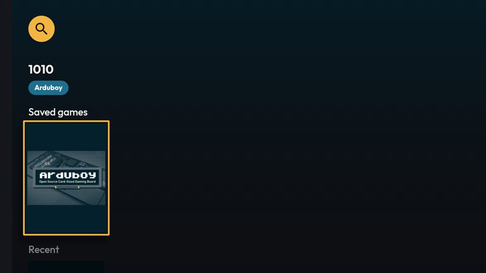
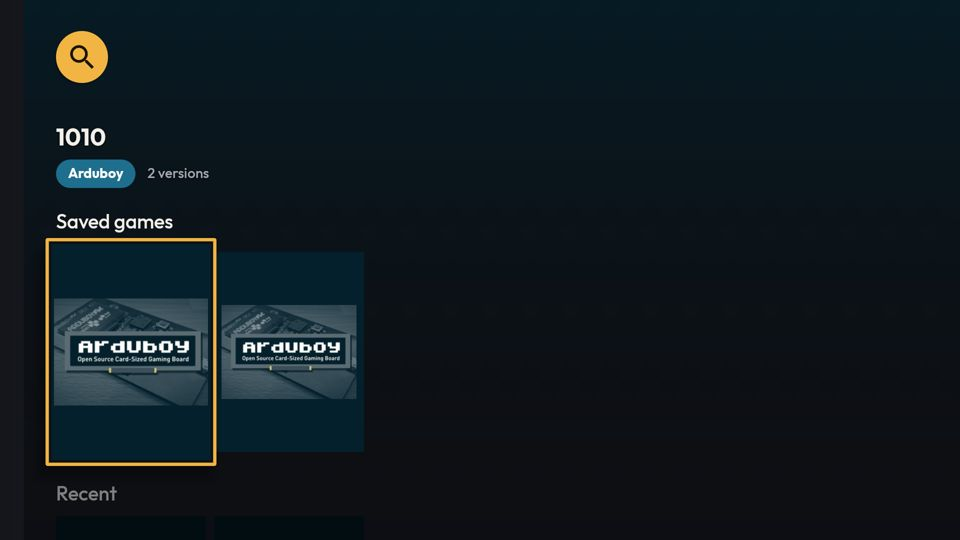
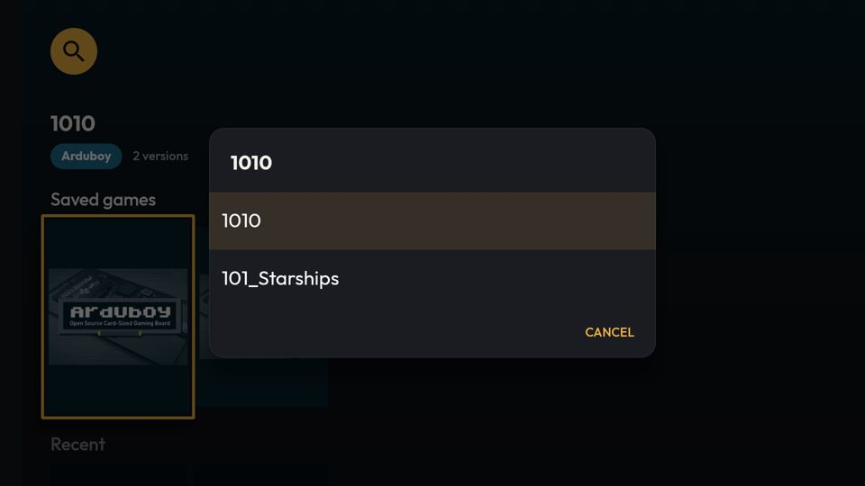
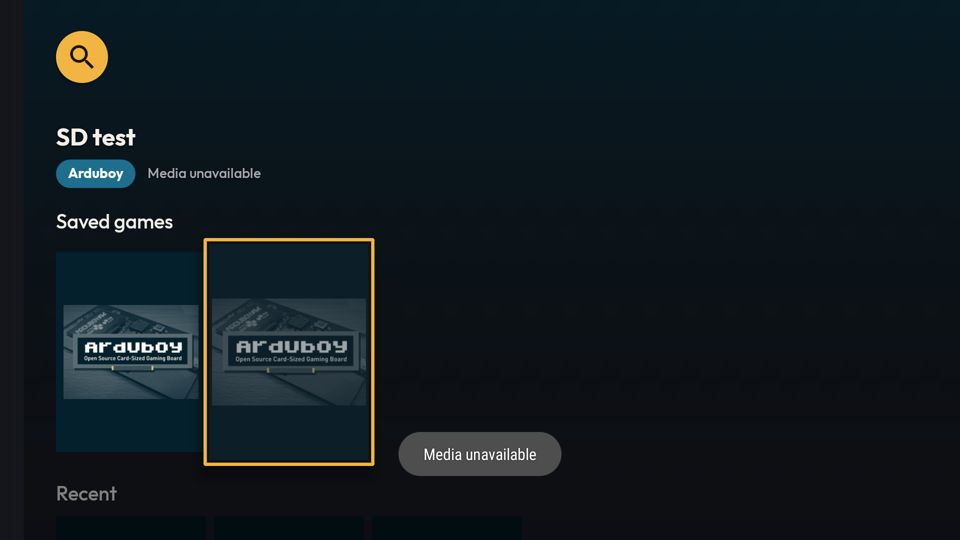
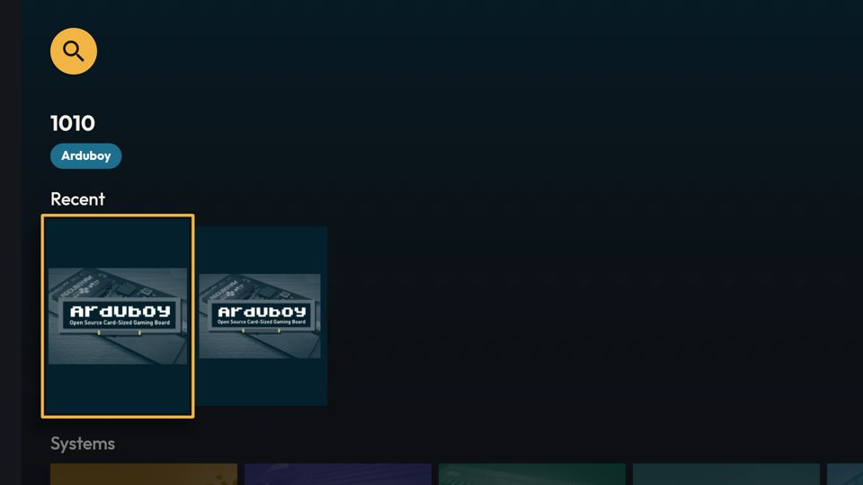

# [FEATURE] Fileira "Jogos salvos" na Início da TV (redesenho, entrega 3.6)

**Data:** 2026-10-15
**Status:** implementado e validado no `lemu_tv_api25`; sem commit (aguarda o aval do dono)
**Branch:** `redesenho-3.6-jogos-salvos-tv` (worktree `.claude/worktrees/jogos-salvos-tv`, a partir de `cf6b120`)
**Plano:** `docs/backlogs/2026-10-13-redesenho-visual-inspirado-pegasus.md` (Fase 3, item 3.6; aval do dono na
entrada "passagem de bastão: 3.5 e 3.6" do Andamento)

Legenda de caminhos: a mesma do plano (`M/`, `TV/`, `APP/`, `LIB/`).

## O que é

A TV não tinha área de Jogos salvos. Esta entrega põe na Início da TV uma fileira "Jogos salvos" com os grupos
salvos mais recentes, com as mesmas regras de toque da aba do celular: mídia inacessível avisa; grupo com mais de
uma versão salva abre um seletor só com as salvas; uma versão joga direto.

## Análise (registrada antes do código)

### Símbolos abertos

- `LIB/library/db/dao/GameDao.kt::observeInstalledGameGroups(romsDirPrefix, managedMarker)` — `Flow<List<InstalledGameGroup>>`,
  um grupo por `(systemId, title)` com versão baixada (`downloaded_roms`) ou ROM local fora da pasta gerenciada; o
  representante é a versão da última ação; ordem `lastActionAt DESC`. Varre `games` inteira e reemite a cada mudança em
  `games`/`downloaded_roms`.
- `GameDao::getInstalledVariantsForGroup(systemId, title, romsDirPrefix, managedMarker)` — `suspend`, as versões
  salvas do grupo, da mais recente para a mais antiga.
- `LIB/library/db/entity/InstalledGameGroup` — `game` (representante), `installedVariantsCount`, `lastActionAt`.
- `M/feature/installed/StorageAvailabilityMonitor` — `mediaStateChanges: Flow<Long>` (broadcast de mídia, com emissão
  inicial) e `isGameAvailable(game)` (`file`: existe e tem tamanho > 0; `content`: abre o stream; erro → `false`).
  `InstalledGameGroupUiModel(group, isAvailable)` mora no mesmo arquivo.
- `M/feature/home/HomeViewModel.savedGames` — a fileira do celular (2.3): fluxo **frio**, resolve `romsDirPrefix`
  (`DirectoriesManager.getInternalRomsDirectory().toUri()`, sem `/` final) e `getManagedRomsMarker()` no IO, combina
  o DAO com `mediaStateChanges`, `take(CAROUSEL_MAX_ITEMS)`. Não usa `InstalledGamesViewModel` (o `init` dele varre
  a pasta de ROMs). É o molde desta entrega.
- `M/feature/main/MainActivity.kt` — `onInstalledGameClick` (≈`:380`): `!isAvailable` → toast
  `installed_media_unavailable`; `installedVariantsCount > 1` → modal só com as salvas
  (`getInstalledVariantsForGroup`); senão placeholder → diálogo de salvar, ou joga. Escolha no modal (≈`:1005`):
  placeholder primeiro (diálogo de salvar), depois mídia inacessível (toast), senão joga. Rótulo da versão no modal:
  `fileName` sem extensão (`GameVariantsModal.fileNameWithoutExtension`).
- `M/feature/installed/SavedGameBadges` — no celular: capa a 60% (`SAVED_GAME_UNAVAILABLE_ALPHA`) e selo de nuvem
  cortada quando a mídia não está acessível; selo com a contagem quando há mais de uma versão.
- `TV/home/TVHomeViewModel` — `combine` de favoritos, recentes, sistemas e dois estados de varredura, com
  `debounceAfterFirst(100)`, iniciado no `init`; `HomeViewState`.
- `TV/home/TVHomeFragment` — `update(viewState)` recria o adapter quando muda a presença de alguma fileira
  (`recreateAdapter(includeFavorites, includeRecentGames, includeSystems)`) e depois faz `setItems` com `DiffCallback`
  por fileira, achada pelo id do `HeaderItem` (`findAdapterById`). Clique: `Game` → `gameInteractor.onGamePlay`.
  Seleção: `TVAmbientBackground.onItemSelected` (aceita `Game`/`MetaSystemInfo`, ignora o resto) e
  `TVFocusPanel.onItemSelected`.
- `APP/shared/GameInteractor.onGamePlay` — na TV, placeholder vai para o `onPlaceholderGame` (o
  `TVRomDownloadDialog`); o resto joga. `isRomDownloaded(game)` é o oposto do teste de placeholder.
- `TV/shared/GamePresenter` + `newTVCardView` — cartão 3:4 só imagem na Início, `TVCovers.loadCover`,
  `TVCardFocusHighlight.setupOnCard`, `GameContextMenuListener` no menu de contexto. **A 3.5 (outra sessão) altera
  este arquivo**: a 3.6 não mexe nele.
- `TV/home/TVFocusPanel` — título + chip do sistema; `contentOf(item)` conhece `Game`, `MetaSystemInfo`, `TVSetting`.
- `TV/game/TVRomDownloadDialog` — diálogos no tema `R.style.LemuroidTVDialog` passado por id ao `Builder`, fonte nos
  botões por `TVTypography.apply` depois do `show()`.
- `DirectoriesManager` — `@PerApp` no `LemuroidApplicationModule`, injetável no fragmento.
- Strings: `title_installed` ("Jogos salvos", en + pt-BR), `installed_media_unavailable` ("Mídia inacessível"),
  `installed_versions_count` ("%d versões").

### Hipóteses descartadas

- **Pôr a fileira dentro do `combine` do `TVHomeViewModel`.** A query varre `games` inteira; dentro do `combine` ela
  atrasaria o primeiro estado da Início (favoritos/sistemas) no boot. Fica num fluxo separado, começado depois do
  primeiro quadro, e quente a partir daí (`stateIn(Lazily)`), para não repetir a query a cada volta de um jogo
  (`launchOnState(RESUMED)` recoleta).
- **Reaproveitar `InstalledGamesViewModel`.** O `init` varre a pasta de ROMs — mesmo motivo do celular.
- **Selos sobre a capa (versões, mídia) como no celular.** O `ImageCardView` não aceita filho arbitrário (o
  `BaseCardView` dispõe os filhos por tipo), o `foreground` já é a borda de foco e o `badgeImage` fica na área de
  informação, que o cartão só-imagem da Início não tem. Em vez de selo: capa a 60% quando a mídia está inacessível
  (igual ao celular) e o texto (versões / mídia inacessível) no painel de foco, ao lado do chip do sistema.
- **Alterar o `GamePresenter`.** Conflito garantido com a 3.5. A fileira tem presenter próprio.

### Decisões

- **Ordem:** primeira fileira da Início, antes de Favoritos — como no celular ("a primeira depois do destaque").
- **Rótulo:** `title_installed`.
- **Tamanho:** os `CAROUSEL_MAX_ITEMS` (10) grupos mais recentes, sem "Ver todos": a TV não tem tela de Jogos
  salvos (fica como backlog).
- **Sistemas ocultos na TV (PSP/3DS):** não filtrados — a fileira mostra o que está no aparelho, como no celular.
- **Seletor de versões:** `AlertDialog` no tema `LemuroidTVDialog`, título do jogo, uma linha por versão salva
  (`fileName` sem extensão), fonte Outfit. Escolha segue a ordem do celular.

### O que fazer

1. `TVHomeViewModel.savedGames`: `StateFlow<List<InstalledGameGroupUiModel>?>` (`null` = ainda não carregado), molde
   do `HomeViewModel.savedGames`, `stateIn(viewModelScope, Lazily, null)`.
2. `TVHomeFragment`: coleta depois do primeiro quadro (`awaitFrame`); `update` passa a considerar a fileira
   (`SAVED_ADAPTER`); clique em `InstalledGameGroupUiModel` → regra do celular; seleção mapeia o item para o `Game`
   no fundo ambiente.
3. `TV/home/SavedGamePresenter` (novo): cartão só imagem, capa a 60% se inacessível, `contentDescription` com título e
   estado, menu de contexto do representante.
4. `TVFocusPanel`: aceita `InstalledGameGroupUiModel`; texto de detalhe ao lado do chip.
5. `TV/home/TVSavedVariantsDialog` (novo): seletor.
6. Prova no `lemu_tv_api25`: sem jogo salvo não há fileira; salvar um jogo → fileira aparece sem reabrir a tela; jogar;
   duas versões salvas → seletor; mídia inacessível (ROM local apontando para o SD e `sm unmount`) → capa apagada,
   painel e toast.

## Implementação

| Arquivo | O que mudou |
|---|---|
| `TV/home/TVHomeViewModel.kt` | Recebe `DirectoriesManager`. `savedGames: StateFlow<List<InstalledGameGroupUiModel>?>` (molde do `HomeViewModel.savedGames`, `stateIn(Lazily, null)`), `savedVariants(game)` e `isAvailable(game)` (as duas no IO). O `combine` da Início não muda. |
| `TV/home/TVHomeFragment.kt` | Injeta `DirectoriesManager`; ViewModel por `lazy`. Dois coletores (estado da Início e, depois de `awaitFrame()`, `savedGames`) guardam o último valor e chamam `render()` (o antigo `update`). Fileira `SAVED_ADAPTER` (id 5) em primeiro, com `LEANBACK_SAVED_GAME_DIFF_CALLBACK` (mesmo item = mesmo `systemId` + `title`). Clique em `InstalledGameGroupUiModel` → `onSavedGameClick`; escolha no seletor → `onSavedVariantSelected`. O fundo ambiente recebe o `Game` do grupo. Ao recriar o adapter, mantém a fileira selecionada pelo id (`rowIdAt`). |
| `TV/home/SavedGamePresenter.kt` (novo) | Cartão só imagem da Início (mesma montagem do `GamePresenter`, sem tocar nele); capa a 60% com mídia inacessível; `contentDescription` com título e estado; menu de contexto do representante. `savedGameDetail()` dá o texto do estado ("Mídia inacessível" / "N versões"). |
| `TV/home/TVSavedVariantsDialog.kt` (novo) | Seletor: `AlertDialog` no `LemuroidTVDialog`, título próprio em Outfit (o do framework tem id interno), uma linha por versão (`fileName` sem extensão), Cancelar. |
| `TV/home/TVFocusPanel.kt` + `res/layout/tv_focus_panel.xml` | Painel aceita `InstalledGameGroupUiModel`; texto de detalhe (`tv_focus_panel_detail`) à direita do chip do sistema, só quando há estado a mostrar. |

## Validação

- Build `:lemuroid-app:assembleFreeBundleDebug -PdevAbi=x86` OK; `:lemuroid-app:ktlintMainSourceSetCheck` OK;
  `:lemuroid-app:lintFreeBundleDebug` BUILD SUCCESSFUL. O
  `ktlintCheck` completo falha em `ktlintKotlinScriptCheck` por apontamentos no `lemuroid-app/build.gradle.kts`, que esta
  entrega não toca.
- `lemu_tv_api25` em instância `-read-only` (a outra sessão fica com a instância normal), com `-sdcard`, nada persiste.
  Dados: `1010` (Arduboy) já salvo no AVD; um segundo jogo renomeado para o título `1010`, com arquivo e linha em
  `downloaded_roms` (grupo de 2 versões); uma linha `SD test` com `fileUri` no SD (`/storage/0000-0000`).
  - Início abre com "Jogos salvos" na primeira fileira; o painel mostra título, chip e "2 versões".
  - Cartão de uma versão → joga. Grupo de 2 versões → seletor com as duas, a mais recente primeiro; escolher a segunda
    abre o jogo certo (`load game: Game(id=8856, …)` no logcat).
  - `sm unmount` com a Início aberta: sem reabrir, o cartão do SD apaga e o painel mostra "Mídia inacessível"; o toque
    só mostra o toast, o jogo não abre.
  - Menu de contexto (toque longo por `sendevent` do código 232) no cartão salvo: o menu de sempre. "Excluir ROM" no
    grupo de 2 → vira 1 versão sem reabrir; excluir a última → a fileira some e o foco vai para Recentes.
  - Salvar um jogo pelo diálogo da TV (download real) → jogo abre; de volta à Início, a fileira voltou.
  - `logcat -b crash` vazio.
- **Achado no teste, fora do escopo:** ao remontar o SD o sistema dispara a `LibraryIndexWork`
  (`MediaMountedReceiver`), e a varredura apagou a linha `SD test`. Isso é a regra do pitfall 5 (ROM fora da pasta
  gerenciada que não foi achada é removida) aplicada a uma linha de teste que não estava numa pasta varrida; não é
  efeito desta entrega.
- **Segunda rodada (16/10, mesmo AVD em pt-BR, `setprop persist.sys.locale pt-BR`):**
  - Textos em pt-BR: "Jogos salvos", "Mídia inacessível", menu de contexto.
  - **Mídia que volta:** download guardado no SD, na pasta gerenciada desse volume
    (`/storage/0000-0000/Android/data/<pkg>/files/roms/arduboy/`, com linha em `downloaded_roms`) — a pasta que a
    varredura protege. `sm unmount` → capa apagada e "Mídia inacessível"; `sm mount` → a varredura roda, o cartão fica,
    capa e painel voltam ao normal sem reabrir a Início, e o jogo abre (`load game: Game(id=8857, …)`).
  - **Correção feita na revisão:** a fileira chega depois do primeiro quadro e em cima das outras; adapter novo mantém
    o *índice* selecionado, que passaria a apontar para a fileira de cima. Agora `render()` guarda o id do `HeaderItem`
    selecionado e o reaplica depois de recriar o adapter, quando a seleção não estava na primeira fileira (na primeira,
    o foco vai para a nova primeira fileira, que é o esperado ao abrir). Prova pelo mesmo caminho: foco em Recentes,
    "Adicionar aos Favoritos" faz a fileira Favoritos surgir acima, e o foco segue em Recentes; ao abrir a Início, o
    foco está em Jogos salvos.
  - **Custo da query** (o SQL do `observeInstalledGameGroups` com `.timer on`, banco do AVD, 60.872 linhas em `games`):
    0,171 s no x86 do emulador. Em TV box ARM fraca deve ser algumas vezes isso; por isso a coleta depois do primeiro
    quadro e a correção de foco acima.
- **Não verificado:** TV box real; `FULL` (o AVD é `LITE`; a fileira só usa o painel e o fundo ambiente, que já
  passaram por `FULL` na 3.4); `gfxinfo`; tempo da query em ARM.

| | |
|---|---|
| Fileira e painel |  |
| Grupo com 2 versões |  |
| Seletor de versões |  |
| Mídia inacessível (capa apagada, painel e toast) |  |
| Sem jogos salvos: a fileira some |  |

## Fora do escopo (backlog)

- Tela "Jogos salvos" na TV, com "Ver todos" na fileira: hoje a fileira mostra só os 10 grupos mais recentes.
- Selos sobre a capa (versões, mídia) no cartão Leanback: exigiria um cartão próprio no lugar do `ImageCardView`.
